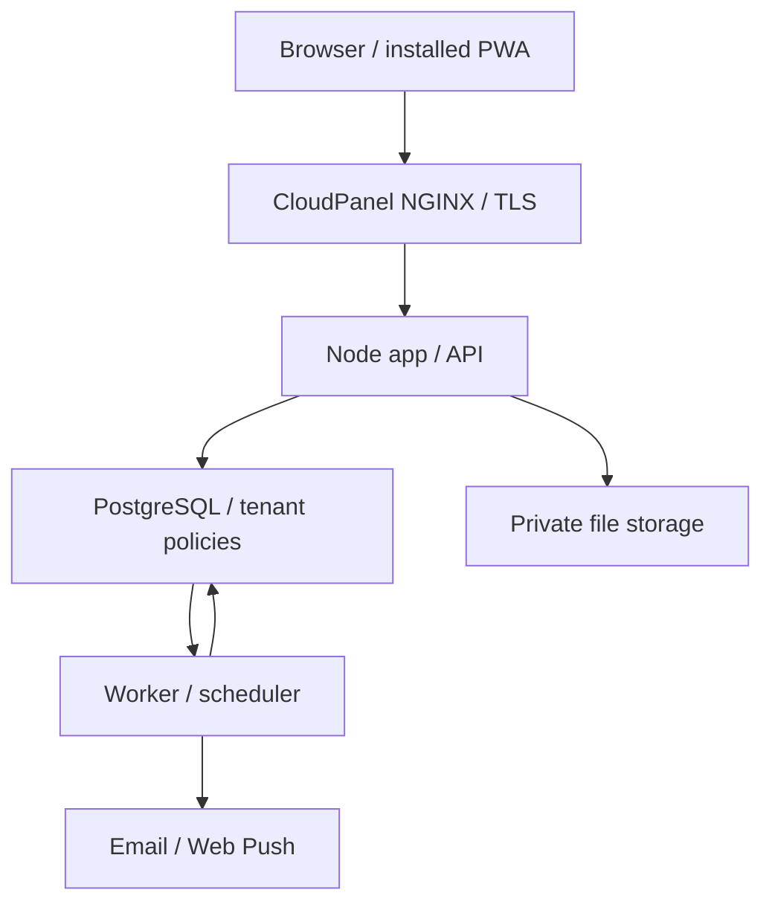

# Hosted architecture proposal

Status: proposed, 16 November 2026. Confirm the stack in [#1](https://github.com/CoyWorks/Pactaris/issues/1) before writing the scaffold.

## Runtime options

| Option | Benefits for this project | Tradeoffs | Assessment |
| --- | --- | --- | --- |
| Node.js/TypeScript + React/Vite + Express | Reuses React/TypeScript UI and existing Drizzle/domain concepts; shared validation types | Authentication, policy boundaries and worker integration require deliberate assembly | Recommended starting point |
| PHP/Laravel + React or server-rendered UI | Integrated authentication scaffolding and queue ecosystem; fits PHP operations | Backend and SQLite/Worker-specific code need porting; React reuse depends on UI choice | Strong alternative if Laravel maintenance is preferred |
| Python/Django + optional React | Built-in authentication and administration foundation | TypeScript backend/domain code must be ported; background worker architecture still needed | Strong alternative if Python becomes the team standard |

This ranking is a project-fit judgment, not a claim that one runtime is universally more secure or faster. All three can serve this application behind CloudPanel. No performance benchmark has been run.

Keep the existing visual interaction patterns, not the Cloudflare hosting architecture. Moving from Vinext/Worker routes to Vite + a Node API is a deliberate backend port; it is not a deployment configuration change.

## Required product and infrastructure boundary

The app is BDSM/SM/kink-first. Multiple relationship-scoped Dom/sub/top/bottom/switch roles and overlapping romantic links belong in M0 (#35), not a later optional enhancement. See [DOMAIN_MODEL.md](DOMAIN_MODEL.md).

One logical hosted product spans independent operator-managed instances. Each owns its hosting, PostgreSQL, files, workers and backups and hosts multiple isolated households. A separate manager owns minimal registry/placement/health/lifecycle metadata and integrates platform identity and versioned entitlements. It does not own a shared tenant-content database. See [INFRASTRUCTURE.md](INFRASTRUCTURE.md), #55 and #58.

Build entitlement hooks in M0 (#53), with paid checkout later. Commercial entitlement, technical permission and consent/safety are separate checks. See [PLANS.md](PLANS.md).

## Per-instance service layout

Serve the frontend and API under one origin. Bind application ports to loopback; keep database ports private. CloudPanel manages the proxy/TLS boundary. PostgreSQL, workers, backups and application maintenance need their own operating procedures.

Begin with one manager and one instance on OCI if resources allow. Co-location requires distinct processes, credentials and databases and provides no host-compromise isolation. This is a single point of failure. Backups provide recovery, not high availability. Confirm the actual target server, CPU architecture, RAM, free disk, competing workloads and supported OS before sizing. Do not infer the target from another project.

Use either supervised host processes or loopback-bound application containers. A Docker-friendly project does not require running CloudPanel inside a container or replacing its public NGINX listener.

## Account and tenant model

| Entity | Scope | Key rule |
| --- | --- | --- |
| Platform subject / credentials | Global identity boundary | Independent of household owner |
| Local subject mapping / sessions / devices | Instance | Audience-bound sessions plus current local membership |
| Household | Tenant with one home instance | Private BDSM dynamic with explicit lifecycle and placement version |
| Membership | User + household | Unique per pair; active/revoked/left states |
| Role and permission assignment | Household membership | Stable policy identifiers; titles do not grant rights |
| Relationship/contextual roles | Relationship/session participants | Core multi-role BDSM model; no implicit technical authority |
| Standing | Household membership | Optional status; no permission inheritance |
| Task, protocol, ritual, ledger, file, audit | Household | Tenant key and resource visibility enforced together |
| Notification preference | User/device and optional membership | No cross-household content leakage |
| Subscription/entitlement | Proposed household with account sponsor | Versioned to instance; basic rights stay free |

Tenant-owned relations need composite foreign keys such as `(household_id, membership_id)`, not only a global ID reference. Distinguish global tables from tenant tables explicitly.

Authorize the signed-in user against active membership, then set transaction-local database context through trusted server code. Use application policies plus PostgreSQL RLS. The runtime DB role must not own tenant tables, be a superuser or have BYPASSRLS. Review FORCE ROW LEVEL SECURITY where appropriate; keep migration credentials separate. Test pooled connections and missing context. A client-supplied household ID is a selector, never proof of access.

## Domain services

- Identity and sessions.
- Household membership, invitations and ownership transfer.
- Permissions and resource visibility.
- Agreements, acceptance, limits and safety state.
- Tasks, recurrence, protocols and check-ins.
- Ledger and reversals.
- File authorization and storage adapters.
- Inbox, delivery preferences and external notification adapters.
- Audit, exports, deletion and operational tooling.

Use one modular application per instance with a separate worker entry point and a distinct manager/agent contract. Keep these boundaries even during the first one-instance rollout; do not fragment each instance into microservices.

## Transactions and background work

Commit a domain change, minimal audit event and outbox event together. Workers claim durable jobs with retry/backoff, unique operation keys and dead-letter handling. Re-evaluate current membership, consent, resource visibility and pause immediately before execution. Define cancellation/disposition for queued work after pause, consent changes or deletion.

Use database constraints and transactions for recurrence creation, invite acceptance, ledger operations and safety transitions. Do not rely on a successful UI request or an in-memory timer for correctness.

## Privacy and client behavior

Cache only public static assets. Authenticated HTML and API responses use no-store. Clear user/household caches on logout and switching. Offline safety requests must show an unconfirmed state until acknowledged by the server.

Store files outside the public web root or in a private bucket. Authorize each parent object and download. Select quotas, streaming limits, validation, metadata stripping, quarantine/scanning and lifecycle cleanup before enabling uploads.

TLS and storage/backup encryption are baseline hosting controls. End-to-end encryption is a separate research proposal ([#48](https://github.com/CoyWorks/Pactaris/issues/48)); no E2EE claim is made.

## Identity, billing and management contracts

Global subjects map to local instance memberships. The manager directory assigns exactly one active home instance per household. Use verified per-instance sessions/audiences and bounded account-revocation propagation. Local pause/stop/leave with valid sessions must not require fresh manager RPC. Each instance enforces its current resource policy and safety state.

Recommended billing scope is household-sponsored, with authenticated versioned entitlements and local atomic usage tracking. Manager/provider outages must not erase entitlements or block basic rights. Exact identity provider, manager placement, agent bootstrap, session lifetimes and quotas remain open.

## Decisions deliberately left open

Auth library versus external OIDC, exact supported versions, process supervision method, storage backend, email provider, domain, pricing, quotas, region and recovery targets. See [DECISIONS.md](DECISIONS.md).

## Technical references

Checked 16 November 2026. Pin versions and recheck documentation at implementation time.

- [CloudPanel site types](https://www.cloudpanel.io/docs/v2/frontend-area/add-site/)
- [CloudPanel application port and proxy settings](https://www.cloudpanel.io/docs/v2/frontend-area/settings/)
- [CloudPanel Node.js process supervision example](https://www.cloudpanel.io/docs/v2/nodejs/deployment/pm2/)
- [PostgreSQL row security](https://www.postgresql.org/docs/current/ddl-rowsecurity.html)
- [Drizzle RLS](https://orm.drizzle.team/docs/rls)
- [Drizzle transactions](https://orm.drizzle.team/docs/transactions)
- [Web Push API](https://developer.mozilla.org/en-US/docs/Web/API/Push_API)
- [Laravel documentation](https://laravel.com/framework/docs)
- [Laravel queues](https://laravel.com/framework/docs/queues)
- [Django authentication](https://docs.djangoproject.com/en/dev/topics/auth/)
- [Django deployment checklist](https://docs.djangoproject.com/en/dev/howto/deployment/checklist/)

## Confirmed choices superseding earlier alternatives

Current direction is Node.js/TypeScript/Express, PostgreSQL/Drizzle and systemd. Central identity is a maintained broker/service supporting Google, Apple and local verified email/password accounts and exposing OIDC to instances; product choice/configuration remains open. Production starts empty; no legacy users/data transfer.

Central CloudPanel proxies local identity/main services and remote private-LAN instances, each with separate data/credentials. Ship GitHub installer/updater/status and minimum instance registration/status with the first working slice (#56 M0). See [INSTALL_UPDATE.md](INSTALL_UPDATE.md). Project-owned source is proprietary/all rights reserved under LICENSE.txt; prior references to choosing an open-source license are superseded.

## Identity and Instance are separate applications

Identity and Instance must each be installable, deployable, updatable and movable without installing the other application or CloudPanel. A shared repository/library is allowed; mandatory shared runtime, config files, database, migration lock or release pointer is not. Keep identity data and tenant data separate, and use OIDC over verified network contracts.

Initial example, not a live configuration:

| Public origin (HTTPS 443) | Backend as resolved from the proxy | Purpose |
| --- | --- | --- |
| panel.coyseinri.nl | https://127.0.0.1:8443 | Existing CloudPanel admin |
| identity.coyworks.nl | https://127.0.0.1:9443 | Identity application |
| instance1.coyworks.nl | https://127.0.0.1:9444 | Local Instance application |
| instance2.coyworks.nl | https://instance2.coyworks.nl:9444, with internal DNS resolving to the remote private host | Remote Instance application |

9443 and 9444 are configurable default HTTPS ingress ports, checked for conflicts. Every instance uses the same application/default port on its own host. Multiple instances on one host need distinct endpoints/paths. 8443 belongs to existing CloudPanel administration and is not reused by Identity/Instance.

The instance2 upstream hostname must resolve from the proxy to the actual private backend, not back to the public proxy. Use split DNS or a distinct internal backend name/private IP. Keep public origin, backend target, listen interface/port and verified TLS server name as separate settings.

Verify backend TLS against the configured trusted identity. A hostname certificate does not automatically cover 127.0.0.1: configure an explicit trusted TLS name/SNI or a certificate with the correct IP SAN. Do not disable backend certificate validation. No ports, domains or private addresses are hardcoded into feature logic.

Adding another proxy or moving Identity/Instance to separate hosts must work through configuration while preserving the public origins/issuer. Changing the public OIDC issuer itself requires controlled trust/session migration, not just swapping an internal address. CloudPanel is external ingress; neither application requires it locally.

Proposed source modules now distinguish apps/identity and apps/instance, each with its own frontend/server/build and data boundary; shared contracts/i18n are libraries. Instance worker remains an independently supervised entry point within the Instance installation. This supersedes a mandatory single central bundle or shared apps/api deployment. See #3/#55/#56.
