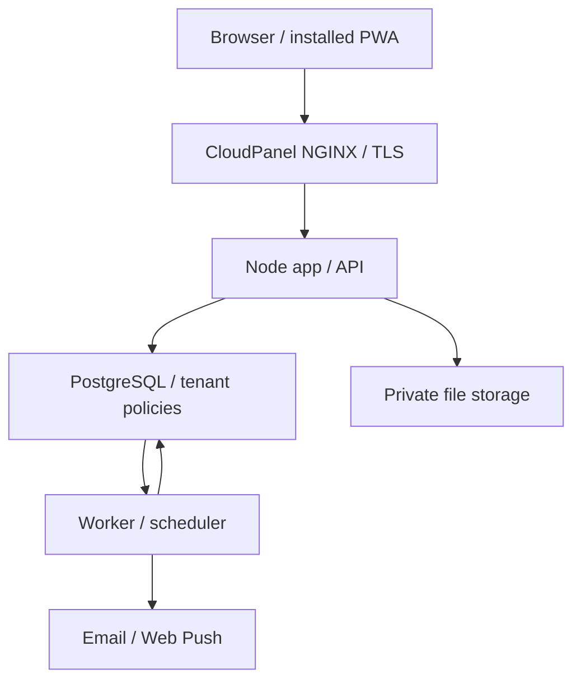

# Hosted architecture proposal

Status: proposed, 16 November 2026. Confirm the stack in [#1](https://github.com/CoyWorks/Pactaris/issues/1) before writing the scaffold.

## Runtime options

| Option | Benefits for this project | Tradeoffs | Assessment |
| --- | --- | --- | --- |
| Node.js/TypeScript + React/Vite + Express | Reuses React/TypeScript UI and existing Drizzle/domain concepts; shared validation types | Authentication, policy boundaries and worker integration require deliberate assembly | Recommended starting point |
| PHP/Laravel + React or server-rendered UI | Integrated authentication scaffolding and queue ecosystem; fits PHP operations | Backend and SQLite/Worker-specific code need porting; React reuse depends on UI choice | Strong alternative if Laravel maintenance is preferred |
| Python/Django + optional React | Built-in authentication and administration foundation | TypeScript backend/domain code must be ported; background worker architecture still needed | Strong alternative if Python becomes the team standard |

This ranking is a project-fit judgment, not a claim that one runtime is universally more secure or faster. All three can serve this application behind CloudPanel. No performance benchmark has been run.

Keep the existing visual interaction patterns, not the Cloudflare hosting architecture. Moving from Vinext/Worker routes to Vite + a Node API is a deliberate backend port; it is not a deployment configuration change.

## Initial service layout

Serve the frontend and API under one origin. Bind application ports to loopback; keep database ports private. CloudPanel manages the proxy/TLS boundary. PostgreSQL, workers, backups and application maintenance need their own operating procedures.

Begin on one OCI VM if resources allow. This is a single point of failure. Backups provide recovery, not high availability. Confirm the actual target server, CPU architecture, RAM, free disk, competing workloads and supported OS before sizing. Do not infer the target from another project.

Use either supervised host processes or loopback-bound application containers. A Docker-friendly project does not require running CloudPanel inside a container or replacing its public NGINX listener.

## Account and tenant model

| Entity | Scope | Key rule |
| --- | --- | --- |
| User, credentials, sessions, devices | Global account | Independent of any household owner |
| Household | Tenant | Private workspace with explicit lifecycle |
| Membership | User + household | Unique per pair; active/revoked/left states |
| Role and permission assignment | Household membership | Stable policy identifiers; titles do not grant rights |
| Standing and relationship | Household membership | Optional domain concepts; no implicit permission inheritance |
| Task, protocol, ritual, ledger, file, audit | Household | Tenant key and resource visibility enforced together |
| Notification preference | User/device and optional membership | No cross-household content leakage |
| Subscription/entitlement | To be decided | Never controls access to basic safety/export/leave/delete |

Tenant-owned relations need composite foreign keys such as `(household_id, membership_id)`, not only a global ID reference. Distinguish global tables from tenant tables explicitly.

Authorize the signed-in user against active membership, then set transaction-local database context through trusted server code. Use application policies plus PostgreSQL RLS. The runtime DB role must not own tenant tables, be a superuser or have BYPASSRLS. Review FORCE ROW LEVEL SECURITY where appropriate; keep migration credentials separate. Test pooled connections and missing context. A client-supplied household ID is a selector, never proof of access.

## Domain services

- Identity and sessions.
- Household membership, invitations and ownership transfer.
- Permissions and resource visibility.
- Agreements, acceptance, limits and safety state.
- Tasks, recurrence, protocols and check-ins.
- Ledger and reversals.
- File authorization and storage adapters.
- Inbox, delivery preferences and external notification adapters.
- Audit, exports, deletion and operational tooling.

Use one modular application with a separate worker entry point. Do not split into microservices for the MVP.

## Transactions and background work

Commit a domain change, minimal audit event and outbox event together. Workers claim durable jobs with retry/backoff, unique operation keys and dead-letter handling. Re-evaluate current membership, consent, resource visibility and pause immediately before execution. Define cancellation/disposition for queued work after pause, consent changes or deletion.

Use database constraints and transactions for recurrence creation, invite acceptance, ledger operations and safety transitions. Do not rely on a successful UI request or an in-memory timer for correctness.

## Privacy and client behavior

Cache only public static assets. Authenticated HTML and API responses use no-store. Clear user/household caches on logout and switching. Offline safety requests must show an unconfirmed state until acknowledged by the server.

Store files outside the public web root or in a private bucket. Authorize each parent object and download. Select quotas, streaming limits, validation, metadata stripping, quarantine/scanning and lifecycle cleanup before enabling uploads.

TLS and storage/backup encryption are baseline hosting controls. End-to-end encryption is a separate research proposal ([#48](https://github.com/CoyWorks/Pactaris/issues/48)); no E2EE claim is made.

## Decisions deliberately left open

Auth library versus external OIDC, exact supported versions, process supervision method, storage backend, email provider, domain, pricing, quotas, region and recovery targets. See [DECISIONS.md](DECISIONS.md).

## Technical references

Checked 16 November 2026. Pin versions and recheck documentation at implementation time.

- [CloudPanel site types](https://www.cloudpanel.io/docs/v2/frontend-area/add-site/)
- [CloudPanel application port and proxy settings](https://www.cloudpanel.io/docs/v2/frontend-area/settings/)
- [CloudPanel Node.js process supervision example](https://www.cloudpanel.io/docs/v2/nodejs/deployment/pm2/)
- [PostgreSQL row security](https://www.postgresql.org/docs/current/ddl-rowsecurity.html)
- [Drizzle RLS](https://orm.drizzle.team/docs/rls)
- [Drizzle transactions](https://orm.drizzle.team/docs/transactions)
- [Web Push API](https://developer.mozilla.org/en-US/docs/Web/API/Push_API)
- [Laravel documentation](https://laravel.com/framework/docs)
- [Laravel queues](https://laravel.com/framework/docs/queues)
- [Django authentication](https://docs.djangoproject.com/en/dev/topics/auth/)
- [Django deployment checklist](https://docs.djangoproject.com/en/dev/howto/deployment/checklist/)
