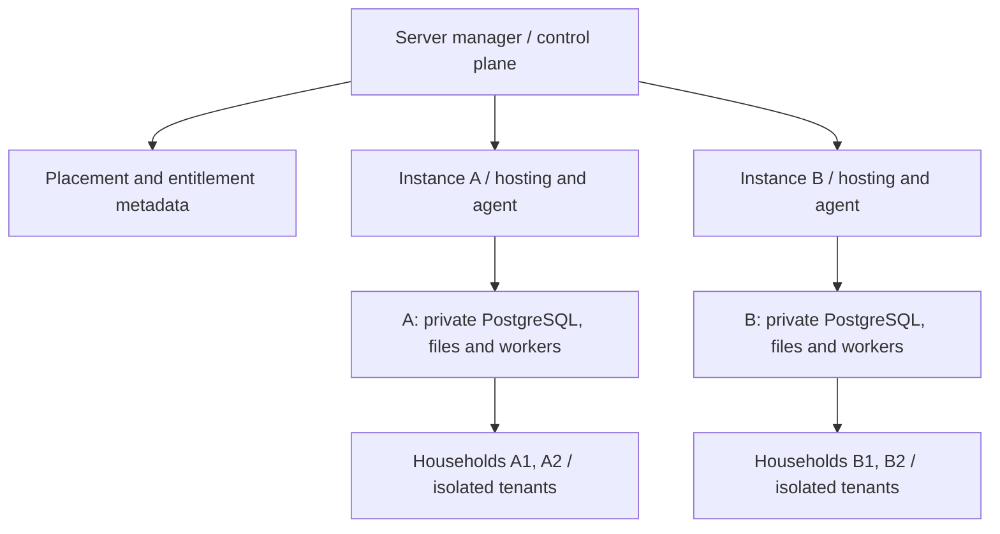

# Managed instances and server manager

Status: architecture proposal, 16 November 2026. Requirements: independent app instances, each with its own hosting, database, files, worker and lifecycle; multiple isolated households per instance. This is infrastructure for the public hosted product, not a return to public self-hosted editions.

## Control and data planes

Arrows represent scoped orchestration/ownership, not a requirement that the manager directly connects to instance databases. Each instance database serves only that instance. Household isolation remains necessary inside every instance.

| Component | Owns | Does not routinely receive |
| --- | --- | --- |
| Manager registry | Instance IDs/endpoints, versions, capacity, health, placement and maintenance state | Tasks, scenes, limits, private attachments or relationship graph |
| Platform identity service | Verified account subject and authentication/recovery state | Tenant content; household role permissions |
| Billing/entitlements | Sponsor, plan version, status, aggregate usage and invoices | Intimate relationship/session metadata |
| Instance | Local subject mapping, memberships, tenant domain data, local sessions, jobs, files and backups | Other instances' database/storage credentials |
| Household | Its scoped members, agreements, workflows and content | Another household's data even on the same instance |

The manager may host identity/billing modules initially, but keep their privileges and stored data explicit. No single shared tenant-content PostgreSQL server is the required fleet model.

## Instance contract

Record a stable instance ID, authenticated endpoint, region, supported CPU/OS/runtime, installed application/schema version, protocol compatibility, capacity/usage, health, backup freshness and lifecycle state. Give each instance separate runtime/database/storage/agent credentials and backup ownership.

A server is initially one instance; preserve IDs/interfaces so separate physical/virtual hosts can be added. Co-locating manager and first instance is possible with separate services, secrets and databases, but gives no hardware or root-compromise isolation. Do not claim HA from multiple tenant databases or backup jobs.

Use existing OCI/CloudPanel infrastructure first. Each instance has a defined application origin/hosting boundary and its own database/storage. CloudPanel can terminate TLS and proxy to its app; database ports stay private. If proxy and app are on different hosts, use authenticated/protected private connectivity instead of assuming loopback. Do not install a second public listener over CloudPanel's ports.

## Installation and enrollment

Planned operator flow, not an available command yet:

1. Prepare a supported VM and confirm resources, DNS/TLS, proxy and private ports.
2. Run the versioned installer with a secret-safe configuration input. Preflight before mutation; repeated runs preserve data and existing secrets.
3. Install app/API, worker/scheduler, private PostgreSQL/storage and supervision. Runtime uses an unprivileged service identity.
4. In the manager, create a short-lived enrollment token bound to the expected instance.
5. The instance establishes authenticated TLS, proves identity and exchanges the token once for scoped, rotatable instance credentials.
6. Verify version compatibility, storage/database access, health, backups and restart/reboot behavior before marking it ready.
7. Enable household placement only after readiness passes.

Enrollment must define certificate/key bootstrap, renewal, revocation, replay protection and recovery. Do not store enrollment tokens in URLs, shell arguments or logs. Manager actions are allowlisted and audited with operator MFA; the agent is not an arbitrary remote root shell. Prefer a pull-based management channel where practical.

Installer: [#56](https://github.com/CoyWorks/Pactaris/issues/56). Enrollment/inventory: [#57](https://github.com/CoyWorks/Pactaris/issues/57). Contract: [#55](https://github.com/CoyWorks/Pactaris/issues/55).

## Placement and identity

Use a stable platform subject for the independent account and map it to local membership in each instance. Authentication credentials need not be duplicated across tenant databases. The proposed identity service uses a maintained authentication/OIDC solution; the exact choice remains open.

The manager directory maps a household to exactly one active home instance, with placement version and lifecycle. Creating a household uses idempotency and capacity reservation; retries cannot create two active homes. Household content and relationship joins stay local.

A user can enter through a common dashboard and choose only households they are authorized to access, including households on different instances. Use verified SSO redirects and audience-bound instance-local sessions; do not share broad wildcard cookies or forward account bearer tokens to arbitrary endpoints. Household admins cannot discover a member's other dynamics.

Validate instance, subject, session, membership and resource on every request. Instance-local membership revocation is immediate. Define bounded propagation for global account/session revocation and directory updates. See [#58](https://github.com/CoyWorks/Pactaris/issues/58).

## Outage behavior

| Failure | Required behavior |
| --- | --- |
| Manager/registry unavailable | Existing valid local sessions continue permitted local work and safety actions; new placement/enrollment is unavailable |
| Central identity unavailable | Existing valid local sessions remain bounded by their lifetime; new sign-in/refresh may fail; never fail open |
| Billing/provider unavailable | Use last valid versioned entitlement with explicit grace; preserve safe existing access and cap new billable growth |
| One instance unavailable | Other instances remain isolated/operational; show the affected dynamic unavailable, not empty or successfully stopped |
| User's network offline | Clearly show no server acknowledgement for stop or changes; no emergency-service guarantee |
| Worker/delivery outage | Preserve in-app safety state, alert operator and retry only still-authorized jobs |

Safety must not require a fresh manager RPC on every local action. This does not promise offline authentication or operation of a failed data-plane server. Define what is cached, its lifetime and revocation limits before implementation.

## Operations

Version and authenticate manager/agent commands. Use canary/batched upgrades, backups before risky migration, compatibility checks, health gates and a documented recovery path. A failed irreversible schema migration cannot be undone by merely rolling back application code.

Drain stops new placements, not existing members' safety/exit access. Maintenance and retirement have explicit states. Retire only after confirmed relocation/export/deletion, backup-retention handling and credential revocation. Keep each instance's backup keys/access separate and reconcile deletion/placement tombstones after recovery.

Aggregate only operational metrics: capacity, queue lag, versions, errors and backup freshness. No scene names, limits, private notes, participant graph or attachment names in fleet telemetry.

## Moving a household

Prepare placement/version interfaces now; implement automated relocation later ([#60](https://github.com/CoyWorks/Pactaris/issues/60)). Export/import tenant data and files with verified identities, reconcile usage/jobs/outbox/deletion, fence source writes, validate checksums/counts and switch the directory once. Only one instance accepts active writes. Handle token audiences, stale sessions, feed URLs, callbacks and queued notifications explicitly; a move must not duplicate point grants or reminders.

Do not use continuous cross-instance content joins or a distributed dual-write database mesh for the MVP.

## Delivery order

1. Define instance and identity/placement contracts in M0: [#55](https://github.com/CoyWorks/Pactaris/issues/55), [#58](https://github.com/CoyWorks/Pactaris/issues/58).
2. Build the first instance with entitlement hooks ([#53](https://github.com/CoyWorks/Pactaris/issues/53)), local isolation and durable workers.
3. Implement the installer, registry/enrollment and lifecycle: [#56](https://github.com/CoyWorks/Pactaris/issues/56), [#57](https://github.com/CoyWorks/Pactaris/issues/57), [#59](https://github.com/CoyWorks/Pactaris/issues/59).
4. Run two independent databases/stores and manager-outage tests in [#62](https://github.com/CoyWorks/Pactaris/issues/62) before second-instance public onboarding.
5. Add full tenant relocation and paid-plan reconciliation: [#60](https://github.com/CoyWorks/Pactaris/issues/60), [#61](https://github.com/CoyWorks/Pactaris/issues/61).

No Kubernetes, automatic multi-region failover or unrestricted remote management is required. The two-plane boundary is required from the core even while there is only one instance.

## Confirmed first delivery

The initial central identity service must support Google, Apple and local verified email/password accounts. Every instance receives central OIDC identity and manages local sessions/rights. Production databases start empty, with no imported Site accounts/content.

Central CloudPanel is the public proxy for local main/identity services and private-LAN instances. Internal servers need no CloudPanel. Use systemd and isolated databases/credentials; verified TLS and restricted proxy sources on the LAN. Public proxy failure and manager failure are distinct operational conditions.

#56 is M0: ship GitHub-based install.sh/update.sh/status.sh with the first working slice, including a minimum registered-instance/status path. See [INSTALL_UPDATE.md](INSTALL_UPDATE.md). Preserve a second pinned-version update in the initial acceptance demo. Advanced manager-driven canary/drain/retirement (#59) follows the same safe updater contract. Support read-only source access after the repository becomes private. No script exists yet in this planning-only repository.
