# Gateway database schema

<!-- Generated by scripts/schema-snapshot.ts from the migrations. Do not edit by hand: run `npm run schema:snapshot`. -->

Schema `pactaris` after 30 migrations: 32 tables, 0 functions. How to read this page and the access model: [README.md](README.md).

## Tables

| Table | Columns | Row-level security | Runtime access |
|---|---|---|---|
| [abuse_reports](#abuse_reports) | 10 | off | SELECT,INSERT,UPDATE,DELETE |
| [account_deletion_instances](#account_deletion_instances) | 3 | off | SELECT,INSERT |
| [account_deletions](#account_deletions) | 6 | off | SELECT,INSERT,UPDATE |
| [account_export_events](#account_export_events) | 3 | off | INSERT |
| [account_households](#account_households) | 3 | off | SELECT,INSERT,DELETE |
| [account_presentation_events](#account_presentation_events) | 3 | off | INSERT |
| [accounts](#accounts) | 13 | off | SELECT,INSERT,UPDATE,DELETE |
| [auth_limits](#auth_limits) | 3 | off | SELECT,INSERT,UPDATE,DELETE |
| [calendar_feeds](#calendar_feeds) | 5 | off | SELECT,INSERT,UPDATE,DELETE |
| [household_plans](#household_plans) | 8 | off | SELECT,INSERT,UPDATE |
| [instances](#instances) | 5 | off | SELECT |
| [invitation_acceptances](#invitation_acceptances) | 8 | off | SELECT,INSERT,UPDATE |
| [invitation_mail](#invitation_mail) | 6 | off | SELECT,INSERT,UPDATE,DELETE |
| [invitation_routes](#invitation_routes) | 9 | off | SELECT,INSERT,UPDATE |
| [login_attempts](#login_attempts) | 6 | off | SELECT,INSERT,UPDATE,DELETE |
| [maintenance_runs](#maintenance_runs) | 9 | off | SELECT,INSERT,UPDATE,DELETE |
| [membership_operations](#membership_operations) | 11 | off | SELECT,INSERT,UPDATE,DELETE |
| [onboarding_events](#onboarding_events) | 3 | off | SELECT,INSERT |
| [onboarding_operations](#onboarding_operations) | 12 | off | SELECT,INSERT,UPDATE |
| [operator_events](#operator_events) | 5 | off | SELECT,INSERT |
| [operator_grants](#operator_grants) | 3 | off | SELECT,INSERT,DELETE |
| [placements](#placements) | 4 | off | SELECT,INSERT |
| [plan_credits](#plan_credits) | 10 | off | SELECT,INSERT |
| [plan_subscriptions](#plan_subscriptions) | 9 | off | SELECT,INSERT,UPDATE |
| [platform_settings](#platform_settings) | 8 | off | SELECT,UPDATE |
| [push_devices](#push_devices) | 10 | off | SELECT,INSERT,UPDATE,DELETE |
| [registry_events](#registry_events) | 4 | off | functions only |
| [report_notes](#report_notes) | 5 | off | SELECT,INSERT,DELETE |
| [revocation_journal](#revocation_journal) | 7 | off | SELECT,INSERT |
| [sessions](#sessions) | 12 | off | SELECT,INSERT,UPDATE,DELETE |
| [smtp_settings](#smtp_settings) | 4 | off | SELECT,INSERT,UPDATE |
| [task_push_scopes](#task_push_scopes) | 11 | off | SELECT,INSERT,UPDATE,DELETE |

## Relations

Foreign keys between tables (most also carry `household_id`, so a row can only point inside its own dynamic).

```mermaid
erDiagram
  abuse_reports }o--|| accounts : ""
  account_deletion_instances }o--|| account_deletions : ""
  account_deletion_instances }o--|| instances : ""
  account_deletions }o--|| accounts : ""
  account_export_events }o--|| accounts : ""
  account_households }o--|| accounts : ""
  account_households }o--|| placements : ""
  account_presentation_events }o--|| accounts : ""
  calendar_feeds }o--|| accounts : ""
  household_plans }o--|| placements : ""
  invitation_acceptances }o--|| accounts : ""
  invitation_acceptances }o--|| invitation_routes : ""
  invitation_mail }o--|| invitation_routes : ""
  invitation_routes }o--|| accounts : ""
  invitation_routes }o--|| instances : ""
  invitation_routes }o--|| placements : ""
  maintenance_runs }o--|| accounts : ""
  membership_operations }o--|| accounts : ""
  membership_operations }o--|| instances : ""
  membership_operations }o--|| placements : ""
  onboarding_events }o--|| onboarding_operations : ""
  onboarding_operations }o--|| accounts : ""
  onboarding_operations }o--|| instances : ""
  operator_events }o--|| accounts : ""
  operator_grants }o--|| accounts : ""
  placements }o--|| instances : ""
  plan_credits }o--|| accounts : ""
  plan_credits }o--|| household_plans : ""
  plan_credits }o--|| plan_subscriptions : ""
  plan_subscriptions }o--|| accounts : ""
  plan_subscriptions }o--|| household_plans : ""
  platform_settings }o--|| accounts : ""
  push_devices }o--|| sessions : ""
  registry_events }o--|| instances : ""
  report_notes }o--|| abuse_reports : ""
  report_notes }o--|| accounts : ""
  revocation_journal }o--|| instances : ""
  sessions }o--|| accounts : ""
  smtp_settings }o--|| accounts : ""
  task_push_scopes }o--|| instances : ""
  task_push_scopes }o--|| placements : ""
  task_push_scopes }o--|| push_devices : ""
  task_push_scopes }o--|| sessions : ""
```

### abuse_reports

| Column | Type | Null | Default |
|---|---|---|---|
| id | uuid | not null |  |
| reporter_account_id | uuid | not null |  |
| category | text | not null |  |
| household_id | uuid | null |  |
| details | text | not null |  |
| created_at | timestamp with time zone | not null | now() |
| state | text | not null | 'open'::text |
| resolution | text | null |  |
| closed_at | timestamp with time zone | null |  |
| closed_by | uuid | null |  |

| Constraint | Definition |
|---|---|
| abuse_reports_category_check | CHECK ((category = ANY (ARRAY['bug'::text, 'account'::text, 'suggestion'::text, 'minorSafety'::text, 'members'::text, 'other'::text, 'harassment'::text, 'unwantedInvitation'::text, 'nonConsensual'::text, 'impersonation'::text, 'spam'::text]))) |
| abuse_reports_check | CHECK (((state = 'open'::text) = ((resolution IS NULL) AND (closed_at IS NULL) AND (closed_by IS NULL)))) |
| abuse_reports_details_check | CHECK (((char_length(details) >= 1) AND (char_length(details) <= 1000))) |
| abuse_reports_resolution_check | CHECK ((resolution = ANY (ARRAY['actioned'::text, 'noAction'::text, 'duplicate'::text]))) |
| abuse_reports_state_check | CHECK ((state = ANY (ARRAY['open'::text, 'closed'::text]))) |
| abuse_reports_closed_by_fkey | FOREIGN KEY (closed_by) REFERENCES pactaris.accounts(id) |
| abuse_reports_reporter_account_id_fkey | FOREIGN KEY (reporter_account_id) REFERENCES pactaris.accounts(id) |
| abuse_reports_pkey | PRIMARY KEY (id) |

Indexes:

- `CREATE INDEX abuse_reports_created ON abuse_reports USING btree (created_at DESC, id)`
- `CREATE INDEX abuse_reports_open ON abuse_reports USING btree (state, created_at)`

### account_deletion_instances

| Column | Type | Null | Default |
|---|---|---|---|
| account_id | uuid | not null |  |
| instance_id | uuid | not null |  |
| acknowledged_at | timestamp with time zone | not null | now() |

| Constraint | Definition |
|---|---|
| account_deletion_instances_account_id_fkey | FOREIGN KEY (account_id) REFERENCES pactaris.account_deletions(account_id) |
| account_deletion_instances_instance_id_fkey | FOREIGN KEY (instance_id) REFERENCES pactaris.instances(id) |
| account_deletion_instances_pkey | PRIMARY KEY (account_id, instance_id) |

### account_deletions

| Column | Type | Null | Default |
|---|---|---|---|
| account_id | uuid | not null |  |
| operation_id | uuid | not null |  |
| requested_at | timestamp with time zone | not null | now() |
| completed_at | timestamp with time zone | null |  |
| attempts | integer | not null | 0 |
| next_attempt_at | timestamp with time zone | not null | now() |

| Constraint | Definition |
|---|---|
| account_deletions_attempts_check | CHECK ((attempts >= 0)) |
| account_deletions_account_id_fkey | FOREIGN KEY (account_id) REFERENCES pactaris.accounts(id) |
| account_deletions_pkey | PRIMARY KEY (account_id) |
| account_deletions_operation_id_key | UNIQUE (operation_id) |

Indexes:

- `CREATE INDEX account_deletions_pending ON account_deletions USING btree (next_attempt_at) WHERE (completed_at IS NULL)`

### account_export_events

| Column | Type | Null | Default |
|---|---|---|---|
| account_id | uuid | not null |  |
| exported_at | timestamp with time zone | not null | now() |
| complete | boolean | not null |  |

| Constraint | Definition |
|---|---|
| account_export_events_account_id_fkey | FOREIGN KEY (account_id) REFERENCES pactaris.accounts(id) |

Indexes:

- `CREATE INDEX account_export_events_account ON account_export_events USING btree (account_id, exported_at)`

### account_households

| Column | Type | Null | Default |
|---|---|---|---|
| account_id | uuid | not null |  |
| household_id | uuid | not null |  |
| membership_id | uuid | null |  |

| Constraint | Definition |
|---|---|
| account_households_account_id_fkey | FOREIGN KEY (account_id) REFERENCES pactaris.accounts(id) |
| account_households_household_id_fkey | FOREIGN KEY (household_id) REFERENCES pactaris.placements(household_id) |
| account_households_pkey | PRIMARY KEY (account_id, household_id) |

### account_presentation_events

| Column | Type | Null | Default |
|---|---|---|---|
| id | uuid | not null | gen_random_uuid() |
| account_id | uuid | not null |  |
| changed_at | timestamp with time zone | not null | now() |

| Constraint | Definition |
|---|---|
| account_presentation_events_account_id_fkey | FOREIGN KEY (account_id) REFERENCES pactaris.accounts(id) ON DELETE CASCADE |
| account_presentation_events_pkey | PRIMARY KEY (id) |

Indexes:

- `CREATE INDEX account_presentation_events_account_id_changed_at_idx ON account_presentation_events USING btree (account_id, changed_at)`

### accounts

| Column | Type | Null | Default |
|---|---|---|---|
| id | uuid | not null |  |
| issuer | text | not null |  |
| subject | text | not null |  |
| display_name | text | not null | ''::text |
| status | text | not null | 'active'::text |
| created_at | timestamp with time zone | not null | now() |
| verified_email | text | null |  |
| verified_email_asserted_at | timestamp with time zone | null |  |
| locale_format | text | null |  |
| time_zone | text | null |  |
| preferred_display_name | text | null |  |
| identity_user_id | bigint | null |  |
| adult_confirmed_at | timestamp with time zone | null |  |

| Constraint | Definition |
|---|---|
| account_presentation_pair | CHECK ((((locale_format IS NULL) AND (time_zone IS NULL)) OR ((locale_format IS NOT NULL) AND (time_zone IS NOT NULL) AND ((char_length(locale_format) >= 1) AND (char_length(locale_format) <= 64)) AND ((char_length(time_zone) >= 1) AND (char_length(time_zone) <= 100))))) |
| accounts_identity_user_id_check | CHECK ((identity_user_id > 0)) |
| accounts_preferred_display_name_check | CHECK (((preferred_display_name IS NULL) OR (((char_length(preferred_display_name) >= 1) AND (char_length(preferred_display_name) <= 80)) AND (preferred_display_name !~ '[[:cntrl:]]'::text)))) |
| accounts_status_check | CHECK ((status = ANY (ARRAY['active'::text, 'suspended'::text, 'deleting'::text, 'deleted'::text]))) |
| accounts_verified_email_pair | CHECK ((((verified_email IS NULL) AND (verified_email_asserted_at IS NULL)) OR ((verified_email IS NOT NULL) AND (verified_email_asserted_at IS NOT NULL) AND ((octet_length(verified_email) >= 3) AND (octet_length(verified_email) <= 254))))) |
| accounts_pkey | PRIMARY KEY (id) |
| accounts_issuer_subject_key | UNIQUE (issuer, subject) |

Indexes:

- `CREATE INDEX accounts_created ON accounts USING btree (created_at DESC, id)`

### auth_limits

| Column | Type | Null | Default |
|---|---|---|---|
| bucket_hash | text | not null |  |
| attempts | integer | not null |  |
| resets_at | timestamp with time zone | not null |  |

| Constraint | Definition |
|---|---|
| auth_limits_pkey | PRIMARY KEY (bucket_hash) |

### calendar_feeds

| Column | Type | Null | Default |
|---|---|---|---|
| account_id | uuid | not null |  |
| household_id | uuid | not null |  |
| token_hash | text | not null |  |
| created_at | timestamp with time zone | not null | now() |
| last_used_at | timestamp with time zone | null |  |

| Constraint | Definition |
|---|---|
| calendar_feeds_token_hash_check | CHECK ((token_hash ~ '^[a-f0-9]{64}$'::text)) |
| calendar_feeds_account_id_fkey | FOREIGN KEY (account_id) REFERENCES pactaris.accounts(id) ON DELETE CASCADE |
| calendar_feeds_pkey | PRIMARY KEY (account_id, household_id) |
| calendar_feeds_token_hash_key | UNIQUE (token_hash) |

### household_plans

| Column | Type | Null | Default |
|---|---|---|---|
| household_id | uuid | not null |  |
| tier | text | not null | 'free'::text |
| paid_until | timestamp with time zone | null |  |
| extra_members | integer | not null | 0 |
| version | bigint | not null | 1 |
| synced_version | bigint | not null | 0 |
| expired_at | timestamp with time zone | null |  |
| updated_at | timestamp with time zone | not null | now() |

| Constraint | Definition |
|---|---|
| household_plans_check | CHECK (((tier = 'free'::text) = (paid_until IS NULL))) |
| household_plans_extra_members_check | CHECK (((extra_members >= 0) AND (extra_members <= 984))) |
| household_plans_tier_check | CHECK ((tier = ANY (ARRAY['free'::text, 'level1'::text, 'level2'::text]))) |
| household_plans_version_check | CHECK ((version > 0)) |
| household_plans_household_id_fkey | FOREIGN KEY (household_id) REFERENCES pactaris.placements(household_id) |
| household_plans_pkey | PRIMARY KEY (household_id) |

### instances

| Column | Type | Null | Default |
|---|---|---|---|
| id | uuid | not null |  |
| endpoint | text | not null |  |
| tls_server_name | text | not null |  |
| ca_file | text | not null |  |
| status | text | not null | 'active'::text |

| Constraint | Definition |
|---|---|
| instances_status_check | CHECK ((status = ANY (ARRAY['active'::text, 'disabled'::text]))) |
| instances_pkey | PRIMARY KEY (id) |

### invitation_acceptances

| Column | Type | Null | Default |
|---|---|---|---|
| id | uuid | not null |  |
| invitation_id | uuid | not null |  |
| account_id | uuid | not null |  |
| request_hash | text | not null |  |
| membership_id | uuid | null |  |
| status | text | not null | 'pending'::text |
| created_at | timestamp with time zone | not null | now() |
| next_check_at | timestamp with time zone | not null | now() |

| Constraint | Definition |
|---|---|
| invitation_acceptances_request_hash_check | CHECK ((length(request_hash) = 64)) |
| invitation_acceptances_status_check | CHECK ((status = ANY (ARRAY['pending'::text, 'complete'::text, 'left'::text, 'rejected'::text]))) |
| invitation_acceptances_account_id_fkey | FOREIGN KEY (account_id) REFERENCES pactaris.accounts(id) |
| invitation_acceptances_invitation_id_fkey | FOREIGN KEY (invitation_id) REFERENCES pactaris.invitation_routes(id) |
| invitation_acceptances_pkey | PRIMARY KEY (id) |

Indexes:

- `CREATE INDEX invitation_acceptances_next_check_at_idx ON invitation_acceptances USING btree (next_check_at) WHERE (status = 'pending'::text)`

### invitation_mail

| Column | Type | Null | Default |
|---|---|---|---|
| invitation_id | uuid | not null |  |
| status | text | not null | 'queued'::text |
| payload | bytea | null |  |
| expires_at | timestamp with time zone | not null |  |
| next_attempt_at | timestamp with time zone | not null | now() |
| attempts | integer | not null | 0 |

| Constraint | Definition |
|---|---|
| invitation_mail_attempts_check | CHECK (((attempts >= 0) AND (attempts <= 5))) |
| invitation_mail_check | CHECK (((status = 'queued'::text) = (payload IS NOT NULL))) |
| invitation_mail_status_check | CHECK ((status = ANY (ARRAY['queued'::text, 'sent'::text, 'failed'::text, 'inactive'::text]))) |
| invitation_mail_invitation_id_fkey | FOREIGN KEY (invitation_id) REFERENCES pactaris.invitation_routes(id) ON DELETE CASCADE |
| invitation_mail_pkey | PRIMARY KEY (invitation_id) |

Indexes:

- `CREATE INDEX invitation_mail_next_attempt_at_idx ON invitation_mail USING btree (next_attempt_at) WHERE (status = 'queued'::text)`

### invitation_routes

| Column | Type | Null | Default |
|---|---|---|---|
| id | uuid | not null |  |
| household_id | uuid | not null |  |
| instance_id | uuid | not null |  |
| placement_version | bigint | not null |  |
| creator_membership_id | uuid | not null |  |
| creator_account_id | uuid | not null |  |
| create_operation_id | uuid | not null |  |
| request_hash | text | not null |  |
| created_at | timestamp with time zone | not null | now() |

| Constraint | Definition |
|---|---|
| invitation_routes_request_hash_check | CHECK ((length(request_hash) = 64)) |
| invitation_routes_creator_account_id_fkey | FOREIGN KEY (creator_account_id) REFERENCES pactaris.accounts(id) |
| invitation_routes_household_id_fkey | FOREIGN KEY (household_id) REFERENCES pactaris.placements(household_id) |
| invitation_routes_instance_id_fkey | FOREIGN KEY (instance_id) REFERENCES pactaris.instances(id) |
| invitation_routes_pkey | PRIMARY KEY (id) |
| invitation_routes_create_operation_id_key | UNIQUE (create_operation_id) |

### login_attempts

| Column | Type | Null | Default |
|---|---|---|---|
| cookie_hash | text | not null |  |
| state | text | not null |  |
| nonce | text | not null |  |
| verifier | text | not null |  |
| expires_at | timestamp with time zone | not null |  |
| client | text | not null | 'browser'::text |

| Constraint | Definition |
|---|---|
| login_attempts_client_check | CHECK ((client = ANY (ARRAY['browser'::text, 'app'::text]))) |
| login_attempts_cookie_hash_check | CHECK ((length(cookie_hash) = 64)) |
| login_attempts_pkey | PRIMARY KEY (cookie_hash) |
| login_attempts_state_key | UNIQUE (state) |

### maintenance_runs

| Column | Type | Null | Default |
|---|---|---|---|
| id | uuid | not null |  |
| task | text | not null |  |
| trigger | text | not null |  |
| dry | boolean | not null | false |
| operator_account_id | uuid | null |  |
| started_at | timestamp with time zone | not null | now() |
| finished_at | timestamp with time zone | null |  |
| ok | boolean | null |  |
| details | jsonb | not null | '{}'::jsonb |

| Constraint | Definition |
|---|---|
| maintenance_runs_task_check | CHECK ((task = 'gateway'::text)) |
| maintenance_runs_trigger_check | CHECK ((trigger = ANY (ARRAY['schedule'::text, 'operator'::text]))) |
| maintenance_runs_operator_account_id_fkey | FOREIGN KEY (operator_account_id) REFERENCES pactaris.accounts(id) |
| maintenance_runs_pkey | PRIMARY KEY (id) |

Indexes:

- `CREATE INDEX maintenance_runs_recent ON maintenance_runs USING btree (started_at DESC)`

### membership_operations

| Column | Type | Null | Default |
|---|---|---|---|
| id | uuid | not null |  |
| actor_account_id | uuid | not null |  |
| household_id | uuid | not null |  |
| instance_id | uuid | not null |  |
| placement_version | bigint | not null |  |
| actor_membership_id | uuid | not null |  |
| action | text | not null |  |
| request_hash | text | not null |  |
| status | text | not null | 'pending'::text |
| created_at | timestamp with time zone | not null | now() |
| next_check_at | timestamp with time zone | not null | now() |

| Constraint | Definition |
|---|---|
| membership_operations_action_check | CHECK ((action = ANY (ARRAY['memberAlias'::text, 'memberRemove'::text, 'ownerOffer'::text, 'ownerAccept'::text, 'ownerDecline'::text, 'ownerCancel'::text]))) |
| membership_operations_request_hash_check | CHECK ((length(request_hash) = 64)) |
| membership_operations_status_check | CHECK ((status = ANY (ARRAY['pending'::text, 'complete'::text, 'rejected'::text]))) |
| membership_operations_actor_account_id_fkey | FOREIGN KEY (actor_account_id) REFERENCES pactaris.accounts(id) |
| membership_operations_household_id_fkey | FOREIGN KEY (household_id) REFERENCES pactaris.placements(household_id) |
| membership_operations_instance_id_fkey | FOREIGN KEY (instance_id) REFERENCES pactaris.instances(id) |
| membership_operations_pkey | PRIMARY KEY (id) |

Indexes:

- `CREATE INDEX membership_operations_next_check_at_idx ON membership_operations USING btree (next_check_at) WHERE (status = 'pending'::text)`

### onboarding_events

| Column | Type | Null | Default |
|---|---|---|---|
| operation_id | uuid | not null |  |
| event_key | text | not null |  |
| created_at | timestamp with time zone | not null | now() |

| Constraint | Definition |
|---|---|
| onboarding_events_event_key_check | CHECK ((event_key = ANY (ARRAY['onboarding.reserved'::text, 'onboarding.complete'::text, 'onboarding.released'::text]))) |
| onboarding_events_operation_id_fkey | FOREIGN KEY (operation_id) REFERENCES pactaris.onboarding_operations(id) |
| onboarding_events_pkey | PRIMARY KEY (operation_id, event_key) |

### onboarding_operations

| Column | Type | Null | Default |
|---|---|---|---|
| id | uuid | not null |  |
| account_id | uuid | not null |  |
| household_id | uuid | not null |  |
| instance_id | uuid | not null |  |
| placement_version | bigint | not null | 1 |
| action | text | not null |  |
| request_hash | text | not null |  |
| status | text | not null | 'pending'::text |
| created_at | timestamp with time zone | not null | now() |
| updated_at | timestamp with time zone | not null | now() |
| next_check_at | timestamp with time zone | not null | now() |
| membership_id | uuid | null |  |

| Constraint | Definition |
|---|---|
| onboarding_operations_action_check | CHECK ((action = ANY (ARRAY['create'::text, 'leave'::text]))) |
| onboarding_operations_placement_version_check | CHECK ((placement_version > 0)) |
| onboarding_operations_request_hash_check | CHECK ((request_hash ~ '^[a-f0-9]{64}$'::text)) |
| onboarding_operations_status_check | CHECK ((status = ANY (ARRAY['pending'::text, 'complete'::text, 'released'::text]))) |
| onboarding_operations_account_id_fkey | FOREIGN KEY (account_id) REFERENCES pactaris.accounts(id) |
| onboarding_operations_instance_id_fkey | FOREIGN KEY (instance_id) REFERENCES pactaris.instances(id) |
| onboarding_operations_pkey | PRIMARY KEY (id) |

Indexes:

- `CREATE INDEX onboarding_operations_account_id_status_action_idx ON onboarding_operations USING btree (account_id, status, action)`
- `CREATE INDEX onboarding_operations_next_check_at_idx ON onboarding_operations USING btree (next_check_at) WHERE (status = 'pending'::text)`

### operator_events

| Column | Type | Null | Default |
|---|---|---|---|
| id | uuid | not null | gen_random_uuid() |
| operator_account_id | uuid | not null |  |
| action | text | not null |  |
| target_id | uuid | not null |  |
| created_at | timestamp with time zone | not null | now() |

| Constraint | Definition |
|---|---|
| operator_events_action_check | CHECK ((action = ANY (ARRAY['report.closed'::text, 'report.reopened'::text, 'report.noted'::text, 'report.deleted'::text, 'account.suspended'::text, 'account.restored'::text, 'settings.updated'::text, 'operator.granted'::text, 'operator.revoked'::text, 'maintenance.run'::text, 'plan.granted'::text, 'plan.members'::text, 'subscription.paused'::text, 'subscription.resumed'::text, 'subscription.stopped'::text]))) |
| operator_events_operator_account_id_fkey | FOREIGN KEY (operator_account_id) REFERENCES pactaris.accounts(id) |
| operator_events_pkey | PRIMARY KEY (id) |

Indexes:

- `CREATE INDEX operator_events_created ON operator_events USING btree (created_at DESC, id)`

### operator_grants

| Column | Type | Null | Default |
|---|---|---|---|
| account_id | uuid | not null |  |
| granted_by | uuid | not null |  |
| granted_at | timestamp with time zone | not null | now() |

| Constraint | Definition |
|---|---|
| operator_grants_account_id_fkey | FOREIGN KEY (account_id) REFERENCES pactaris.accounts(id) |
| operator_grants_granted_by_fkey | FOREIGN KEY (granted_by) REFERENCES pactaris.accounts(id) |
| operator_grants_pkey | PRIMARY KEY (account_id) |

### placements

| Column | Type | Null | Default |
|---|---|---|---|
| household_id | uuid | not null |  |
| instance_id | uuid | not null |  |
| version | bigint | not null |  |
| status | text | not null | 'active'::text |

| Constraint | Definition |
|---|---|
| placements_status_check | CHECK ((status = ANY (ARRAY['active'::text, 'disabled'::text]))) |
| placements_version_check | CHECK ((version > 0)) |
| placements_instance_id_fkey | FOREIGN KEY (instance_id) REFERENCES pactaris.instances(id) |
| placements_pkey | PRIMARY KEY (household_id) |

Indexes:

- `CREATE INDEX placements_instance_household ON placements USING btree (instance_id, household_id)`

### plan_credits

| Column | Type | Null | Default |
|---|---|---|---|
| id | uuid | not null |  |
| household_id | uuid | not null |  |
| account_id | uuid | null |  |
| operator_account_id | uuid | null |  |
| subscription_id | uuid | null |  |
| tier | text | not null |  |
| months | integer | not null |  |
| source | text | not null |  |
| provider_ref | text | null |  |
| created_at | timestamp with time zone | not null | now() |

| Constraint | Definition |
|---|---|
| plan_credits_months_check | CHECK (((months >= 1) AND (months <= 60))) |
| plan_credits_provider_ref_check | CHECK (((char_length(provider_ref) >= 1) AND (char_length(provider_ref) <= 200))) |
| plan_credits_source_check | CHECK ((source = ANY (ARRAY['prepaid'::text, 'subscription'::text, 'operator'::text]))) |
| plan_credits_tier_check | CHECK ((tier = ANY (ARRAY['level1'::text, 'level2'::text]))) |
| plan_credits_account_id_fkey | FOREIGN KEY (account_id) REFERENCES pactaris.accounts(id) ON DELETE SET NULL |
| plan_credits_household_id_fkey | FOREIGN KEY (household_id) REFERENCES pactaris.household_plans(household_id) |
| plan_credits_operator_account_id_fkey | FOREIGN KEY (operator_account_id) REFERENCES pactaris.accounts(id) ON DELETE SET NULL |
| plan_credits_subscription_id_fkey | FOREIGN KEY (subscription_id) REFERENCES pactaris.plan_subscriptions(id) |
| plan_credits_pkey | PRIMARY KEY (id) |
| plan_credits_source_provider_ref_key | UNIQUE (source, provider_ref) |

Indexes:

- `CREATE INDEX plan_credits_household_id_created_at_idx ON plan_credits USING btree (household_id, created_at DESC)`

### plan_subscriptions

| Column | Type | Null | Default |
|---|---|---|---|
| id | uuid | not null |  |
| household_id | uuid | not null |  |
| holder_account_id | uuid | null |  |
| tier | text | not null |  |
| state | text | not null | 'active'::text |
| provider | text | not null |  |
| provider_ref | text | null |  |
| created_at | timestamp with time zone | not null | now() |
| updated_at | timestamp with time zone | not null | now() |

| Constraint | Definition |
|---|---|
| plan_subscriptions_provider_check | CHECK ((provider ~ '^[a-z][a-z0-9_]{1,31}$'::text)) |
| plan_subscriptions_provider_ref_check | CHECK (((char_length(provider_ref) >= 1) AND (char_length(provider_ref) <= 200))) |
| plan_subscriptions_state_check | CHECK ((state = ANY (ARRAY['active'::text, 'paused'::text, 'stopped'::text]))) |
| plan_subscriptions_tier_check | CHECK ((tier = ANY (ARRAY['level1'::text, 'level2'::text]))) |
| plan_subscriptions_holder_account_id_fkey | FOREIGN KEY (holder_account_id) REFERENCES pactaris.accounts(id) ON DELETE SET NULL |
| plan_subscriptions_household_id_fkey | FOREIGN KEY (household_id) REFERENCES pactaris.household_plans(household_id) |
| plan_subscriptions_pkey | PRIMARY KEY (id) |
| plan_subscriptions_provider_provider_ref_key | UNIQUE (provider, provider_ref) |

Indexes:

- `CREATE UNIQUE INDEX plan_subscriptions_one_live ON plan_subscriptions USING btree (household_id) WHERE (state = ANY (ARRAY['active'::text, 'paused'::text]))`

### platform_settings

| Column | Type | Null | Default |
|---|---|---|---|
| singleton | boolean | not null | true |
| registration | text | not null | 'open'::text |
| announcement | text | null |  |
| announcement_level | text | not null | 'info'::text |
| version | integer | not null | 1 |
| updated_by | uuid | null |  |
| updated_at | timestamp with time zone | not null | now() |
| closed_report_days | integer | not null | 365 |

| Constraint | Definition |
|---|---|
| platform_settings_announcement_check | CHECK (((announcement IS NULL) OR ((char_length(announcement) >= 1) AND (char_length(announcement) <= 300)))) |
| platform_settings_announcement_level_check | CHECK ((announcement_level = ANY (ARRAY['info'::text, 'warning'::text]))) |
| platform_settings_closed_report_days_check | CHECK (((closed_report_days >= 30) AND (closed_report_days <= 3650))) |
| platform_settings_registration_check | CHECK ((registration = ANY (ARRAY['open'::text, 'closed'::text]))) |
| platform_settings_singleton_check | CHECK (singleton) |
| platform_settings_version_check | CHECK ((version > 0)) |
| platform_settings_updated_by_fkey | FOREIGN KEY (updated_by) REFERENCES pactaris.accounts(id) |
| platform_settings_pkey | PRIMARY KEY (singleton) |

### push_devices

| Column | Type | Null | Default |
|---|---|---|---|
| endpoint_hash | text | not null |  |
| session_hash | text | not null |  |
| ciphertext | bytea | not null |  |
| consented_at | timestamp with time zone | not null | now() |
| next_attempt_at | timestamp with time zone | null |  |
| queued_at | timestamp with time zone | null |  |
| last_requested_at | timestamp with time zone | null |  |
| attempts | integer | not null | 0 |
| scan_after | timestamp with time zone | not null | now() |
| scan_cursor | uuid | null |  |

| Constraint | Definition |
|---|---|
| push_devices_attempts_check | CHECK (((attempts >= 0) AND (attempts <= 3))) |
| push_devices_endpoint_hash_check | CHECK ((length(endpoint_hash) = 64)) |
| push_devices_session_hash_fkey | FOREIGN KEY (session_hash) REFERENCES pactaris.sessions(token_hash) ON DELETE CASCADE |
| push_devices_pkey | PRIMARY KEY (endpoint_hash) |
| push_devices_session_hash_key | UNIQUE (session_hash) |

Indexes:

- `CREATE INDEX push_devices_due ON push_devices USING btree (next_attempt_at) WHERE (next_attempt_at IS NOT NULL)`
- `CREATE INDEX push_devices_scan ON push_devices USING btree (scan_after)`

### registry_events

| Column | Type | Null | Default |
|---|---|---|---|
| id | uuid | not null |  |
| instance_id | uuid | not null |  |
| event_key | text | not null |  |
| created_at | timestamp with time zone | not null | now() |

| Constraint | Definition |
|---|---|
| registry_events_event_key_check | CHECK ((event_key = 'registry.instanceRegistered'::text)) |
| registry_events_instance_id_fkey | FOREIGN KEY (instance_id) REFERENCES pactaris.instances(id) |
| registry_events_pkey | PRIMARY KEY (id) |

### report_notes

| Column | Type | Null | Default |
|---|---|---|---|
| id | uuid | not null |  |
| report_id | uuid | not null |  |
| author_account_id | uuid | not null |  |
| body | text | not null |  |
| created_at | timestamp with time zone | not null | now() |

| Constraint | Definition |
|---|---|
| report_notes_body_check | CHECK (((char_length(body) >= 1) AND (char_length(body) <= 2000))) |
| report_notes_author_account_id_fkey | FOREIGN KEY (author_account_id) REFERENCES pactaris.accounts(id) |
| report_notes_report_id_fkey | FOREIGN KEY (report_id) REFERENCES pactaris.abuse_reports(id) |
| report_notes_pkey | PRIMARY KEY (id) |

Indexes:

- `CREATE INDEX report_notes_report ON report_notes USING btree (report_id, created_at)`

### revocation_journal

| Column | Type | Null | Default |
|---|---|---|---|
| instance_id | uuid | not null |  |
| entry_id | uuid | not null |  |
| household_id | uuid | not null |  |
| kind | text | not null |  |
| subject | jsonb | not null |  |
| occurred_at | timestamp with time zone | not null |  |
| received_at | timestamp with time zone | not null | now() |

| Constraint | Definition |
|---|---|
| revocation_journal_kind_check | CHECK ((kind ~ '^[a-zA-Z]{1,24}\.[a-zA-Z]{1,24}$'::text)) |
| revocation_journal_subject_check | CHECK (((jsonb_typeof(subject) = 'object'::text) AND (octet_length((subject)::text) <= 1024))) |
| revocation_journal_instance_id_fkey | FOREIGN KEY (instance_id) REFERENCES pactaris.instances(id) |
| revocation_journal_pkey | PRIMARY KEY (instance_id, entry_id) |

Indexes:

- `CREATE INDEX revocation_journal_household ON revocation_journal USING btree (instance_id, household_id, occurred_at)`

### sessions

| Column | Type | Null | Default |
|---|---|---|---|
| token_hash | text | not null |  |
| account_id | uuid | not null |  |
| csrf_token | text | not null |  |
| created_at | timestamp with time zone | not null | now() |
| expires_at | timestamp with time zone | not null |  |
| idle_expires_at | timestamp with time zone | not null |  |
| recipient_email | text | null |  |
| recipient_asserted_at | timestamp with time zone | null |  |
| public_id | uuid | not null | gen_random_uuid() |
| mfa_at | timestamp with time zone | null |  |
| authenticated_at | timestamp with time zone | null |  |
| idle_seconds | integer | null |  |

| Constraint | Definition |
|---|---|
| sessions_idle_seconds_check | CHECK (((idle_seconds >= 60) AND (idle_seconds <= 31536000))) |
| sessions_recipient_pair | CHECK ((((recipient_email IS NULL) AND (recipient_asserted_at IS NULL)) OR ((recipient_email IS NOT NULL) AND (recipient_asserted_at IS NOT NULL) AND ((octet_length(recipient_email) >= 3) AND (octet_length(recipient_email) <= 254))))) |
| sessions_token_hash_check | CHECK ((length(token_hash) = 64)) |
| sessions_account_id_fkey | FOREIGN KEY (account_id) REFERENCES pactaris.accounts(id) |
| sessions_pkey | PRIMARY KEY (token_hash) |

Indexes:

- `CREATE INDEX sessions_account_id_idx ON sessions USING btree (account_id)`
- `CREATE UNIQUE INDEX sessions_account_id_public_id_idx ON sessions USING btree (account_id, public_id)`
- `CREATE INDEX sessions_expires_at_idx ON sessions USING btree (expires_at)`

### smtp_settings

| Column | Type | Null | Default |
|---|---|---|---|
| singleton | boolean | not null | true |
| ciphertext | bytea | not null |  |
| updated_at | timestamp with time zone | not null | now() |
| updated_by | uuid | not null |  |

| Constraint | Definition |
|---|---|
| smtp_settings_singleton_check | CHECK (singleton) |
| smtp_settings_updated_by_fkey | FOREIGN KEY (updated_by) REFERENCES pactaris.accounts(id) |
| smtp_settings_pkey | PRIMARY KEY (singleton) |

### task_push_scopes

| Column | Type | Null | Default |
|---|---|---|---|
| endpoint_hash | text | not null |  |
| session_hash | text | not null |  |
| household_id | uuid | not null |  |
| instance_id | uuid | not null |  |
| placement_version | bigint | not null |  |
| membership_id | uuid | not null |  |
| last_seq | bigint | not null | 0 |
| pending_seq | bigint | null |  |
| next_attempt_at | timestamp with time zone | null |  |
| expires_at | timestamp with time zone | null |  |
| attempts | integer | not null | 0 |

| Constraint | Definition |
|---|---|
| task_push_scopes_attempts_check | CHECK (((attempts >= 0) AND (attempts <= 3))) |
| task_push_scopes_check | CHECK ((pending_seq > last_seq)) |
| task_push_scopes_last_seq_check | CHECK ((last_seq >= 0)) |
| task_push_scopes_placement_version_check | CHECK ((placement_version > 0)) |
| task_push_scopes_endpoint_hash_fkey | FOREIGN KEY (endpoint_hash) REFERENCES pactaris.push_devices(endpoint_hash) ON DELETE CASCADE |
| task_push_scopes_household_id_fkey | FOREIGN KEY (household_id) REFERENCES pactaris.placements(household_id) ON DELETE CASCADE |
| task_push_scopes_instance_id_fkey | FOREIGN KEY (instance_id) REFERENCES pactaris.instances(id) |
| task_push_scopes_session_hash_fkey | FOREIGN KEY (session_hash) REFERENCES pactaris.sessions(token_hash) ON DELETE CASCADE |
| task_push_scopes_pkey | PRIMARY KEY (endpoint_hash, household_id) |

Indexes:

- `CREATE INDEX task_push_pending ON task_push_scopes USING btree (next_attempt_at) WHERE (pending_seq IS NOT NULL)`

