# Instance database schema

<!-- Generated by scripts/schema-snapshot.ts from the migrations. Do not edit by hand: run `npm run schema:snapshot`. -->

Schema `pactaris` after 75 migrations: 97 tables, 177 functions. How to read this page and the access model: [README.md](README.md).

## Tables

| Table | Columns | Row-level security | Runtime access |
|---|---|---|---|
| [agreement_decisions](#agreement_decisions) | 10 | forced | functions only |
| [agreement_reviews](#agreement_reviews) | 7 | forced | functions only |
| [agreement_versions](#agreement_versions) | 8 | forced | functions only |
| [agreements](#agreements) | 4 | forced | functions only |
| [approval_receipts](#approval_receipts) | 6 | forced | functions only |
| [assignment_policies](#assignment_policies) | 9 | forced | functions only |
| [assignment_policy_events](#assignment_policy_events) | 6 | forced | functions only |
| [audit_events](#audit_events) | 7 | forced | functions only |
| [authority_delegations](#authority_delegations) | 11 | forced | functions only |
| [authority_habit_entries](#authority_habit_entries) | 7 | forced | functions only |
| [authority_habit_results](#authority_habit_results) | 7 | forced | functions only |
| [authority_habits](#authority_habits) | 27 | forced | functions only |
| [authority_links](#authority_links) | 17 | forced | functions only |
| [authority_pairs](#authority_pairs) | 6 | forced | functions only |
| [authority_punishments](#authority_punishments) | 5 | forced | functions only |
| [authority_receipts](#authority_receipts) | 6 | forced | functions only |
| [authority_transfers](#authority_transfers) | 12 | forced | functions only |
| [calendar_hidden](#calendar_hidden) | 4 | forced | functions only |
| [catalog_items](#catalog_items) | 5 | forced | functions only |
| [catalog_outbox](#catalog_outbox) | 4 | forced | functions only |
| [catalog_receipts](#catalog_receipts) | 6 | forced | functions only |
| [catalog_versions](#catalog_versions) | 5 | forced | functions only |
| [consent_outbox](#consent_outbox) | 4 | forced | functions only |
| [consent_receipts](#consent_receipts) | 6 | forced | functions only |
| [consent_records](#consent_records) | 7 | forced | functions only |
| [delegation_uses](#delegation_uses) | 2 | off | SELECT,INSERT,DELETE |
| [document_acknowledgements](#document_acknowledgements) | 5 | forced | functions only |
| [document_assignments](#document_assignments) | 4 | forced | functions only |
| [document_outbox](#document_outbox) | 4 | forced | functions only |
| [document_receipts](#document_receipts) | 6 | forced | functions only |
| [document_versions](#document_versions) | 11 | forced | functions only |
| [documents](#documents) | 8 | forced | functions only |
| [draft_attachments](#draft_attachments) | 4 | forced | functions only |
| [dynamic_roles](#dynamic_roles) | 3 | forced | functions only |
| [exchange_receipts](#exchange_receipts) | 6 | forced | functions only |
| [exchanges](#exchanges) | 13 | forced | functions only |
| [household_command_receipts](#household_command_receipts) | 7 | forced | functions only |
| [household_entitlements](#household_entitlements) | 5 | forced | SELECT |
| [household_outbox](#household_outbox) | 7 | forced | functions only |
| [household_reentry](#household_reentry) | 3 | forced | functions only |
| [household_terms](#household_terms) | 3 | forced | functions only |
| [households](#households) | 14 | forced | SELECT |
| [invitation_outbox](#invitation_outbox) | 7 | forced | functions only |
| [invitation_receipts](#invitation_receipts) | 6 | forced | functions only |
| [invitations](#invitations) | 11 | forced | functions only |
| [local_safety_grants](#local_safety_grants) | 5 | forced | functions only |
| [maintenance_runs](#maintenance_runs) | 8 | forced | functions only |
| [member_notices](#member_notices) | 10 | forced | functions only |
| [membership_endings](#membership_endings) | 7 | forced | functions only |
| [membership_outbox](#membership_outbox) | 5 | forced | functions only |
| [membership_receipts](#membership_receipts) | 7 | forced | functions only |
| [memberships](#memberships) | 13 | forced | SELECT |
| [notice_preferences](#notice_preferences) | 5 | forced | functions only |
| [ownership_offers](#ownership_offers) | 10 | forced | functions only |
| [partner_events](#partner_events) | 7 | forced | functions only |
| [partner_outbox](#partner_outbox) | 4 | forced | functions only |
| [partner_receipts](#partner_receipts) | 6 | forced | functions only |
| [partner_tasks](#partner_tasks) | 16 | forced | functions only |
| [personal_limits](#personal_limits) | 4 | forced | functions only |
| [personal_task_series](#personal_task_series) | 14 | forced | functions only |
| [point_adjustments](#point_adjustments) | 7 | forced | functions only |
| [progress_events](#progress_events) | 12 | forced | functions only |
| [proof_receipts](#proof_receipts) | 6 | forced | functions only |
| [relationship_holds](#relationship_holds) | 5 | forced | functions only |
| [relationship_outbox](#relationship_outbox) | 5 | forced | functions only |
| [relationship_participants](#relationship_participants) | 6 | forced | functions only |
| [relationship_receipts](#relationship_receipts) | 7 | forced | functions only |
| [relationship_roles](#relationship_roles) | 7 | forced | functions only |
| [relationships](#relationships) | 12 | forced | functions only |
| [restore_fence](#restore_fence) | 4 | forced | functions only |
| [revocation_journal](#revocation_journal) | 6 | forced | functions only |
| [reward_point_entries](#reward_point_entries) | 5 | forced | functions only |
| [reward_redemptions](#reward_redemptions) | 15 | forced | functions only |
| [routine_outbox](#routine_outbox) | 4 | forced | functions only |
| [routine_receipts](#routine_receipts) | 6 | forced | functions only |
| [routine_revisions](#routine_revisions) | 5 | forced | functions only |
| [routines](#routines) | 10 | forced | functions only |
| [shared_checkins](#shared_checkins) | 8 | forced | functions only |
| [shop_listings](#shop_listings) | 7 | forced | functions only |
| [shop_listings_frozen](#shop_listings_frozen) | 8 | forced | functions only |
| [task_approvals](#task_approvals) | 6 | forced | functions only |
| [task_delivery_preferences](#task_delivery_preferences) | 8 | forced | functions only |
| [task_generation_jobs](#task_generation_jobs) | 8 | forced | functions only |
| [task_inbox](#task_inbox) | 9 | forced | functions only |
| [task_inbox_preferences](#task_inbox_preferences) | 5 | forced | functions only |
| [task_point_reversals](#task_point_reversals) | 4 | forced | functions only |
| [task_points](#task_points) | 4 | forced | functions only |
| [task_proof_views](#task_proof_views) | 4 | forced | functions only |
| [task_proofs](#task_proofs) | 14 | forced | functions only |
| [task_reminder_jobs](#task_reminder_jobs) | 5 | forced | functions only |
| [task_series](#task_series) | 14 | forced | functions only |
| [task_series_versions](#task_series_versions) | 5 | forced | functions only |
| [tasks](#tasks) | 15 | forced | functions only |
| [workspace_change_cursors](#workspace_change_cursors) | 5 | forced | functions only |
| [workspace_change_tokens](#workspace_change_tokens) | 4 | forced | functions only |
| [workspace_outbox](#workspace_outbox) | 4 | forced | functions only |
| [workspace_receipts](#workspace_receipts) | 6 | forced | functions only |

## Relations

Foreign keys between tables (most also carry `household_id`, so a row can only point inside its own dynamic).

```mermaid
erDiagram
  agreement_decisions }o--|| agreement_versions : ""
  agreement_decisions }o--|| memberships : ""
  agreement_reviews }o--|| agreements : ""
  agreement_reviews }o--|| memberships : ""
  agreement_versions }o--|| agreements : ""
  agreement_versions }o--|| memberships : ""
  agreements }o--|| relationships : ""
  approval_receipts }o--|| memberships : ""
  assignment_policies }o--|| agreement_versions : ""
  assignment_policies }o--|| memberships : ""
  assignment_policy_events }o--|| assignment_policies : ""
  assignment_policy_events }o--|| memberships : ""
  audit_events }o--|| households : ""
  authority_delegations }o--|| authority_links : ""
  authority_delegations }o--|| memberships : ""
  authority_habit_entries }o--|| authority_habits : ""
  authority_habit_entries }o--|| memberships : ""
  authority_habit_results }o--|| authority_habits : ""
  authority_habits }o--|| memberships : ""
  authority_links }o--|| memberships : ""
  authority_pairs }o--|| agreements : ""
  authority_pairs }o--|| assignment_policies : ""
  authority_pairs }o--|| relationships : ""
  authority_punishments }o--|| exchanges : ""
  authority_punishments }o--|| partner_tasks : ""
  authority_receipts }o--|| memberships : ""
  authority_transfers }o--|| memberships : ""
  calendar_hidden }o--|| households : ""
  calendar_hidden }o--|| memberships : ""
  catalog_items }o--|| memberships : ""
  catalog_outbox }o--|| catalog_receipts : ""
  catalog_outbox }o--|| households : ""
  catalog_receipts }o--|| memberships : ""
  catalog_versions }o--|| catalog_items : ""
  consent_outbox }o--|| consent_receipts : ""
  consent_outbox }o--|| households : ""
  consent_receipts }o--|| memberships : ""
  consent_records }o--|| memberships : ""
  document_acknowledgements }o--|| document_versions : ""
  document_acknowledgements }o--|| memberships : ""
  document_assignments }o--|| document_versions : ""
  document_assignments }o--|| memberships : ""
  document_outbox }o--|| document_receipts : ""
  document_outbox }o--|| households : ""
  document_receipts }o--|| memberships : ""
  document_versions }o--|| documents : ""
  documents }o--|| memberships : ""
  draft_attachments }o--|| document_versions : ""
  dynamic_roles }o--|| households : ""
  exchange_receipts }o--|| memberships : ""
  exchanges }o--|| memberships : ""
  household_command_receipts }o--|| households : ""
  household_entitlements }o--|| households : ""
  household_outbox }o--|| household_command_receipts : ""
  household_outbox }o--|| households : ""
  household_reentry }o--|| memberships : ""
  household_terms }o--|| households : ""
  invitation_outbox }o--|| households : ""
  invitation_outbox }o--|| invitation_receipts : ""
  invitation_receipts }o--|| invitations : ""
  invitations }o--|| households : ""
  invitations }o--|| memberships : ""
  local_safety_grants }o--|| memberships : ""
  member_notices }o--|| memberships : ""
  membership_endings }o--|| memberships : ""
  membership_outbox }o--|| households : ""
  membership_outbox }o--|| membership_receipts : ""
  membership_receipts }o--|| households : ""
  membership_receipts }o--|| memberships : ""
  memberships }o--|| households : ""
  notice_preferences }o--|| memberships : ""
  ownership_offers }o--|| households : ""
  ownership_offers }o--|| memberships : ""
  partner_events }o--|| memberships : ""
  partner_events }o--|| partner_tasks : ""
  partner_outbox }o--|| households : ""
  partner_outbox }o--|| partner_receipts : ""
  partner_receipts }o--|| memberships : ""
  partner_tasks }o--|| agreement_versions : ""
  partner_tasks }o--|| assignment_policies : ""
  partner_tasks }o--|| memberships : ""
  partner_tasks }o--|| task_series_versions : ""
  personal_limits }o--|| memberships : ""
  personal_task_series }o--|| memberships : ""
  point_adjustments }o--|| memberships : ""
  progress_events }o--|| routine_revisions : ""
  proof_receipts }o--|| memberships : ""
  relationship_holds }o--|| relationship_participants : ""
  relationship_outbox }o--|| households : ""
  relationship_outbox }o--|| relationship_receipts : ""
  relationship_participants }o--|| memberships : ""
  relationship_participants }o--|| relationships : ""
  relationship_receipts }o--|| memberships : ""
  relationship_roles }o--|| dynamic_roles : ""
  relationship_roles }o--|| relationship_participants : ""
  relationships }o--|| households : ""
  relationships }o--|| memberships : ""
  revocation_journal }o--|| households : ""
  reward_point_entries }o--|| reward_redemptions : ""
  reward_redemptions }o--|| agreement_versions : ""
  reward_redemptions }o--|| catalog_versions : ""
  reward_redemptions }o--|| memberships : ""
  routine_outbox }o--|| households : ""
  routine_outbox }o--|| routine_receipts : ""
  routine_receipts }o--|| memberships : ""
  routine_revisions }o--|| routines : ""
  routines }o--|| memberships : ""
  shared_checkins }o--|| memberships : ""
  shop_listings }o--|| catalog_items : ""
  shop_listings }o--|| memberships : ""
  shop_listings_frozen }o--|| catalog_items : ""
  shop_listings_frozen }o--|| memberships : ""
  task_approvals }o--|| memberships : ""
  task_approvals }o--|| partner_tasks : ""
  task_delivery_preferences }o--|| memberships : ""
  task_generation_jobs }o--|| task_series_versions : ""
  task_inbox }o--|| memberships : ""
  task_inbox }o--|| partner_tasks : ""
  task_inbox_preferences }o--|| memberships : ""
  task_point_reversals }o--|| memberships : ""
  task_point_reversals }o--|| task_points : ""
  task_points }o--|| memberships : ""
  task_points }o--|| partner_tasks : ""
  task_proof_views }o--|| memberships : ""
  task_proof_views }o--|| task_proofs : ""
  task_proofs }o--|| memberships : ""
  task_proofs }o--|| partner_tasks : ""
  task_reminder_jobs }o--|| partner_tasks : ""
  task_series }o--|| assignment_policies : ""
  task_series }o--|| memberships : ""
  task_series_versions }o--|| task_series : ""
  tasks }o--|| memberships : ""
  tasks }o--|| personal_task_series : ""
  workspace_change_cursors }o--|| memberships : ""
  workspace_change_tokens }o--|| memberships : ""
  workspace_outbox }o--|| households : ""
  workspace_outbox }o--|| workspace_receipts : ""
  workspace_receipts }o--|| memberships : ""
```

### agreement_decisions

| Column | Type | Null | Default |
|---|---|---|---|
| household_id | uuid | not null |  |
| agreement_id | uuid | not null |  |
| version | bigint | not null |  |
| membership_id | uuid | not null |  |
| decision | text | not null | 'pending'::text |
| household_epoch | bigint | null |  |
| member_epoch | bigint | null |  |
| relationship_epoch | bigint | null |  |
| limits_version | bigint | null |  |
| decided_at | timestamp with time zone | null |  |

| Constraint | Definition |
|---|---|
| agreement_decisions_decision_check | CHECK ((decision = ANY (ARRAY['pending'::text, 'accepted'::text, 'declined'::text, 'withdrawn'::text]))) |
| agreement_decisions_household_id_agreement_id_version_fkey | FOREIGN KEY (household_id, agreement_id, version) REFERENCES pactaris.agreement_versions(household_id, agreement_id, version) |
| agreement_decisions_household_id_membership_id_fkey | FOREIGN KEY (household_id, membership_id) REFERENCES pactaris.memberships(household_id, id) |
| agreement_decisions_pkey | PRIMARY KEY (household_id, agreement_id, version, membership_id) |

Policies:

- **command_only** (ALL, public): `pactaris.command_executor()`

Triggers: `journal_agreement_decision` → `journal_agreement_decision()`, `workspace_change_delivery_event` → `workspace_change_delivery_event()`

### agreement_reviews

| Column | Type | Null | Default |
|---|---|---|---|
| household_id | uuid | not null |  |
| agreement_id | uuid | not null |  |
| interval_months | integer | null |  |
| next_review | date | null |  |
| last_reviewed | date | null |  |
| version | bigint | not null | 1 |
| updated_by | uuid | not null |  |

| Constraint | Definition |
|---|---|
| agreement_reviews_check | CHECK (((interval_months IS NULL) = (next_review IS NULL))) |
| agreement_reviews_interval_months_check | CHECK (((interval_months >= 1) AND (interval_months <= 24))) |
| agreement_reviews_household_id_agreement_id_fkey | FOREIGN KEY (household_id, agreement_id) REFERENCES pactaris.agreements(household_id, id) |
| agreement_reviews_household_id_updated_by_fkey | FOREIGN KEY (household_id, updated_by) REFERENCES pactaris.memberships(household_id, id) |
| agreement_reviews_pkey | PRIMARY KEY (household_id, agreement_id) |

Policies:

- **command_only** (ALL, public): `pactaris.command_executor()`

### agreement_versions

| Column | Type | Null | Default |
|---|---|---|---|
| household_id | uuid | not null |  |
| agreement_id | uuid | not null |  |
| version | bigint | not null |  |
| terms | jsonb | not null |  |
| expires_at | timestamp with time zone | not null |  |
| revoked | boolean | not null | false |
| created_by | uuid | not null |  |
| created_at | timestamp with time zone | not null | now() |

| Constraint | Definition |
|---|---|
| agreement_versions_household_id_agreement_id_fkey | FOREIGN KEY (household_id, agreement_id) REFERENCES pactaris.agreements(household_id, id) |
| agreement_versions_household_id_created_by_fkey | FOREIGN KEY (household_id, created_by) REFERENCES pactaris.memberships(household_id, id) |
| agreement_versions_pkey | PRIMARY KEY (household_id, agreement_id, version) |

Policies:

- **command_only** (ALL, public): `pactaris.command_executor()`

Triggers: `journal_agreement_version` → `journal_agreement_version()`, `workspace_change_more` → `workspace_change_more()`

### agreements

| Column | Type | Null | Default |
|---|---|---|---|
| household_id | uuid | not null |  |
| id | uuid | not null |  |
| relationship_id | uuid | not null |  |
| version | bigint | not null | 1 |

| Constraint | Definition |
|---|---|
| agreements_household_id_relationship_id_fkey | FOREIGN KEY (household_id, relationship_id) REFERENCES pactaris.relationships(household_id, id) |
| agreements_pkey | PRIMARY KEY (household_id, id) |

Policies:

- **command_only** (ALL, public): `pactaris.command_executor()`

Triggers: `workspace_change_more` → `workspace_change_more()`

### approval_receipts

| Column | Type | Null | Default |
|---|---|---|---|
| operation_id | uuid | not null |  |
| household_id | uuid | not null |  |
| actor_membership_id | uuid | not null |  |
| request_hash | text | not null |  |
| result | jsonb | not null |  |
| created_at | timestamp with time zone | not null | now() |

| Constraint | Definition |
|---|---|
| approval_receipts_request_hash_check | CHECK ((request_hash ~ '^[a-f0-9]{64}$'::text)) |
| approval_receipts_household_id_actor_membership_id_fkey | FOREIGN KEY (household_id, actor_membership_id) REFERENCES pactaris.memberships(household_id, id) |
| approval_receipts_pkey | PRIMARY KEY (operation_id) |

Indexes:

- `CREATE INDEX approval_receipts_created ON approval_receipts USING btree (created_at)`

Policies:

- **command_only** (ALL, public): `pactaris.command_executor()`

### assignment_policies

| Column | Type | Null | Default |
|---|---|---|---|
| household_id | uuid | not null |  |
| id | uuid | not null |  |
| creator_id | uuid | not null |  |
| assignee_id | uuid | not null |  |
| agreement_id | uuid | not null |  |
| agreement_version | bigint | not null |  |
| version | bigint | not null | 1 |
| mode | text | not null |  |
| state | text | not null | 'proposed'::text |

| Constraint | Definition |
|---|---|
| assignment_policies_check | CHECK ((creator_id <> assignee_id)) |
| assignment_policies_mode_check | CHECK ((mode = ANY (ARRAY['direct'::text, 'explicit'::text]))) |
| assignment_policies_state_check | CHECK ((state = ANY (ARRAY['proposed'::text, 'active'::text, 'revoked'::text]))) |
| assignment_policies_household_id_agreement_id_agreement_ve_fkey | FOREIGN KEY (household_id, agreement_id, agreement_version) REFERENCES pactaris.agreement_versions(household_id, agreement_id, version) |
| assignment_policies_household_id_assignee_id_fkey | FOREIGN KEY (household_id, assignee_id) REFERENCES pactaris.memberships(household_id, id) |
| assignment_policies_household_id_creator_id_fkey | FOREIGN KEY (household_id, creator_id) REFERENCES pactaris.memberships(household_id, id) |
| assignment_policies_pkey | PRIMARY KEY (household_id, id) |

Policies:

- **command_only** (ALL, public): `pactaris.command_executor()`

Triggers: `journal_assignment_policy` → `journal_assignment_policy()`, `workspace_change_delivery_event` → `workspace_change_delivery_event()`

### assignment_policy_events

| Column | Type | Null | Default |
|---|---|---|---|
| household_id | uuid | not null |  |
| policy_id | uuid | not null |  |
| version | bigint | not null |  |
| action | text | not null |  |
| actor_id | uuid | not null |  |
| at | timestamp with time zone | not null |  |

| Constraint | Definition |
|---|---|
| assignment_policy_events_household_id_actor_id_fkey | FOREIGN KEY (household_id, actor_id) REFERENCES pactaris.memberships(household_id, id) |
| assignment_policy_events_household_id_policy_id_fkey | FOREIGN KEY (household_id, policy_id) REFERENCES pactaris.assignment_policies(household_id, id) |
| assignment_policy_events_pkey | PRIMARY KEY (household_id, policy_id, version) |

Policies:

- **command_only** (ALL, public): `pactaris.command_executor()`

### audit_events

| Column | Type | Null | Default |
|---|---|---|---|
| household_id | uuid | not null |  |
| id | uuid | not null |  |
| actor_account_id | uuid | null |  |
| event_key | text | not null |  |
| resource_id | uuid | null |  |
| parameters | jsonb | not null | '{}'::jsonb |
| created_at | timestamp with time zone | not null | now() |

| Constraint | Definition |
|---|---|
| audit_events_household_id_fkey | FOREIGN KEY (household_id) REFERENCES pactaris.households(id) |
| audit_events_pkey | PRIMARY KEY (household_id, id) |

Policies:

- **audit_command** (ALL, public): `pactaris.command_executor()`

### authority_delegations

| Column | Type | Null | Default |
|---|---|---|---|
| household_id | uuid | not null |  |
| id | uuid | not null |  |
| link_id | uuid | not null |  |
| delegate_id | uuid | not null |  |
| tasks | boolean | not null |  |
| outcomes | boolean | not null |  |
| ends_at | timestamp with time zone | null |  |
| state | text | not null | 'active'::text |
| version | bigint | not null | 1 |
| created_by | uuid | not null |  |
| approve | boolean | not null | false |

| Constraint | Definition |
|---|---|
| authority_delegations_check | CHECK ((tasks OR approve OR outcomes)) |
| authority_delegations_state_check | CHECK ((state = ANY (ARRAY['active'::text, 'revoked'::text]))) |
| authority_delegations_household_id_created_by_fkey | FOREIGN KEY (household_id, created_by) REFERENCES pactaris.memberships(household_id, id) |
| authority_delegations_household_id_delegate_id_fkey | FOREIGN KEY (household_id, delegate_id) REFERENCES pactaris.memberships(household_id, id) |
| authority_delegations_household_id_link_id_fkey | FOREIGN KEY (household_id, link_id) REFERENCES pactaris.authority_links(household_id, id) |
| authority_delegations_pkey | PRIMARY KEY (household_id, id) |

Indexes:

- `CREATE UNIQUE INDEX authority_delegations_active ON authority_delegations USING btree (household_id, link_id, delegate_id) WHERE (state = 'active'::text)`

Policies:

- **command_only** (ALL, public): `pactaris.command_executor()`

Triggers: `habit_delegation_safety_fence` → `habit_delegation_safety_fence()`, `journal_authority` → `journal_authority()`, `notice_events` → `notice_events()`, `workspace_change_more` → `workspace_change_more()`

### authority_habit_entries

| Column | Type | Null | Default |
|---|---|---|---|
| household_id | uuid | not null |  |
| id | uuid | not null |  |
| habit_id | uuid | not null |  |
| member_id | uuid | not null |  |
| occurred_at | timestamp with time zone | not null |  |
| count | integer | not null |  |
| reversed | boolean | not null | false |

| Constraint | Definition |
|---|---|
| authority_habit_entries_count_check | CHECK (((count >= 1) AND (count <= 1000))) |
| authority_habit_entries_household_id_habit_id_fkey | FOREIGN KEY (household_id, habit_id) REFERENCES pactaris.authority_habits(household_id, id) |
| authority_habit_entries_household_id_member_id_fkey | FOREIGN KEY (household_id, member_id) REFERENCES pactaris.memberships(household_id, id) |
| authority_habit_entries_pkey | PRIMARY KEY (household_id, id) |

Indexes:

- `CREATE INDEX authority_habit_entries_habit ON authority_habit_entries USING btree (household_id, habit_id, occurred_at)`

Policies:

- **command_only** (ALL, public): `pactaris.command_executor()`

Triggers: `workspace_change_more` → `workspace_change_more()`

### authority_habit_results

| Column | Type | Null | Default |
|---|---|---|---|
| household_id | uuid | not null |  |
| habit_id | uuid | not null |  |
| period_start | date | not null |  |
| total | integer | not null |  |
| result | text | not null |  |
| outcome | jsonb | not null | '{}'::jsonb |
| created_at | timestamp with time zone | not null | statement_timestamp() |

| Constraint | Definition |
|---|---|
| authority_habit_results_result_check | CHECK ((result = ANY (ARRAY['reached'::text, 'missed'::text, 'skipped'::text]))) |
| authority_habit_results_household_id_habit_id_fkey | FOREIGN KEY (household_id, habit_id) REFERENCES pactaris.authority_habits(household_id, id) |
| authority_habit_results_pkey | PRIMARY KEY (household_id, habit_id, period_start) |

Policies:

- **command_only** (ALL, public): `pactaris.command_executor()`

Triggers: `notice_events` → `notice_events()`, `workspace_change_more` → `workspace_change_more()`

### authority_habits

| Column | Type | Null | Default |
|---|---|---|---|
| household_id | uuid | not null |  |
| id | uuid | not null |  |
| holder_id | uuid | not null |  |
| subject_id | uuid | not null |  |
| title | text | not null |  |
| description | text | not null | ''::text |
| period | text | not null |  |
| mode | text | not null |  |
| goal | integer | not null |  |
| time_zone | text | not null |  |
| reward_points | integer | null |  |
| penalty_points | integer | null |  |
| punishment | text | null |  |
| state | text | not null | 'active'::text |
| version | bigint | not null | 1 |
| created_at | timestamp with time zone | not null | statement_timestamp() |
| next_period | date | not null |  |
| milestone_every | integer | null |  |
| milestone_points | integer | null |  |
| weekdays | smallint[] | not null | ARRAY[(1)::smallint, (2)::smallint, (3)::smallint, (4)::smallint, (5)::smallint, (6)::smallint, (7)::smallint] |
| breaks | jsonb | not null | '[]'::jsonb |
| skip_through | date | null |  |
| category | text | not null | ''::text |
| extra_points | integer | null |  |
| extra_limit | integer | null |  |
| plan_frozen | boolean | not null | false |
| plan_frozen_state | text | null |  |

| Constraint | Definition |
|---|---|
| authority_habits_breaks_check | CHECK (((jsonb_typeof(breaks) = 'array'::text) AND (jsonb_array_length(breaks) <= 100))) |
| authority_habits_category_check | CHECK ((char_length(category) <= 60)) |
| authority_habits_check | CHECK ((holder_id <> subject_id)) |
| authority_habits_check1 | CHECK (((mode = 'maximum'::text) OR (goal >= 1))) |
| authority_habits_description_check | CHECK ((char_length(description) <= 500)) |
| authority_habits_extra_limit_check | CHECK (((extra_limit >= 1) AND (extra_limit <= 1000))) |
| authority_habits_extra_minimum | CHECK (((extra_points IS NULL) OR (mode = 'minimum'::text))) |
| authority_habits_extra_pair | CHECK (((extra_points IS NULL) = (extra_limit IS NULL))) |
| authority_habits_extra_points_check | CHECK (((extra_points >= 1) AND (extra_points <= 10000))) |
| authority_habits_goal_check | CHECK (((goal >= 0) AND (goal <= 1000))) |
| authority_habits_milestone_every_check | CHECK (((milestone_every >= 2) AND (milestone_every <= 365))) |
| authority_habits_milestone_pair | CHECK (((milestone_every IS NULL) = (milestone_points IS NULL))) |
| authority_habits_milestone_points_check | CHECK (((milestone_points >= 1) AND (milestone_points <= 10000))) |
| authority_habits_mode_check | CHECK ((mode = ANY (ARRAY['minimum'::text, 'maximum'::text]))) |
| authority_habits_penalty_points_check | CHECK (((penalty_points >= 1) AND (penalty_points <= 10000))) |
| authority_habits_period_check | CHECK ((period = ANY (ARRAY['daily'::text, 'weekly'::text]))) |
| authority_habits_plan_frozen_state_check | CHECK ((plan_frozen_state = ANY (ARRAY['active'::text, 'paused'::text]))) |
| authority_habits_punishment_check | CHECK (((char_length(punishment) >= 1) AND (char_length(punishment) <= 120))) |
| authority_habits_reward_points_check | CHECK (((reward_points >= 1) AND (reward_points <= 10000))) |
| authority_habits_state_check | CHECK ((state = ANY (ARRAY['active'::text, 'paused'::text, 'archived'::text]))) |
| authority_habits_time_zone_check | CHECK (((char_length(time_zone) >= 1) AND (char_length(time_zone) <= 100))) |
| authority_habits_title_check | CHECK (((char_length(title) >= 1) AND (char_length(title) <= 120))) |
| authority_habits_weekdays_check | CHECK ((((cardinality(weekdays) >= 1) AND (cardinality(weekdays) <= 7)) AND (weekdays <@ ARRAY[(1)::smallint, (2)::smallint, (3)::smallint, (4)::smallint, (5)::smallint, (6)::smallint, (7)::smallint]))) |
| authority_habits_household_id_holder_id_fkey | FOREIGN KEY (household_id, holder_id) REFERENCES pactaris.memberships(household_id, id) |
| authority_habits_household_id_subject_id_fkey | FOREIGN KEY (household_id, subject_id) REFERENCES pactaris.memberships(household_id, id) |
| authority_habits_pkey | PRIMARY KEY (household_id, id) |

Indexes:

- `CREATE INDEX authority_habits_subject ON authority_habits USING btree (household_id, subject_id) WHERE (state <> 'archived'::text)`

Policies:

- **command_only** (ALL, public): `pactaris.command_executor()`

Triggers: `journal_habit_break` → `journal_habit_break()`, `plan_frozen_habit` → `plan_frozen_guard()`, `plan_habit_capacity` → `plan_item_capacity()`, `plan_room_habit` → `plan_room_changed()`, `workspace_change_more` → `workspace_change_more()`

### authority_links

| Column | Type | Null | Default |
|---|---|---|---|
| household_id | uuid | not null |  |
| id | uuid | not null |  |
| dom_id | uuid | not null |  |
| sub_id | uuid | not null |  |
| state | text | not null | 'invited'::text |
| label | text | not null |  |
| rank_authority | text | not null | 'tasks'::text |
| private | boolean | not null | false |
| version | bigint | not null | 1 |
| created_at | timestamp with time zone | not null | statement_timestamp() |
| accepted_at | timestamp with time zone | null |  |
| ended_at | timestamp with time zone | null |  |
| ended_by | uuid | null |  |
| can_spend_points | boolean | not null | true |
| can_propose | boolean | not null | true |
| is_primary | boolean | not null | false |
| legacy_full | boolean | not null | false |

| Constraint | Definition |
|---|---|
| authority_links_check | CHECK ((dom_id <> sub_id)) |
| authority_links_label_check | CHECK ((char_length(label) <= 80)) |
| authority_links_rank_authority_check | CHECK ((rank_authority = ANY (ARRAY['off'::text, 'tasks'::text, 'outcomes'::text]))) |
| authority_links_state_check | CHECK ((state = ANY (ARRAY['invited'::text, 'active'::text, 'ended'::text]))) |
| authority_links_household_id_dom_id_fkey | FOREIGN KEY (household_id, dom_id) REFERENCES pactaris.memberships(household_id, id) |
| authority_links_household_id_sub_id_fkey | FOREIGN KEY (household_id, sub_id) REFERENCES pactaris.memberships(household_id, id) |
| authority_links_pkey | PRIMARY KEY (household_id, id) |

Indexes:

- `CREATE UNIQUE INDEX authority_links_pair ON authority_links USING btree (household_id, dom_id, sub_id) WHERE (state <> 'ended'::text)`
- `CREATE UNIQUE INDEX authority_links_primary ON authority_links USING btree (household_id, sub_id) WHERE (is_primary AND (state = 'active'::text))`

Policies:

- **command_only** (ALL, public): `pactaris.command_executor()`

Triggers: `habit_link_safety_fence` → `habit_link_safety_fence()`, `journal_authority` → `journal_authority()`, `journal_primary` → `journal_primary()`, `notice_events` → `notice_events()`, `workspace_change_more` → `workspace_change_more()`

### authority_pairs

| Column | Type | Null | Default |
|---|---|---|---|
| household_id | uuid | not null |  |
| holder_id | uuid | not null |  |
| subject_id | uuid | not null |  |
| relationship_id | uuid | not null |  |
| agreement_id | uuid | not null |  |
| policy_id | uuid | not null |  |

| Constraint | Definition |
|---|---|
| authority_pairs_household_id_agreement_id_fkey | FOREIGN KEY (household_id, agreement_id) REFERENCES pactaris.agreements(household_id, id) |
| authority_pairs_household_id_policy_id_fkey | FOREIGN KEY (household_id, policy_id) REFERENCES pactaris.assignment_policies(household_id, id) |
| authority_pairs_household_id_relationship_id_fkey | FOREIGN KEY (household_id, relationship_id) REFERENCES pactaris.relationships(household_id, id) |
| authority_pairs_pkey | PRIMARY KEY (household_id, holder_id, subject_id) |
| authority_pairs_household_id_agreement_id_key | UNIQUE (household_id, agreement_id) |

Policies:

- **command_only** (ALL, public): `pactaris.command_executor()`

### authority_punishments

| Column | Type | Null | Default |
|---|---|---|---|
| household_id | uuid | not null |  |
| task_id | uuid | not null |  |
| issuer_id | uuid | not null |  |
| subject_id | uuid | not null |  |
| exchange_id | uuid | null |  |

| Constraint | Definition |
|---|---|
| authority_punishments_household_id_exchange_id_fkey | FOREIGN KEY (household_id, exchange_id) REFERENCES pactaris.exchanges(household_id, id) |
| authority_punishments_household_id_task_id_fkey | FOREIGN KEY (household_id, task_id) REFERENCES pactaris.partner_tasks(household_id, id) |
| authority_punishments_pkey | PRIMARY KEY (household_id, task_id) |

Policies:

- **command_only** (ALL, public): `pactaris.command_executor()`

### authority_receipts

| Column | Type | Null | Default |
|---|---|---|---|
| operation_id | uuid | not null |  |
| household_id | uuid | not null |  |
| actor_membership_id | uuid | not null |  |
| request_hash | text | not null |  |
| result | jsonb | not null |  |
| created_at | timestamp with time zone | not null | now() |

| Constraint | Definition |
|---|---|
| authority_receipts_request_hash_check | CHECK ((request_hash ~ '^[a-f0-9]{64}$'::text)) |
| authority_receipts_household_id_actor_membership_id_fkey | FOREIGN KEY (household_id, actor_membership_id) REFERENCES pactaris.memberships(household_id, id) |
| authority_receipts_pkey | PRIMARY KEY (operation_id) |

Indexes:

- `CREATE INDEX authority_receipts_created ON authority_receipts USING btree (created_at)`

Policies:

- **command_only** (ALL, public): `pactaris.command_executor()`

### authority_transfers

| Column | Type | Null | Default |
|---|---|---|---|
| household_id | uuid | not null |  |
| id | uuid | not null |  |
| sub_id | uuid | not null |  |
| from_dom | uuid | null |  |
| to_dom | uuid | not null |  |
| proposer_id | uuid | not null |  |
| to_accepted | boolean | not null | false |
| sub_accepted | boolean | not null | false |
| state | text | not null | 'proposed'::text |
| version | bigint | not null | 1 |
| created_at | timestamp with time zone | not null | statement_timestamp() |
| decided_at | timestamp with time zone | null |  |

| Constraint | Definition |
|---|---|
| authority_transfers_check | CHECK ((to_dom <> sub_id)) |
| authority_transfers_state_check | CHECK ((state = ANY (ARRAY['proposed'::text, 'completed'::text, 'declined'::text, 'cancelled'::text]))) |
| authority_transfers_household_id_from_dom_fkey | FOREIGN KEY (household_id, from_dom) REFERENCES pactaris.memberships(household_id, id) |
| authority_transfers_household_id_proposer_id_fkey | FOREIGN KEY (household_id, proposer_id) REFERENCES pactaris.memberships(household_id, id) |
| authority_transfers_household_id_sub_id_fkey | FOREIGN KEY (household_id, sub_id) REFERENCES pactaris.memberships(household_id, id) |
| authority_transfers_household_id_to_dom_fkey | FOREIGN KEY (household_id, to_dom) REFERENCES pactaris.memberships(household_id, id) |
| authority_transfers_pkey | PRIMARY KEY (household_id, id) |

Indexes:

- `CREATE UNIQUE INDEX authority_transfers_open ON authority_transfers USING btree (household_id, sub_id) WHERE (state = 'proposed'::text)`

Policies:

- **command_only** (ALL, public): `pactaris.command_executor()`

Triggers: `workspace_change_more` → `workspace_change_more()`

### calendar_hidden

| Column | Type | Null | Default |
|---|---|---|---|
| household_id | uuid | not null |  |
| resource_id | uuid | not null |  |
| set_by | uuid | not null |  |
| set_at | timestamp with time zone | not null | now() |

| Constraint | Definition |
|---|---|
| calendar_hidden_household_id_fkey | FOREIGN KEY (household_id) REFERENCES pactaris.households(id) |
| calendar_hidden_household_id_set_by_fkey | FOREIGN KEY (household_id, set_by) REFERENCES pactaris.memberships(household_id, id) |
| calendar_hidden_pkey | PRIMARY KEY (household_id, resource_id) |

Policies:

- **command_only** (ALL, public): `pactaris.command_executor()`

### catalog_items

| Column | Type | Null | Default |
|---|---|---|---|
| household_id | uuid | not null |  |
| id | uuid | not null |  |
| creator_membership_id | uuid | not null |  |
| version | bigint | not null | 1 |
| state | text | not null | 'draft'::text |

| Constraint | Definition |
|---|---|
| catalog_items_state_check | CHECK ((state = ANY (ARRAY['draft'::text, 'archived'::text]))) |
| catalog_items_household_id_creator_membership_id_fkey | FOREIGN KEY (household_id, creator_membership_id) REFERENCES pactaris.memberships(household_id, id) |
| catalog_items_pkey | PRIMARY KEY (household_id, id) |

Policies:

- **command_only** (ALL, public): `pactaris.command_executor()`

Triggers: `plan_room_catalog` → `plan_room_changed()`, `workspace_change_more` → `workspace_change_more()`

### catalog_outbox

| Column | Type | Null | Default |
|---|---|---|---|
| operation_id | uuid | not null |  |
| household_id | uuid | not null |  |
| event_key | text | not null |  |
| created_at | timestamp with time zone | not null | now() |

| Constraint | Definition |
|---|---|
| catalog_outbox_household_id_fkey | FOREIGN KEY (household_id) REFERENCES pactaris.households(id) |
| catalog_outbox_operation_id_fkey | FOREIGN KEY (operation_id) REFERENCES pactaris.catalog_receipts(operation_id) |
| catalog_outbox_pkey | PRIMARY KEY (operation_id) |

Policies:

- **command_only** (ALL, public): `pactaris.command_executor()`

### catalog_receipts

| Column | Type | Null | Default |
|---|---|---|---|
| operation_id | uuid | not null |  |
| household_id | uuid | not null |  |
| actor_membership_id | uuid | not null |  |
| request_hash | text | not null |  |
| result | jsonb | not null |  |
| created_at | timestamp with time zone | not null | now() |

| Constraint | Definition |
|---|---|
| catalog_receipts_request_hash_check | CHECK ((request_hash ~ '^[a-f0-9]{64}$'::text)) |
| catalog_receipts_household_id_actor_membership_id_fkey | FOREIGN KEY (household_id, actor_membership_id) REFERENCES pactaris.memberships(household_id, id) |
| catalog_receipts_pkey | PRIMARY KEY (operation_id) |

Indexes:

- `CREATE INDEX catalog_receipts_created ON catalog_receipts USING btree (created_at)`

Policies:

- **command_only** (ALL, public): `pactaris.command_executor()`

### catalog_versions

| Column | Type | Null | Default |
|---|---|---|---|
| household_id | uuid | not null |  |
| item_id | uuid | not null |  |
| version | bigint | not null |  |
| fields | jsonb | not null |  |
| created_at | timestamp with time zone | not null | now() |

| Constraint | Definition |
|---|---|
| catalog_versions_household_id_item_id_fkey | FOREIGN KEY (household_id, item_id) REFERENCES pactaris.catalog_items(household_id, id) |
| catalog_versions_pkey | PRIMARY KEY (household_id, item_id, version) |

Policies:

- **command_only** (ALL, public): `pactaris.command_executor()`

Triggers: `plan_catalog_capacity` → `plan_catalog_capacity()`

### consent_outbox

| Column | Type | Null | Default |
|---|---|---|---|
| operation_id | uuid | not null |  |
| household_id | uuid | not null |  |
| event_key | text | not null |  |
| created_at | timestamp with time zone | not null | now() |

| Constraint | Definition |
|---|---|
| consent_outbox_household_id_fkey | FOREIGN KEY (household_id) REFERENCES pactaris.households(id) |
| consent_outbox_operation_id_fkey | FOREIGN KEY (operation_id) REFERENCES pactaris.consent_receipts(operation_id) |
| consent_outbox_pkey | PRIMARY KEY (operation_id) |

Policies:

- **command_only** (ALL, public): `pactaris.command_executor()`

### consent_receipts

| Column | Type | Null | Default |
|---|---|---|---|
| operation_id | uuid | not null |  |
| household_id | uuid | not null |  |
| actor_membership_id | uuid | not null |  |
| request_hash | text | not null |  |
| result | jsonb | not null |  |
| created_at | timestamp with time zone | not null | now() |

| Constraint | Definition |
|---|---|
| consent_receipts_request_hash_check | CHECK ((request_hash ~ '^[a-f0-9]{64}$'::text)) |
| consent_receipts_household_id_actor_membership_id_fkey | FOREIGN KEY (household_id, actor_membership_id) REFERENCES pactaris.memberships(household_id, id) |
| consent_receipts_pkey | PRIMARY KEY (operation_id) |

Indexes:

- `CREATE INDEX consent_receipts_created ON consent_receipts USING btree (created_at)`

Policies:

- **command_only** (ALL, public): `pactaris.command_executor()`

### consent_records

| Column | Type | Null | Default |
|---|---|---|---|
| household_id | uuid | not null |  |
| id | uuid | not null |  |
| membership_id | uuid | not null |  |
| version | bigint | not null |  |
| status | text | not null | 'proposed'::text |
| scope | jsonb | not null | '{}'::jsonb |
| created_at | timestamp with time zone | not null | now() |

| Constraint | Definition |
|---|---|
| consent_records_status_check | CHECK ((status = ANY (ARRAY['proposed'::text, 'accepted'::text, 'declined'::text, 'withdrawn'::text]))) |
| consent_records_household_id_membership_id_fkey | FOREIGN KEY (household_id, membership_id) REFERENCES pactaris.memberships(household_id, id) |
| consent_records_pkey | PRIMARY KEY (household_id, id) |

### delegation_uses

| Column | Type | Null | Default |
|---|---|---|---|
| jti | uuid | not null |  |
| expires_at | timestamp with time zone | not null |  |

| Constraint | Definition |
|---|---|
| delegation_uses_pkey | PRIMARY KEY (jti) |

### document_acknowledgements

| Column | Type | Null | Default |
|---|---|---|---|
| household_id | uuid | not null |  |
| document_id | uuid | not null |  |
| version | bigint | not null |  |
| membership_id | uuid | not null |  |
| acknowledged_at | timestamp with time zone | not null | now() |

| Constraint | Definition |
|---|---|
| document_acknowledgements_household_id_document_id_version_fkey | FOREIGN KEY (household_id, document_id, version) REFERENCES pactaris.document_versions(household_id, document_id, version) |
| document_acknowledgements_household_id_membership_id_fkey | FOREIGN KEY (household_id, membership_id) REFERENCES pactaris.memberships(household_id, id) |
| document_acknowledgements_pkey | PRIMARY KEY (household_id, document_id, version, membership_id) |

Policies:

- **command_only** (ALL, public): `pactaris.command_executor()`

Triggers: `workspace_change_delivery_event` → `workspace_change_delivery_event()`

### document_assignments

| Column | Type | Null | Default |
|---|---|---|---|
| household_id | uuid | not null |  |
| document_id | uuid | not null |  |
| version | bigint | not null |  |
| recipient_id | uuid | not null |  |

| Constraint | Definition |
|---|---|
| document_assignments_household_id_document_id_version_fkey | FOREIGN KEY (household_id, document_id, version) REFERENCES pactaris.document_versions(household_id, document_id, version) |
| document_assignments_household_id_recipient_id_fkey | FOREIGN KEY (household_id, recipient_id) REFERENCES pactaris.memberships(household_id, id) |
| document_assignments_pkey | PRIMARY KEY (household_id, document_id, version, recipient_id) |

Policies:

- **command_only** (ALL, public): `pactaris.command_executor()`

Triggers: `workspace_change_more` → `workspace_change_more()`

### document_outbox

| Column | Type | Null | Default |
|---|---|---|---|
| operation_id | uuid | not null |  |
| household_id | uuid | not null |  |
| event_key | text | not null |  |
| created_at | timestamp with time zone | not null | now() |

| Constraint | Definition |
|---|---|
| document_outbox_household_id_fkey | FOREIGN KEY (household_id) REFERENCES pactaris.households(id) |
| document_outbox_operation_id_fkey | FOREIGN KEY (operation_id) REFERENCES pactaris.document_receipts(operation_id) |
| document_outbox_pkey | PRIMARY KEY (operation_id) |

Policies:

- **command_only** (ALL, public): `pactaris.command_executor()`

### document_receipts

| Column | Type | Null | Default |
|---|---|---|---|
| operation_id | uuid | not null |  |
| household_id | uuid | not null |  |
| actor_membership_id | uuid | not null |  |
| request_hash | text | not null |  |
| result | jsonb | not null |  |
| created_at | timestamp with time zone | not null | now() |

| Constraint | Definition |
|---|---|
| document_receipts_request_hash_check | CHECK ((request_hash ~ '^[a-f0-9]{64}$'::text)) |
| document_receipts_household_id_actor_membership_id_fkey | FOREIGN KEY (household_id, actor_membership_id) REFERENCES pactaris.memberships(household_id, id) |
| document_receipts_pkey | PRIMARY KEY (operation_id) |

Indexes:

- `CREATE INDEX document_receipts_created ON document_receipts USING btree (created_at)`

Policies:

- **command_only** (ALL, public): `pactaris.command_executor()`

### document_versions

| Column | Type | Null | Default |
|---|---|---|---|
| household_id | uuid | not null |  |
| document_id | uuid | not null |  |
| version | bigint | not null |  |
| title | text | not null |  |
| body | text | not null |  |
| category | text | not null |  |
| position | integer | not null |  |
| visibility | text | not null |  |
| recipients | jsonb | not null |  |
| state | text | not null |  |
| created_at | timestamp with time zone | not null | now() |

| Constraint | Definition |
|---|---|
| document_versions_body_check | CHECK ((char_length(body) <= 2000)) |
| document_versions_category_check | CHECK ((char_length(category) <= 60)) |
| document_versions_position_check | CHECK ((("position" >= 0) AND ("position" <= 999999))) |
| document_versions_state_check | CHECK ((state = ANY (ARRAY['draft'::text, 'published'::text, 'archived'::text]))) |
| document_versions_title_check | CHECK (((char_length(title) >= 1) AND (char_length(title) <= 120))) |
| document_versions_visibility_check | CHECK ((visibility = ANY (ARRAY['private'::text, 'participants'::text, 'household'::text]))) |
| document_versions_household_id_document_id_fkey | FOREIGN KEY (household_id, document_id) REFERENCES pactaris.documents(household_id, id) |
| document_versions_pkey | PRIMARY KEY (household_id, document_id, version) |

Policies:

- **command_only** (ALL, public): `pactaris.command_executor()`

Triggers: `workspace_change_more` → `workspace_change_more()`

### documents

| Column | Type | Null | Default |
|---|---|---|---|
| household_id | uuid | not null |  |
| id | uuid | not null |  |
| creator_membership_id | uuid | not null |  |
| kind | text | not null |  |
| version | bigint | not null | 1 |
| state | text | not null | 'draft'::text |
| created_at | timestamp with time zone | not null | now() |
| updated_at | timestamp with time zone | not null | now() |

| Constraint | Definition |
|---|---|
| documents_kind_check | CHECK ((kind = ANY (ARRAY['rule'::text, 'protocol'::text, 'note'::text]))) |
| documents_state_check | CHECK ((state = ANY (ARRAY['draft'::text, 'published'::text, 'archived'::text, 'deleted'::text]))) |
| documents_household_id_creator_membership_id_fkey | FOREIGN KEY (household_id, creator_membership_id) REFERENCES pactaris.memberships(household_id, id) |
| documents_pkey | PRIMARY KEY (household_id, id) |

Indexes:

- `CREATE INDEX documents_kind ON documents USING btree (household_id, kind, state, id)`

Policies:

- **command_only** (ALL, public): `pactaris.command_executor()`

Triggers: `discard_draft_attachment` → `discard_draft_attachment()`, `journal_document` → `journal_document()`, `workspace_change_more` → `workspace_change_more()`

### draft_attachments

| Column | Type | Null | Default |
|---|---|---|---|
| household_id | uuid | not null |  |
| document_id | uuid | not null |  |
| version | bigint | not null |  |
| bytes | bytea | not null |  |

| Constraint | Definition |
|---|---|
| draft_attachments_bytes_check | CHECK (((octet_length(bytes) >= 1) AND (octet_length(bytes) <= 1536))) |
| draft_attachments_household_id_document_id_version_fkey | FOREIGN KEY (household_id, document_id, version) REFERENCES pactaris.document_versions(household_id, document_id, version) ON DELETE CASCADE |
| draft_attachments_pkey | PRIMARY KEY (household_id, document_id) |

Policies:

- **command_only** (ALL, public): `pactaris.command_executor()`

Triggers: `journal_attachment` → `journal_attachment()`

### dynamic_roles

| Column | Type | Null | Default |
|---|---|---|---|
| household_id | uuid | not null |  |
| id | uuid | not null |  |
| label | text | not null |  |

| Constraint | Definition |
|---|---|
| dynamic_roles_household_id_fkey | FOREIGN KEY (household_id) REFERENCES pactaris.households(id) |
| dynamic_roles_pkey | PRIMARY KEY (household_id, id) |

Policies:

- **dynamic_roles_command** (ALL, public): `pactaris.command_executor()`

### exchange_receipts

| Column | Type | Null | Default |
|---|---|---|---|
| operation_id | uuid | not null |  |
| household_id | uuid | not null |  |
| actor_membership_id | uuid | not null |  |
| request_hash | text | not null |  |
| result | jsonb | not null |  |
| created_at | timestamp with time zone | not null | now() |

| Constraint | Definition |
|---|---|
| exchange_receipts_request_hash_check | CHECK ((request_hash ~ '^[a-f0-9]{64}$'::text)) |
| exchange_receipts_household_id_actor_membership_id_fkey | FOREIGN KEY (household_id, actor_membership_id) REFERENCES pactaris.memberships(household_id, id) |
| exchange_receipts_pkey | PRIMARY KEY (operation_id) |

Indexes:

- `CREATE INDEX exchange_receipts_created ON exchange_receipts USING btree (created_at)`

Policies:

- **command_only** (ALL, public): `pactaris.command_executor()`

### exchanges

| Column | Type | Null | Default |
|---|---|---|---|
| household_id | uuid | not null |  |
| id | uuid | not null |  |
| kind | text | not null |  |
| author_id | uuid | not null |  |
| recipient_id | uuid | not null |  |
| title | text | not null |  |
| body | text | not null | ''::text |
| due_at | timestamp with time zone | null |  |
| state | text | not null | 'open'::text |
| response | text | null |  |
| version | bigint | not null | 1 |
| created_at | timestamp with time zone | not null | statement_timestamp() |
| responded_at | timestamp with time zone | null |  |

| Constraint | Definition |
|---|---|
| exchanges_body_check | CHECK ((char_length(body) <= 600)) |
| exchanges_check | CHECK ((author_id <> recipient_id)) |
| exchanges_check1 | CHECK (((due_at IS NULL) OR (kind = 'permission'::text))) |
| exchanges_check2 | CHECK ((((state = 'withdrawn'::text) AND (title = ''::text) AND (body = ''::text) AND (response IS NULL)) OR ((state <> 'withdrawn'::text) AND ((char_length(title) >= 1) AND (char_length(title) <= 120))))) |
| exchanges_check3 | CHECK (((state <> ALL (ARRAY['approved'::text, 'declined'::text])) OR (kind = ANY (ARRAY['permission'::text, 'proposal'::text])))) |
| exchanges_check4 | CHECK (((state <> 'acknowledged'::text) OR (kind = ANY (ARRAY['journal'::text, 'breach'::text])))) |
| exchanges_kind_check | CHECK ((kind = ANY (ARRAY['permission'::text, 'proposal'::text, 'journal'::text, 'breach'::text]))) |
| exchanges_recorded_breach | CHECK (((state <> 'recorded'::text) OR (kind = 'breach'::text))) |
| exchanges_response_check | CHECK ((char_length(response) <= 500)) |
| exchanges_state_check | CHECK ((state = ANY (ARRAY['open'::text, 'recorded'::text, 'approved'::text, 'declined'::text, 'acknowledged'::text, 'withdrawn'::text]))) |
| exchanges_household_id_author_id_fkey | FOREIGN KEY (household_id, author_id) REFERENCES pactaris.memberships(household_id, id) |
| exchanges_household_id_recipient_id_fkey | FOREIGN KEY (household_id, recipient_id) REFERENCES pactaris.memberships(household_id, id) |
| exchanges_pkey | PRIMARY KEY (household_id, id) |

Indexes:

- `CREATE INDEX exchanges_author ON exchanges USING btree (household_id, author_id, created_at DESC)`
- `CREATE INDEX exchanges_recipient ON exchanges USING btree (household_id, recipient_id, created_at DESC)`

Policies:

- **command_only** (ALL, public): `pactaris.command_executor()`

Triggers: `journal_exchange` → `journal_exchange()`, `notice_cleanup` → `notice_cleanup()`, `notice_events` → `notice_events()`, `workspace_change_more` → `workspace_change_more()`

### household_command_receipts

| Column | Type | Null | Default |
|---|---|---|---|
| operation_id | uuid | not null |  |
| household_id | uuid | not null |  |
| account_id | uuid | not null |  |
| action | text | not null |  |
| request_hash | text | not null |  |
| result | jsonb | not null |  |
| created_at | timestamp with time zone | not null | now() |

| Constraint | Definition |
|---|---|
| household_command_receipts_action_check | CHECK ((action = ANY (ARRAY['create'::text, 'leave'::text]))) |
| household_command_receipts_request_hash_check | CHECK ((request_hash ~ '^[a-f0-9]{64}$'::text)) |
| household_command_receipts_household_id_fkey | FOREIGN KEY (household_id) REFERENCES pactaris.households(id) |
| household_command_receipts_pkey | PRIMARY KEY (operation_id) |

Policies:

- **receipts_command** (ALL, public): `pactaris.command_executor()`

### household_entitlements

| Column | Type | Null | Default |
|---|---|---|---|
| household_id | uuid | not null |  |
| version | bigint | not null |  |
| capabilities | jsonb | not null | '{}'::jsonb |
| updated_at | timestamp with time zone | not null | now() |
| plan_version | bigint | not null | 0 |

| Constraint | Definition |
|---|---|
| household_entitlements_plan_version_check | CHECK ((plan_version >= 0)) |
| household_entitlements_version_check | CHECK ((version > 0)) |
| household_entitlements_household_id_fkey | FOREIGN KEY (household_id) REFERENCES pactaris.households(id) |
| household_entitlements_pkey | PRIMARY KEY (household_id) |

Policies:

- **entitlements_command** (ALL, public): `pactaris.command_executor()`
- **entitlements_member** (SELECT, public): `pactaris.active_household(household_id)`

Triggers: `task_default_capacity` → `task_default_capacity()`

### household_outbox

| Column | Type | Null | Default |
|---|---|---|---|
| id | uuid | not null |  |
| household_id | uuid | not null |  |
| operation_id | uuid | not null |  |
| account_id | uuid | not null |  |
| event_key | text | not null |  |
| created_at | timestamp with time zone | not null | now() |
| delivered_at | timestamp with time zone | null |  |

| Constraint | Definition |
|---|---|
| household_outbox_event_key_check | CHECK ((event_key = ANY (ARRAY['household.created'::text, 'household.membershipLeft'::text]))) |
| household_outbox_household_id_fkey | FOREIGN KEY (household_id) REFERENCES pactaris.households(id) |
| household_outbox_operation_id_fkey | FOREIGN KEY (operation_id) REFERENCES pactaris.household_command_receipts(operation_id) |
| household_outbox_pkey | PRIMARY KEY (id) |
| household_outbox_operation_id_key | UNIQUE (operation_id) |

Policies:

- **outbox_command** (ALL, public): `pactaris.command_executor()`

### household_reentry

| Column | Type | Null | Default |
|---|---|---|---|
| household_id | uuid | not null |  |
| membership_id | uuid | not null |  |
| epoch | bigint | not null |  |

| Constraint | Definition |
|---|---|
| household_reentry_household_id_membership_id_fkey | FOREIGN KEY (household_id, membership_id) REFERENCES pactaris.memberships(household_id, id) |
| household_reentry_pkey | PRIMARY KEY (household_id, membership_id) |

Policies:

- **command_only** (ALL, public): `pactaris.command_executor()`

### household_terms

| Column | Type | Null | Default |
|---|---|---|---|
| household_id | uuid | not null |  |
| terms | jsonb | not null | '{}'::jsonb |
| version | bigint | not null | 1 |

| Constraint | Definition |
|---|---|
| household_terms_terms_check | CHECK (((jsonb_typeof(terms) = 'object'::text) AND (octet_length((terms)::text) <= 1024))) |
| household_terms_household_id_fkey | FOREIGN KEY (household_id) REFERENCES pactaris.households(id) |
| household_terms_pkey | PRIMARY KEY (household_id) |

Policies:

- **command_only** (ALL, public): `pactaris.command_executor()`

Triggers: `workspace_change_delivery_event` → `workspace_change_delivery_event()`

### households

| Column | Type | Null | Default |
|---|---|---|---|
| id | uuid | not null |  |
| instance_id | uuid | not null |  |
| display_name | text | not null |  |
| status | text | not null | 'active'::text |
| safety_version | bigint | not null | 1 |
| created_at | timestamp with time zone | not null | now() |
| time_zone | text | not null | 'UTC'::text |
| settings_version | bigint | not null | 1 |
| points_enabled | boolean | not null | true |
| points_label | text | null |  |
| subs_visible | boolean | not null | false |
| authority_version | bigint | not null | 1 |
| closed_at | timestamp with time zone | null |  |
| purged_at | timestamp with time zone | null |  |

| Constraint | Definition |
|---|---|
| households_display_name_check | CHECK (((length(display_name) >= 1) AND (length(display_name) <= 120))) |
| households_points_label_check | CHECK (((points_label IS NULL) OR (((char_length(points_label) >= 1) AND (char_length(points_label) <= 32)) AND (points_label = btrim(points_label)) AND (points_label !~ '[[:cntrl:]]'::text)))) |
| households_status_check | CHECK ((status = ANY (ARRAY['active'::text, 'paused'::text, 'closed'::text]))) |
| households_pkey | PRIMARY KEY (id) |

Indexes:

- `CREATE INDEX households_closed ON households USING btree (instance_id, closed_at) WHERE ((status = 'closed'::text) AND (purged_at IS NULL))`

Policies:

- **households_command** (ALL, public): `pactaris.command_executor()`
- **households_member** (SELECT, public): `pactaris.active_household(id)`

Triggers: `habit_household_safety_fence` → `habit_household_safety_fence()`, `household_closed_at` → `household_closed_at()`, `journal_household` → `journal_household()`, `workspace_change_more` → `workspace_change_more()`

### invitation_outbox

| Column | Type | Null | Default |
|---|---|---|---|
| operation_id | uuid | not null |  |
| household_id | uuid | not null |  |
| account_id | uuid | not null |  |
| membership_id | uuid | null |  |
| event_key | text | not null |  |
| created_at | timestamp with time zone | not null | now() |
| delivered_at | timestamp with time zone | null |  |

| Constraint | Definition |
|---|---|
| invitation_outbox_household_id_fkey | FOREIGN KEY (household_id) REFERENCES pactaris.households(id) |
| invitation_outbox_operation_id_fkey | FOREIGN KEY (operation_id) REFERENCES pactaris.invitation_receipts(operation_id) |
| invitation_outbox_pkey | PRIMARY KEY (operation_id) |

Policies:

- **invitation_outbox_command** (ALL, public): `pactaris.command_executor()`

### invitation_receipts

| Column | Type | Null | Default |
|---|---|---|---|
| operation_id | uuid | not null |  |
| invitation_id | uuid | not null |  |
| account_id | uuid | not null |  |
| action | text | not null |  |
| request_hash | text | not null |  |
| result | jsonb | not null |  |

| Constraint | Definition |
|---|---|
| invitation_receipts_action_check | CHECK ((action = ANY (ARRAY['inviteCreate'::text, 'inviteAccept'::text, 'inviteDecline'::text, 'inviteRevoke'::text]))) |
| invitation_receipts_request_hash_check | CHECK ((length(request_hash) = 64)) |
| invitation_receipts_invitation_id_fkey | FOREIGN KEY (invitation_id) REFERENCES pactaris.invitations(id) |
| invitation_receipts_pkey | PRIMARY KEY (operation_id) |

Policies:

- **invitation_receipts_command** (ALL, public): `pactaris.command_executor()`

### invitations

| Column | Type | Null | Default |
|---|---|---|---|
| id | uuid | not null |  |
| household_id | uuid | not null |  |
| creator_membership_id | uuid | not null |  |
| token_hash | text | not null |  |
| recipient_hash | text | not null |  |
| terms_version | bigint | not null |  |
| status | text | not null | 'pending'::text |
| accepted_account_id | uuid | null |  |
| accepted_membership_id | uuid | null |  |
| expires_at | timestamp with time zone | not null | (now() + '48:00:00'::interval) |
| created_at | timestamp with time zone | not null | now() |

| Constraint | Definition |
|---|---|
| invitations_recipient_hash_check | CHECK ((recipient_hash ~ '^[a-f0-9]{64}$'::text)) |
| invitations_status_check | CHECK ((status = ANY (ARRAY['pending'::text, 'accepted'::text, 'declined'::text, 'revoked'::text]))) |
| invitations_token_hash_check | CHECK ((token_hash ~ '^[a-f0-9]{64}$'::text)) |
| invitations_household_id_accepted_membership_id_fkey | FOREIGN KEY (household_id, accepted_membership_id) REFERENCES pactaris.memberships(household_id, id) |
| invitations_household_id_creator_membership_id_fkey | FOREIGN KEY (household_id, creator_membership_id) REFERENCES pactaris.memberships(household_id, id) |
| invitations_household_id_fkey | FOREIGN KEY (household_id) REFERENCES pactaris.households(id) |
| invitations_pkey | PRIMARY KEY (id) |
| invitations_token_hash_key | UNIQUE (token_hash) |

Indexes:

- `CREATE INDEX invitations_household_id_status_expires_at_idx ON invitations USING btree (household_id, status, expires_at)`

Policies:

- **invitations_command** (ALL, public): `pactaris.command_executor()`

### local_safety_grants

| Column | Type | Null | Default |
|---|---|---|---|
| id | uuid | not null |  |
| household_id | uuid | not null |  |
| membership_id | uuid | not null |  |
| proof_hash | text | not null |  |
| expires_at | timestamp with time zone | not null |  |

| Constraint | Definition |
|---|---|
| local_safety_grants_proof_hash_check | CHECK ((proof_hash ~ '^[a-f0-9]{64}$'::text)) |
| local_safety_grants_household_id_membership_id_fkey | FOREIGN KEY (household_id, membership_id) REFERENCES pactaris.memberships(household_id, id) |
| local_safety_grants_pkey | PRIMARY KEY (id) |

Policies:

- **command_only** (ALL, public): `pactaris.command_executor()`

### maintenance_runs

| Column | Type | Null | Default |
|---|---|---|---|
| id | uuid | not null |  |
| task | text | not null |  |
| trigger | text | not null |  |
| dry | boolean | not null | false |
| started_at | timestamp with time zone | not null | now() |
| finished_at | timestamp with time zone | null |  |
| ok | boolean | null |  |
| details | jsonb | not null | '{}'::jsonb |

| Constraint | Definition |
|---|---|
| maintenance_runs_task_check | CHECK ((task = ANY (ARRAY['retention'::text, 'proofFiles'::text, 'householdPurge'::text]))) |
| maintenance_runs_trigger_check | CHECK ((trigger = ANY (ARRAY['schedule'::text, 'operator'::text]))) |
| maintenance_runs_pkey | PRIMARY KEY (id) |

Indexes:

- `CREATE INDEX maintenance_runs_recent ON maintenance_runs USING btree (task, started_at DESC)`

Policies:

- **command_only** (ALL, public): `pactaris.command_executor()`

### member_notices

| Column | Type | Null | Default |
|---|---|---|---|
| household_id | uuid | not null |  |
| id | uuid | not null | gen_random_uuid() |
| recipient_id | uuid | not null |  |
| actor_id | uuid | null |  |
| kind | text | not null |  |
| resource_id | uuid | not null |  |
| push_seq | bigint | not null | nextval('pactaris.task_inbox_push_seq_seq'::regclass) |
| read | boolean | not null | false |
| created_at | timestamp with time zone | not null | statement_timestamp() |
| pushed_eligible_since | timestamp with time zone | not null | clock_timestamp() |

| Constraint | Definition |
|---|---|
| member_notices_check | CHECK (((actor_id IS NULL) OR (actor_id <> recipient_id))) |
| member_notices_kind_check | CHECK ((kind = ANY (ARRAY['permission'::text, 'proposal'::text, 'journal'::text, 'breach'::text, 'answered'::text, 'invited'::text, 'accepted'::text, 'ended'::text, 'delegated'::text, 'points'::text, 'habit'::text, 'purchase'::text, 'transfer'::text, 'approval'::text]))) |
| member_notices_household_id_actor_id_fkey | FOREIGN KEY (household_id, actor_id) REFERENCES pactaris.memberships(household_id, id) |
| member_notices_household_id_recipient_id_fkey | FOREIGN KEY (household_id, recipient_id) REFERENCES pactaris.memberships(household_id, id) |
| member_notices_pkey | PRIMARY KEY (household_id, id) |

Indexes:

- `CREATE INDEX member_notices_read_created ON member_notices USING btree (created_at) WHERE read`
- `CREATE INDEX member_notices_recipient ON member_notices USING btree (household_id, recipient_id, push_seq DESC)`

Policies:

- **command_only** (ALL, public): `pactaris.command_executor()`

Triggers: `workspace_change_event` → `workspace_change_event()`

### membership_endings

| Column | Type | Null | Default |
|---|---|---|---|
| household_id | uuid | not null |  |
| membership_id | uuid | not null |  |
| account_id | uuid | not null |  |
| id | uuid | not null | gen_random_uuid() |
| end_status | text | not null |  |
| ended_at | timestamp with time zone | null |  |
| recorded_at | timestamp with time zone | not null | now() |

| Constraint | Definition |
|---|---|
| membership_endings_end_status_check | CHECK ((end_status = ANY (ARRAY['left'::text, 'revoked'::text]))) |
| membership_endings_household_id_membership_id_fkey | FOREIGN KEY (household_id, membership_id) REFERENCES pactaris.memberships(household_id, id) |
| membership_endings_pkey | PRIMARY KEY (household_id, membership_id) |
| membership_endings_id_key | UNIQUE (id) |

Policies:

- **membership_endings_command** (ALL, public): `pactaris.command_executor()`

### membership_outbox

| Column | Type | Null | Default |
|---|---|---|---|
| operation_id | uuid | not null |  |
| household_id | uuid | not null |  |
| event_key | text | not null |  |
| created_at | timestamp with time zone | not null | now() |
| delivered_at | timestamp with time zone | null |  |

| Constraint | Definition |
|---|---|
| membership_outbox_household_id_fkey | FOREIGN KEY (household_id) REFERENCES pactaris.households(id) |
| membership_outbox_operation_id_fkey | FOREIGN KEY (operation_id) REFERENCES pactaris.membership_receipts(operation_id) |
| membership_outbox_pkey | PRIMARY KEY (operation_id) |

Policies:

- **membership_outbox_command** (ALL, public): `pactaris.command_executor()`

### membership_receipts

| Column | Type | Null | Default |
|---|---|---|---|
| operation_id | uuid | not null |  |
| household_id | uuid | not null |  |
| actor_account_id | uuid | not null |  |
| actor_membership_id | uuid | not null |  |
| action | text | not null |  |
| request_hash | text | not null |  |
| result | jsonb | not null |  |

| Constraint | Definition |
|---|---|
| membership_receipts_request_hash_check | CHECK ((length(request_hash) = 64)) |
| membership_receipts_household_id_actor_membership_id_fkey | FOREIGN KEY (household_id, actor_membership_id) REFERENCES pactaris.memberships(household_id, id) |
| membership_receipts_household_id_fkey | FOREIGN KEY (household_id) REFERENCES pactaris.households(id) |
| membership_receipts_pkey | PRIMARY KEY (operation_id) |

Policies:

- **membership_receipts_command** (ALL, public): `pactaris.command_executor()`

### memberships

| Column | Type | Null | Default |
|---|---|---|---|
| household_id | uuid | not null |  |
| id | uuid | not null |  |
| account_id | uuid | not null |  |
| status | text | not null | 'invited'::text |
| technical_role | text | not null | 'participant'::text |
| created_at | timestamp with time zone | not null | now() |
| display_name | text | not null | ''::text |
| role_version | bigint | not null | 1 |
| ended_at | timestamp with time zone | null |  |
| safety_paused | boolean | not null | false |
| safety_epoch | bigint | not null | 1 |
| account_erased_at | timestamp with time zone | null |  |
| sub_rank | integer | null |  |

| Constraint | Definition |
|---|---|
| memberships_display_name_check | CHECK ((char_length(display_name) <= 80)) |
| memberships_role_version_check | CHECK ((role_version > 0)) |
| memberships_safety_epoch_check | CHECK ((safety_epoch > 0)) |
| memberships_status_check | CHECK ((status = ANY (ARRAY['invited'::text, 'active'::text, 'left'::text, 'revoked'::text]))) |
| memberships_sub_rank_check | CHECK (((sub_rank >= 1) AND (sub_rank <= 99))) |
| memberships_technical_role_check | CHECK ((technical_role = ANY (ARRAY['owner'::text, 'admin'::text, 'participant'::text]))) |
| memberships_household_id_fkey | FOREIGN KEY (household_id) REFERENCES pactaris.households(id) |
| memberships_pkey | PRIMARY KEY (household_id, id) |

Indexes:

- `CREATE INDEX memberships_account_id_household_id_idx ON memberships USING btree (account_id, household_id) WHERE (status = 'active'::text)`
- `CREATE UNIQUE INDEX memberships_current_account ON memberships USING btree (household_id, account_id) WHERE (status = ANY (ARRAY['invited'::text, 'active'::text]))`

Policies:

- **memberships_command** (ALL, public): `pactaris.command_executor()`
- **memberships_self** (SELECT, public): `((account_id)::text = current_setting('pactaris.account_id'::text, true))`

Triggers: `assignment_policy_departure` → `assignment_policy_departure()`, `authority_departure` → `authority_departure()`, `authority_erasure` → `authority_erasure()`, `catalog_departure` → `catalog_departure()`, `document_departure` → `document_departure()`, `exchange_erasure` → `exchange_erasure()`, `habit_break_erasure` → `habit_break_erasure()`, `habit_category_erasure` → `habit_category_erasure()`, `habit_departure` → `habit_departure()`, `habit_member_safety_fence` → `habit_member_safety_fence()`, `habit_rank_safety_fence` → `habit_rank_safety_fence()`, `journal_membership` → `journal_membership()`, `member_lifecycle_after` → `member_lifecycle_after()`, `member_lifecycle_before` → `member_lifecycle_before()`, `memberships_history` → `membership_history_guard()`, `notice_cleanup` → `notice_cleanup()`, `notice_erasure` → `notice_erasure()`, `notice_people_departure` → `notice_people_departure()`, `partner_departure` → `partner_departure()`, `personal_series_departure` → `personal_series_departure()`, `proof_departure` → `proof_departure()`, `relationship_departure` → `relationship_departure()`, `reward_redemption_departure` → `cancel_departed_redemptions()`, `routine_departure` → `routine_departure()`, `series_departure` → `series_departure()`, `task_departure` → `task_departure()`, `transfer_departure` → `transfer_departure()`, `workspace_change_cleanup` → `workspace_change_cleanup()`, `workspace_change_more` → `workspace_change_more()`

### notice_preferences

| Column | Type | Null | Default |
|---|---|---|---|
| household_id | uuid | not null |  |
| member_id | uuid | not null |  |
| muted | text[] | not null | '{}'::text[] |
| version | bigint | not null | 1 |
| muted_people | uuid[] | not null | '{}'::uuid[] |

| Constraint | Definition |
|---|---|
| notice_preferences_muted_check | CHECK ((muted <@ ARRAY['permission'::text, 'proposal'::text, 'journal'::text, 'breach'::text, 'answered'::text, 'invited'::text, 'accepted'::text, 'ended'::text, 'delegated'::text, 'points'::text, 'habit'::text, 'purchase'::text, 'transfer'::text, 'approval'::text])) |
| notice_preferences_muted_people_check | CHECK ((cardinality(muted_people) <= 100)) |
| notice_preferences_household_id_member_id_fkey | FOREIGN KEY (household_id, member_id) REFERENCES pactaris.memberships(household_id, id) |
| notice_preferences_pkey | PRIMARY KEY (household_id, member_id) |

Policies:

- **command_only** (ALL, public): `pactaris.command_executor()`

Triggers: `workspace_change_delivery_event` → `workspace_change_delivery_event()`

### ownership_offers

| Column | Type | Null | Default |
|---|---|---|---|
| id | uuid | not null |  |
| household_id | uuid | not null |  |
| from_membership_id | uuid | not null |  |
| to_membership_id | uuid | not null |  |
| from_role_version | bigint | not null |  |
| to_role_version | bigint | not null |  |
| safety_version | bigint | not null |  |
| status | text | not null | 'pending'::text |
| expires_at | timestamp with time zone | not null | (now() + '24:00:00'::interval) |
| created_at | timestamp with time zone | not null | now() |

| Constraint | Definition |
|---|---|
| ownership_offers_check | CHECK ((from_membership_id <> to_membership_id)) |
| ownership_offers_status_check | CHECK ((status = ANY (ARRAY['pending'::text, 'accepted'::text, 'declined'::text, 'cancelled'::text, 'expired'::text, 'invalidated'::text]))) |
| ownership_offers_household_id_fkey | FOREIGN KEY (household_id) REFERENCES pactaris.households(id) |
| ownership_offers_household_id_from_membership_id_fkey | FOREIGN KEY (household_id, from_membership_id) REFERENCES pactaris.memberships(household_id, id) |
| ownership_offers_household_id_to_membership_id_fkey | FOREIGN KEY (household_id, to_membership_id) REFERENCES pactaris.memberships(household_id, id) |
| ownership_offers_pkey | PRIMARY KEY (id) |

Indexes:

- `CREATE UNIQUE INDEX ownership_offer_source_pending ON ownership_offers USING btree (household_id, from_membership_id) WHERE (status = 'pending'::text)`

Policies:

- **ownership_offers_command** (ALL, public): `pactaris.command_executor()`

### partner_events

| Column | Type | Null | Default |
|---|---|---|---|
| household_id | uuid | not null |  |
| task_id | uuid | not null |  |
| version | bigint | not null |  |
| action | text | not null |  |
| actor_id | uuid | not null |  |
| note | text | not null | ''::text |
| at | timestamp with time zone | not null | now() |

| Constraint | Definition |
|---|---|
| partner_events_note_check | CHECK ((char_length(note) <= 500)) |
| partner_events_household_id_actor_id_fkey | FOREIGN KEY (household_id, actor_id) REFERENCES pactaris.memberships(household_id, id) |
| partner_events_household_id_task_id_fkey | FOREIGN KEY (household_id, task_id) REFERENCES pactaris.partner_tasks(household_id, id) |
| partner_events_pkey | PRIMARY KEY (household_id, task_id, version) |

Policies:

- **command_only** (ALL, public): `pactaris.command_executor()`

### partner_outbox

| Column | Type | Null | Default |
|---|---|---|---|
| operation_id | uuid | not null |  |
| household_id | uuid | not null |  |
| event_key | text | not null |  |
| created_at | timestamp with time zone | not null | now() |

| Constraint | Definition |
|---|---|
| partner_outbox_household_id_fkey | FOREIGN KEY (household_id) REFERENCES pactaris.households(id) |
| partner_outbox_operation_id_fkey | FOREIGN KEY (operation_id) REFERENCES pactaris.partner_receipts(operation_id) |
| partner_outbox_pkey | PRIMARY KEY (operation_id) |

Policies:

- **command_only** (ALL, public): `pactaris.command_executor()`

Triggers: `task_effects` → `record_task_effects()`

### partner_receipts

| Column | Type | Null | Default |
|---|---|---|---|
| operation_id | uuid | not null |  |
| household_id | uuid | not null |  |
| actor_membership_id | uuid | not null |  |
| request_hash | text | not null |  |
| result | jsonb | not null |  |
| created_at | timestamp with time zone | not null | now() |

| Constraint | Definition |
|---|---|
| partner_receipts_request_hash_check | CHECK ((request_hash ~ '^[a-f0-9]{64}$'::text)) |
| partner_receipts_household_id_actor_membership_id_fkey | FOREIGN KEY (household_id, actor_membership_id) REFERENCES pactaris.memberships(household_id, id) |
| partner_receipts_pkey | PRIMARY KEY (operation_id) |

Indexes:

- `CREATE INDEX partner_receipts_created ON partner_receipts USING btree (created_at)`

Policies:

- **command_only** (ALL, public): `pactaris.command_executor()`

### partner_tasks

| Column | Type | Null | Default |
|---|---|---|---|
| household_id | uuid | not null |  |
| id | uuid | not null |  |
| creator_id | uuid | not null |  |
| assignee_id | uuid | not null |  |
| agreement_id | uuid | not null |  |
| agreement_version | bigint | not null |  |
| fields | jsonb | not null |  |
| version | bigint | not null | 1 |
| state | text | not null | 'offered'::text |
| policy_id | uuid | null |  |
| policy_version | bigint | null |  |
| series_id | uuid | null |  |
| series_version | bigint | null |  |
| occurrence_date | date | null |  |
| available_at | timestamp with time zone | null |  |
| approval_round | integer | not null | 0 |

| Constraint | Definition |
|---|---|
| partner_tasks_check | CHECK ((creator_id <> assignee_id)) |
| partner_tasks_check1 | CHECK (((policy_id IS NULL) = (policy_version IS NULL))) |
| partner_tasks_state_check | CHECK ((state = ANY (ARRAY['assigned'::text, 'offered'::text, 'accepted'::text, 'in_progress'::text, 'submitted'::text, 'changes_requested'::text, 'done'::text, 'declined'::text, 'cancelled'::text]))) |
| partner_tasks_household_id_agreement_id_agreement_version_fkey | FOREIGN KEY (household_id, agreement_id, agreement_version) REFERENCES pactaris.agreement_versions(household_id, agreement_id, version) |
| partner_tasks_household_id_assignee_id_fkey | FOREIGN KEY (household_id, assignee_id) REFERENCES pactaris.memberships(household_id, id) |
| partner_tasks_household_id_creator_id_fkey | FOREIGN KEY (household_id, creator_id) REFERENCES pactaris.memberships(household_id, id) |
| partner_tasks_household_id_policy_id_fkey | FOREIGN KEY (household_id, policy_id) REFERENCES pactaris.assignment_policies(household_id, id) |
| partner_tasks_household_id_series_id_series_version_fkey | FOREIGN KEY (household_id, series_id, series_version) REFERENCES pactaris.task_series_versions(household_id, series_id, version) |
| partner_tasks_pkey | PRIMARY KEY (household_id, id) |
| partner_tasks_household_id_series_id_series_version_occurre_key | UNIQUE (household_id, series_id, series_version, occurrence_date) |

Policies:

- **command_only** (ALL, public): `pactaris.command_executor()`

Triggers: `combined_partner_capacity` → `combined_task_capacity()`, `plan_horizon_partner` → `plan_horizon_check()`, `queue_task_reminder` → `queue_task_reminder()`, `workspace_change_event` → `workspace_change_event()`

### personal_limits

| Column | Type | Null | Default |
|---|---|---|---|
| household_id | uuid | not null |  |
| membership_id | uuid | not null |  |
| version | bigint | not null | 1 |
| limits | jsonb | not null | '{"hard": "", "soft": "", "signal": "", "aftercare": "", "blockedActivities": []}'::jsonb |

| Constraint | Definition |
|---|---|
| personal_limits_household_id_membership_id_fkey | FOREIGN KEY (household_id, membership_id) REFERENCES pactaris.memberships(household_id, id) |
| personal_limits_pkey | PRIMARY KEY (household_id, membership_id) |

Policies:

- **command_only** (ALL, public): `pactaris.command_executor()`

Triggers: `workspace_change_more` → `workspace_change_more()`

### personal_task_series

| Column | Type | Null | Default |
|---|---|---|---|
| household_id | uuid | not null |  |
| id | uuid | not null |  |
| version | bigint | not null |  |
| creator_id | uuid | not null |  |
| fields | jsonb | not null |  |
| schedule | jsonb | not null |  |
| household_epoch | bigint | not null |  |
| member_epoch | bigint | not null |  |
| state | text | not null |  |
| cursor_date | date | not null |  |
| run_after | timestamp with time zone | not null | now() |
| attempts | integer | not null | 0 |
| plan_frozen | boolean | not null | false |
| plan_since | timestamp with time zone | not null | now() |

| Constraint | Definition |
|---|---|
| personal_task_series_attempts_check | CHECK (((attempts >= 0) AND (attempts <= 5))) |
| personal_task_series_state_check | CHECK ((state = ANY (ARRAY['active'::text, 'blocked'::text, 'finished'::text, 'stopped'::text, 'superseded'::text]))) |
| personal_task_series_household_id_creator_id_fkey | FOREIGN KEY (household_id, creator_id) REFERENCES pactaris.memberships(household_id, id) |
| personal_task_series_pkey | PRIMARY KEY (household_id, id, version) |

Indexes:

- `CREATE UNIQUE INDEX personal_task_series_current ON personal_task_series USING btree (household_id, id) WHERE (state <> 'superseded'::text)`
- `CREATE INDEX personal_task_series_due ON personal_task_series USING btree (run_after) WHERE (state = 'active'::text)`

Policies:

- **command_only** (ALL, public): `pactaris.command_executor()`

Triggers: `personal_series_capacity` → `combined_task_capacity()`, `plan_horizon_personal_series` → `plan_horizon_check()`, `plan_personal_series_since` → `plan_personal_series_since()`, `plan_room_personal` → `plan_room_changed()`, `workspace_change_more` → `workspace_change_more()`

### point_adjustments

| Column | Type | Null | Default |
|---|---|---|---|
| household_id | uuid | not null |  |
| id | uuid | not null |  |
| recipient_id | uuid | not null |  |
| issuer_id | uuid | not null |  |
| points | integer | not null |  |
| reason | text | not null | ''::text |
| created_at | timestamp with time zone | not null | statement_timestamp() |

| Constraint | Definition |
|---|---|
| point_adjustments_check | CHECK ((recipient_id <> issuer_id)) |
| point_adjustments_points_check | CHECK ((((points >= '-10000'::integer) AND (points <= 10000)) AND (points <> 0))) |
| point_adjustments_reason_check | CHECK ((char_length(reason) <= 200)) |
| point_adjustments_household_id_issuer_id_fkey | FOREIGN KEY (household_id, issuer_id) REFERENCES pactaris.memberships(household_id, id) |
| point_adjustments_household_id_recipient_id_fkey | FOREIGN KEY (household_id, recipient_id) REFERENCES pactaris.memberships(household_id, id) |
| point_adjustments_pkey | PRIMARY KEY (household_id, id) |

Indexes:

- `CREATE INDEX point_adjustments_recipient ON point_adjustments USING btree (household_id, recipient_id, created_at DESC)`

Policies:

- **command_only** (ALL, public): `pactaris.command_executor()`

Triggers: `notice_events` → `notice_events()`, `workspace_change_more` → `workspace_change_more()`

### progress_events

| Column | Type | Null | Default |
|---|---|---|---|
| household_id | uuid | not null |  |
| id | uuid | not null |  |
| routine_id | uuid | not null |  |
| revision | bigint | not null |  |
| kind | text | not null |  |
| occurred_at | timestamp with time zone | not null |  |
| period_start | timestamp with time zone | not null |  |
| count | integer | not null |  |
| text | text | not null |  |
| rating | integer | null |  |
| confirmed | boolean | null |  |
| reversed_at | timestamp with time zone | null |  |

| Constraint | Definition |
|---|---|
| progress_events_count_check | CHECK (((count >= 1) AND (count <= 10000))) |
| progress_events_rating_check | CHECK (((rating >= 1) AND (rating <= 5))) |
| progress_events_text_check | CHECK ((char_length(text) <= 500)) |
| progress_events_household_id_routine_id_revision_fkey | FOREIGN KEY (household_id, routine_id, revision) REFERENCES pactaris.routine_revisions(household_id, routine_id, revision) |
| progress_events_pkey | PRIMARY KEY (household_id, id) |

Indexes:

- `CREATE INDEX progress_period ON progress_events USING btree (household_id, routine_id, revision, period_start, id)`
- `CREATE UNIQUE INDEX reflection_one_active ON progress_events USING btree (household_id, routine_id, revision, period_start) WHERE ((kind = ANY (ARRAY['ritual'::text, 'checkin'::text])) AND (reversed_at IS NULL))`

Policies:

- **command_only** (ALL, public): `pactaris.command_executor()`

Triggers: `workspace_change_more` → `workspace_change_more()`

### proof_receipts

| Column | Type | Null | Default |
|---|---|---|---|
| operation_id | uuid | not null |  |
| household_id | uuid | not null |  |
| actor_membership_id | uuid | not null |  |
| request_hash | text | not null |  |
| result | jsonb | not null |  |
| created_at | timestamp with time zone | not null | now() |

| Constraint | Definition |
|---|---|
| proof_receipts_request_hash_check | CHECK ((request_hash ~ '^[a-f0-9]{64}$'::text)) |
| proof_receipts_household_id_actor_membership_id_fkey | FOREIGN KEY (household_id, actor_membership_id) REFERENCES pactaris.memberships(household_id, id) |
| proof_receipts_pkey | PRIMARY KEY (operation_id) |

Indexes:

- `CREATE INDEX proof_receipts_created ON proof_receipts USING btree (created_at)`

Policies:

- **command_only** (ALL, public): `pactaris.command_executor()`

### relationship_holds

| Column | Type | Null | Default |
|---|---|---|---|
| household_id | uuid | not null |  |
| relationship_id | uuid | not null |  |
| membership_id | uuid | not null |  |
| paused | boolean | not null | false |
| epoch | bigint | not null | 1 |

| Constraint | Definition |
|---|---|
| relationship_holds_household_id_relationship_id_membership_fkey | FOREIGN KEY (household_id, relationship_id, membership_id) REFERENCES pactaris.relationship_participants(household_id, relationship_id, membership_id) |
| relationship_holds_pkey | PRIMARY KEY (household_id, relationship_id, membership_id) |

Policies:

- **command_only** (ALL, public): `pactaris.command_executor()`

Triggers: `habit_relationship_safety_fence` → `habit_relationship_safety_fence()`, `journal_relationship_hold` → `journal_relationship_hold()`, `workspace_change_delivery_event` → `workspace_change_delivery_event()`

### relationship_outbox

| Column | Type | Null | Default |
|---|---|---|---|
| operation_id | uuid | not null |  |
| household_id | uuid | not null |  |
| event_key | text | not null |  |
| created_at | timestamp with time zone | not null | now() |
| delivered_at | timestamp with time zone | null |  |

| Constraint | Definition |
|---|---|
| relationship_outbox_household_id_fkey | FOREIGN KEY (household_id) REFERENCES pactaris.households(id) |
| relationship_outbox_operation_id_fkey | FOREIGN KEY (operation_id) REFERENCES pactaris.relationship_receipts(operation_id) |
| relationship_outbox_pkey | PRIMARY KEY (operation_id) |

Policies:

- **relationship_outbox_command** (ALL, public): `pactaris.command_executor()`

### relationship_participants

| Column | Type | Null | Default |
|---|---|---|---|
| household_id | uuid | not null |  |
| relationship_id | uuid | not null |  |
| membership_id | uuid | not null |  |
| accepted | boolean | not null | false |
| decision | text | not null | 'pending'::text |
| decided_at | timestamp with time zone | null |  |

| Constraint | Definition |
|---|---|
| relationship_participants_decision_check | CHECK ((decision = ANY (ARRAY['pending'::text, 'accepted'::text, 'declined'::text, 'withdrawn'::text]))) |
| relationship_participants_household_id_membership_id_fkey | FOREIGN KEY (household_id, membership_id) REFERENCES pactaris.memberships(household_id, id) |
| relationship_participants_household_id_relationship_id_fkey | FOREIGN KEY (household_id, relationship_id) REFERENCES pactaris.relationships(household_id, id) |
| relationship_participants_pkey | PRIMARY KEY (household_id, relationship_id, membership_id) |

Policies:

- **relationship_participants_command** (ALL, public): `pactaris.command_executor()`

Triggers: `workspace_change_more` → `workspace_change_more()`

### relationship_receipts

| Column | Type | Null | Default |
|---|---|---|---|
| operation_id | uuid | not null |  |
| household_id | uuid | not null |  |
| actor_membership_id | uuid | not null |  |
| actor_account_id | uuid | not null |  |
| request_hash | text | not null |  |
| result | jsonb | not null |  |
| created_at | timestamp with time zone | not null | now() |

| Constraint | Definition |
|---|---|
| relationship_receipts_request_hash_check | CHECK ((request_hash ~ '^[a-f0-9]{64}$'::text)) |
| relationship_receipts_household_id_actor_membership_id_fkey | FOREIGN KEY (household_id, actor_membership_id) REFERENCES pactaris.memberships(household_id, id) |
| relationship_receipts_pkey | PRIMARY KEY (operation_id) |

Indexes:

- `CREATE INDEX relationship_receipts_created ON relationship_receipts USING btree (created_at)`

Policies:

- **relationship_receipts_command** (ALL, public): `pactaris.command_executor()`

### relationship_roles

| Column | Type | Null | Default |
|---|---|---|---|
| household_id | uuid | not null |  |
| id | uuid | not null |  |
| relationship_id | uuid | not null |  |
| membership_id | uuid | not null |  |
| role_id | uuid | not null |  |
| counterpart_membership_id | uuid | null |  |
| context | text | not null | ''::text |

| Constraint | Definition |
|---|---|
| relationship_roles_check | CHECK (((counterpart_membership_id IS NULL) OR (counterpart_membership_id <> membership_id))) |
| relationship_roles_household_id_relationship_id_counterpar_fkey | FOREIGN KEY (household_id, relationship_id, counterpart_membership_id) REFERENCES pactaris.relationship_participants(household_id, relationship_id, membership_id) |
| relationship_roles_household_id_relationship_id_membership_fkey | FOREIGN KEY (household_id, relationship_id, membership_id) REFERENCES pactaris.relationship_participants(household_id, relationship_id, membership_id) |
| relationship_roles_household_id_role_id_fkey | FOREIGN KEY (household_id, role_id) REFERENCES pactaris.dynamic_roles(household_id, id) |
| relationship_roles_pkey | PRIMARY KEY (household_id, id) |

Policies:

- **relationship_roles_command** (ALL, public): `pactaris.command_executor()`

### relationships

| Column | Type | Null | Default |
|---|---|---|---|
| household_id | uuid | not null |  |
| id | uuid | not null |  |
| label | text | not null |  |
| status | text | not null | 'proposed'::text |
| visibility | text | not null | 'participants'::text |
| version | bigint | not null | 1 |
| created_at | timestamp with time zone | not null | now() |
| proposer_membership_id | uuid | null |  |
| scope | text | not null | ''::text |
| ended_at | timestamp with time zone | null |  |
| end_reason | text | null |  |
| system | boolean | not null | false |

| Constraint | Definition |
|---|---|
| relationships_end_reason_check | CHECK ((end_reason = ANY (ARRAY['declined'::text, 'withdrawn'::text, 'membershipEnded'::text]))) |
| relationships_scope_check | CHECK ((char_length(scope) <= 500)) |
| relationships_status_check | CHECK ((status = ANY (ARRAY['proposed'::text, 'active'::text, 'ended'::text]))) |
| relationships_visibility_check | CHECK ((visibility = ANY (ARRAY['participants'::text, 'household'::text]))) |
| relationships_household_id_fkey | FOREIGN KEY (household_id) REFERENCES pactaris.households(id) |
| relationships_household_id_proposer_membership_id_fkey | FOREIGN KEY (household_id, proposer_membership_id) REFERENCES pactaris.memberships(household_id, id) |
| relationships_pkey | PRIMARY KEY (household_id, id) |

Policies:

- **relationships_command** (ALL, public): `pactaris.command_executor()`

Triggers: `journal_relationship` → `journal_relationship()`, `workspace_change_more` → `workspace_change_more()`

### restore_fence

| Column | Type | Null | Default |
|---|---|---|---|
| singleton | boolean | not null | true |
| fenced | boolean | not null | false |
| fenced_at | timestamp with time zone | null |  |
| released_at | timestamp with time zone | null |  |

| Constraint | Definition |
|---|---|
| restore_fence_singleton_check | CHECK (singleton) |
| restore_fence_pkey | PRIMARY KEY (singleton) |

Policies:

- **restore_fence_command** (ALL, public): `pactaris.command_executor()`

### revocation_journal

| Column | Type | Null | Default |
|---|---|---|---|
| id | uuid | not null | gen_random_uuid() |
| household_id | uuid | not null |  |
| kind | text | not null |  |
| subject | jsonb | not null |  |
| occurred_at | timestamp with time zone | not null | statement_timestamp() |
| exported_at | timestamp with time zone | null |  |

| Constraint | Definition |
|---|---|
| revocation_journal_kind_check | CHECK ((kind = ANY (ARRAY['membership.ended'::text, 'member.paused'::text, 'household.stopped'::text, 'relationship.paused'::text, 'relationship.ended'::text, 'agreement.revoked'::text, 'consent.withdrawn'::text, 'taskAuthority.revoked'::text, 'document.deleted'::text, 'attachment.deleted'::text, 'checkin.withdrawn'::text, 'account.erased'::text, 'exchange.withdrawn'::text, 'authority.ended'::text, 'delegation.revoked'::text, 'primary.released'::text, 'habit.break'::text]))) |
| revocation_journal_subject_check | CHECK ((jsonb_typeof(subject) = 'object'::text)) |
| revocation_journal_household_id_fkey | FOREIGN KEY (household_id) REFERENCES pactaris.households(id) |
| revocation_journal_pkey | PRIMARY KEY (id) |

Indexes:

- `CREATE INDEX revocation_journal_pending ON revocation_journal USING btree (occurred_at, id) WHERE (exported_at IS NULL)`

Policies:

- **revocation_journal_command** (ALL, public): `pactaris.command_executor()`

### reward_point_entries

| Column | Type | Null | Default |
|---|---|---|---|
| household_id | uuid | not null |  |
| redemption_id | uuid | not null |  |
| kind | text | not null |  |
| operation_id | uuid | not null |  |
| created_at | timestamp with time zone | not null | now() |

| Constraint | Definition |
|---|---|
| reward_point_entries_kind_check | CHECK ((kind = ANY (ARRAY['debit'::text, 'credit'::text, 'reversal'::text]))) |
| reward_point_entries_household_id_redemption_id_fkey | FOREIGN KEY (household_id, redemption_id) REFERENCES pactaris.reward_redemptions(household_id, id) |
| reward_point_entries_pkey | PRIMARY KEY (household_id, redemption_id, kind) |
| reward_point_entries_operation_id_key | UNIQUE (operation_id) |

Policies:

- **command_only** (ALL, public): `pactaris.command_executor()`

### reward_redemptions

| Column | Type | Null | Default |
|---|---|---|---|
| household_id | uuid | not null |  |
| id | uuid | not null |  |
| issuer_id | uuid | not null |  |
| recipient_id | uuid | not null |  |
| agreement_id | uuid | not null |  |
| agreement_version | bigint | not null |  |
| household_epoch | bigint | not null |  |
| item_id | uuid | not null |  |
| item_version | bigint | not null |  |
| terms | jsonb | not null |  |
| points | integer | not null |  |
| state | text | not null | 'offered'::text |
| version | bigint | not null | 1 |
| expires_at | timestamp with time zone | not null |  |
| created_at | timestamp with time zone | not null | statement_timestamp() |

| Constraint | Definition |
|---|---|
| reward_redemptions_check | CHECK ((issuer_id <> recipient_id)) |
| reward_redemptions_points_check | CHECK (((points >= 0) AND (points <= 1000000))) |
| reward_redemptions_state_check | CHECK ((state = ANY (ARRAY['offered'::text, 'requested'::text, 'fulfilled'::text, 'declined'::text, 'cancelled'::text, 'reversed'::text]))) |
| reward_redemptions_household_id_agreement_id_agreement_ver_fkey | FOREIGN KEY (household_id, agreement_id, agreement_version) REFERENCES pactaris.agreement_versions(household_id, agreement_id, version) |
| reward_redemptions_household_id_issuer_id_fkey | FOREIGN KEY (household_id, issuer_id) REFERENCES pactaris.memberships(household_id, id) |
| reward_redemptions_household_id_item_id_item_version_fkey | FOREIGN KEY (household_id, item_id, item_version) REFERENCES pactaris.catalog_versions(household_id, item_id, version) |
| reward_redemptions_household_id_recipient_id_fkey | FOREIGN KEY (household_id, recipient_id) REFERENCES pactaris.memberships(household_id, id) |
| reward_redemptions_pkey | PRIMARY KEY (household_id, id) |

Indexes:

- `CREATE INDEX reward_redemptions_issuer ON reward_redemptions USING btree (household_id, issuer_id, id)`
- `CREATE INDEX reward_redemptions_item ON reward_redemptions USING btree (household_id, item_id, recipient_id, created_at)`
- `CREATE INDEX reward_redemptions_recipient ON reward_redemptions USING btree (household_id, recipient_id, id)`

Policies:

- **command_only** (ALL, public): `pactaris.command_executor()`

Triggers: `workspace_change_more` → `workspace_change_more()`

### routine_outbox

| Column | Type | Null | Default |
|---|---|---|---|
| operation_id | uuid | not null |  |
| household_id | uuid | not null |  |
| event_key | text | not null |  |
| created_at | timestamp with time zone | not null | now() |

| Constraint | Definition |
|---|---|
| routine_outbox_household_id_fkey | FOREIGN KEY (household_id) REFERENCES pactaris.households(id) |
| routine_outbox_operation_id_fkey | FOREIGN KEY (operation_id) REFERENCES pactaris.routine_receipts(operation_id) |
| routine_outbox_pkey | PRIMARY KEY (operation_id) |

Policies:

- **command_only** (ALL, public): `pactaris.command_executor()`

### routine_receipts

| Column | Type | Null | Default |
|---|---|---|---|
| operation_id | uuid | not null |  |
| household_id | uuid | not null |  |
| actor_membership_id | uuid | not null |  |
| request_hash | text | not null |  |
| result | jsonb | not null |  |
| created_at | timestamp with time zone | not null | now() |

| Constraint | Definition |
|---|---|
| routine_receipts_request_hash_check | CHECK ((request_hash ~ '^[a-f0-9]{64}$'::text)) |
| routine_receipts_household_id_actor_membership_id_fkey | FOREIGN KEY (household_id, actor_membership_id) REFERENCES pactaris.memberships(household_id, id) |
| routine_receipts_pkey | PRIMARY KEY (operation_id) |

Indexes:

- `CREATE INDEX routine_receipts_created ON routine_receipts USING btree (created_at)`

Policies:

- **command_only** (ALL, public): `pactaris.command_executor()`

### routine_revisions

| Column | Type | Null | Default |
|---|---|---|---|
| household_id | uuid | not null |  |
| routine_id | uuid | not null |  |
| revision | bigint | not null |  |
| fields | jsonb | not null |  |
| created_at | timestamp with time zone | not null | now() |

| Constraint | Definition |
|---|---|
| routine_revisions_household_id_routine_id_fkey | FOREIGN KEY (household_id, routine_id) REFERENCES pactaris.routines(household_id, id) |
| routine_revisions_pkey | PRIMARY KEY (household_id, routine_id, revision) |

Policies:

- **command_only** (ALL, public): `pactaris.command_executor()`

Triggers: `plan_frozen_routine_revision` → `plan_frozen_guard()`, `plan_horizon_routine` → `plan_horizon_check()`

### routines

| Column | Type | Null | Default |
|---|---|---|---|
| household_id | uuid | not null |  |
| id | uuid | not null |  |
| creator_membership_id | uuid | not null |  |
| kind | text | not null |  |
| version | bigint | not null | 1 |
| revision | bigint | not null | 1 |
| state | text | not null | 'draft'::text |
| created_at | timestamp with time zone | not null | now() |
| plan_frozen | boolean | not null | false |
| plan_frozen_state | text | null |  |

| Constraint | Definition |
|---|---|
| routines_kind_check | CHECK ((kind = ANY (ARRAY['habit'::text, 'ritual'::text, 'checkin'::text]))) |
| routines_plan_frozen_state_check | CHECK ((plan_frozen_state = ANY (ARRAY['draft'::text, 'active'::text, 'paused'::text]))) |
| routines_state_check | CHECK ((state = ANY (ARRAY['draft'::text, 'active'::text, 'paused'::text, 'archived'::text]))) |
| routines_household_id_creator_membership_id_fkey | FOREIGN KEY (household_id, creator_membership_id) REFERENCES pactaris.memberships(household_id, id) |
| routines_pkey | PRIMARY KEY (household_id, id) |

Policies:

- **command_only** (ALL, public): `pactaris.command_executor()`

Triggers: `plan_frozen_routine` → `plan_frozen_guard()`, `plan_room_routine` → `plan_room_changed()`, `plan_routine_capacity` → `plan_item_capacity()`, `workspace_change_more` → `workspace_change_more()`

### shared_checkins

| Column | Type | Null | Default |
|---|---|---|---|
| household_id | uuid | not null |  |
| id | uuid | not null |  |
| author_id | uuid | not null |  |
| reviewer_id | uuid | null |  |
| title | text | not null |  |
| response | text | null |  |
| state | text | not null | 'submitted'::text |
| version | bigint | not null | 1 |

| Constraint | Definition |
|---|---|
| shared_checkins_check | CHECK (((state = 'withdrawn'::text) = (response IS NULL))) |
| shared_checkins_check1 | CHECK (((reviewer_id IS NULL) OR (author_id <> reviewer_id))) |
| shared_checkins_response_check | CHECK (((char_length(response) >= 1) AND (char_length(response) <= 500))) |
| shared_checkins_state_check | CHECK ((state = ANY (ARRAY['submitted'::text, 'reviewed'::text, 'withdrawn'::text]))) |
| shared_checkins_title_check | CHECK (((char_length(title) >= 1) AND (char_length(title) <= 120))) |
| shared_checkins_household_id_author_id_fkey | FOREIGN KEY (household_id, author_id) REFERENCES pactaris.memberships(household_id, id) |
| shared_checkins_household_id_reviewer_id_fkey | FOREIGN KEY (household_id, reviewer_id) REFERENCES pactaris.memberships(household_id, id) |
| shared_checkins_pkey | PRIMARY KEY (household_id, id) |

Indexes:

- `CREATE INDEX shared_checkins_author ON shared_checkins USING btree (household_id, author_id, id)`
- `CREATE INDEX shared_checkins_reviewer ON shared_checkins USING btree (household_id, reviewer_id, id)`

Policies:

- **command_only** (ALL, public): `pactaris.command_executor()`

Triggers: `journal_checkin` → `journal_checkin()`, `workspace_change_more` → `workspace_change_more()`

### shop_listings

| Column | Type | Null | Default |
|---|---|---|---|
| household_id | uuid | not null |  |
| item_id | uuid | not null |  |
| holder_id | uuid | not null |  |
| auto_grant | boolean | not null | false |
| weekly_limit | integer | null |  |
| version | bigint | not null | 1 |
| plan_since | timestamp with time zone | not null | now() |

| Constraint | Definition |
|---|---|
| shop_listings_weekly_limit_check | CHECK (((weekly_limit >= 1) AND (weekly_limit <= 100))) |
| shop_listings_household_id_holder_id_fkey | FOREIGN KEY (household_id, holder_id) REFERENCES pactaris.memberships(household_id, id) |
| shop_listings_household_id_item_id_fkey | FOREIGN KEY (household_id, item_id) REFERENCES pactaris.catalog_items(household_id, id) |
| shop_listings_pkey | PRIMARY KEY (household_id, item_id) |

Policies:

- **command_only** (ALL, public): `pactaris.command_executor()`

Triggers: `plan_room_shop` → `plan_room_changed()`, `plan_shop_capacity` → `plan_shop_capacity()`, `workspace_change_delivery_event` → `workspace_change_delivery_event()`

### shop_listings_frozen

| Column | Type | Null | Default |
|---|---|---|---|
| household_id | uuid | not null |  |
| item_id | uuid | not null |  |
| holder_id | uuid | not null |  |
| auto_grant | boolean | not null |  |
| weekly_limit | integer | null |  |
| version | bigint | not null |  |
| plan_since | timestamp with time zone | not null |  |
| frozen_at | timestamp with time zone | not null | now() |

| Constraint | Definition |
|---|---|
| shop_listings_frozen_household_id_holder_id_fkey | FOREIGN KEY (household_id, holder_id) REFERENCES pactaris.memberships(household_id, id) |
| shop_listings_frozen_household_id_item_id_fkey | FOREIGN KEY (household_id, item_id) REFERENCES pactaris.catalog_items(household_id, id) |
| shop_listings_frozen_pkey | PRIMARY KEY (household_id, item_id) |

Policies:

- **command_only** (ALL, public): `pactaris.command_executor()`

### task_approvals

| Column | Type | Null | Default |
|---|---|---|---|
| household_id | uuid | not null |  |
| task_id | uuid | not null |  |
| round | integer | not null |  |
| approver_id | uuid | not null |  |
| decision | text | null |  |
| decided_at | timestamp with time zone | null |  |

| Constraint | Definition |
|---|---|
| task_approvals_decision_check | CHECK ((decision = ANY (ARRAY['approved'::text, 'changes'::text]))) |
| task_approvals_household_id_approver_id_fkey | FOREIGN KEY (household_id, approver_id) REFERENCES pactaris.memberships(household_id, id) |
| task_approvals_household_id_task_id_fkey | FOREIGN KEY (household_id, task_id) REFERENCES pactaris.partner_tasks(household_id, id) |
| task_approvals_pkey | PRIMARY KEY (household_id, task_id, round, approver_id) |

Indexes:

- `CREATE INDEX task_approvals_pending ON task_approvals USING btree (household_id, approver_id) WHERE (decision IS NULL)`

Policies:

- **command_only** (ALL, public): `pactaris.command_executor()`

Triggers: `workspace_change_event` → `workspace_change_event()`

### task_delivery_preferences

| Column | Type | Null | Default |
|---|---|---|---|
| household_id | uuid | not null |  |
| member_id | uuid | not null |  |
| push_enabled | boolean | not null |  |
| reminders | boolean | not null |  |
| enabled_at | timestamp with time zone | null |  |
| quiet_start | time without time zone | null |  |
| quiet_end | time without time zone | null |  |
| time_zone | text | not null |  |

| Constraint | Definition |
|---|---|
| task_delivery_preferences_check | CHECK ((((quiet_start IS NULL) AND (quiet_end IS NULL)) OR ((quiet_start IS NOT NULL) AND (quiet_end IS NOT NULL) AND (quiet_start <> quiet_end)))) |
| task_delivery_preferences_household_id_member_id_fkey | FOREIGN KEY (household_id, member_id) REFERENCES pactaris.memberships(household_id, id) |
| task_delivery_preferences_pkey | PRIMARY KEY (household_id, member_id) |

Policies:

- **command_only** (ALL, public): `pactaris.command_executor()`

Triggers: `workspace_change_delivery_event` → `workspace_change_delivery_event()`

### task_generation_jobs

| Column | Type | Null | Default |
|---|---|---|---|
| household_id | uuid | not null |  |
| series_id | uuid | not null |  |
| version | bigint | not null |  |
| cursor_date | date | not null |  |
| state | text | not null | 'pending'::text |
| attempts | integer | not null | 0 |
| run_after | timestamp with time zone | not null | now() |
| last_code | text | null |  |

| Constraint | Definition |
|---|---|
| task_generation_jobs_state_check | CHECK ((state = ANY (ARRAY['pending'::text, 'done'::text, 'blocked'::text, 'dead'::text]))) |
| task_generation_jobs_household_id_series_id_version_fkey | FOREIGN KEY (household_id, series_id, version) REFERENCES pactaris.task_series_versions(household_id, series_id, version) |
| task_generation_jobs_pkey | PRIMARY KEY (household_id, series_id, version) |

Indexes:

- `CREATE INDEX task_generation_due ON task_generation_jobs USING btree (run_after) WHERE (state = 'pending'::text)`

Policies:

- **command_only** (ALL, public): `pactaris.command_executor()`

Triggers: `plan_frozen_jobs` → `plan_frozen_guard()`

### task_inbox

| Column | Type | Null | Default |
|---|---|---|---|
| household_id | uuid | not null |  |
| id | uuid | not null |  |
| task_id | uuid | not null |  |
| recipient | uuid | not null |  |
| kind | text | not null |  |
| created_at | timestamp with time zone | not null |  |
| read | boolean | not null | false |
| push_seq | bigint | not null |  |
| pushed_eligible_since | timestamp with time zone | not null | clock_timestamp() |

| Constraint | Definition |
|---|---|
| task_inbox_kind_check | CHECK ((kind = ANY (ARRAY['assigned'::text, 'submitted'::text, 'reviewed'::text, 'reminder'::text]))) |
| task_inbox_household_id_recipient_fkey | FOREIGN KEY (household_id, recipient) REFERENCES pactaris.memberships(household_id, id) |
| task_inbox_household_id_task_id_fkey | FOREIGN KEY (household_id, task_id) REFERENCES pactaris.partner_tasks(household_id, id) ON DELETE CASCADE |
| task_inbox_pkey | PRIMARY KEY (household_id, id) |

Indexes:

- `CREATE INDEX task_inbox_push_candidates ON task_inbox USING btree (household_id, recipient, push_seq DESC) WHERE (NOT read)`
- `CREATE INDEX task_inbox_read_created ON task_inbox USING btree (created_at) WHERE read`
- `CREATE INDEX task_inbox_recipient ON task_inbox USING btree (household_id, recipient, created_at DESC, id DESC)`
- `CREATE INDEX task_inbox_unread ON task_inbox USING btree (household_id, recipient) WHERE (NOT read)`

Policies:

- **command_only** (ALL, public): `pactaris.command_executor()`

Triggers: `task_inbox_preference` → `apply_task_inbox_preferences()`, `task_inbox_sender_preference` → `task_inbox_sender_preference()`, `workspace_change_event` → `workspace_change_event()`

### task_inbox_preferences

| Column | Type | Null | Default |
|---|---|---|---|
| household_id | uuid | not null |  |
| membership_id | uuid | not null |  |
| assigned | boolean | not null |  |
| submitted | boolean | not null |  |
| reviewed | boolean | not null |  |

| Constraint | Definition |
|---|---|
| task_inbox_preferences_household_id_membership_id_fkey | FOREIGN KEY (household_id, membership_id) REFERENCES pactaris.memberships(household_id, id) |
| task_inbox_preferences_pkey | PRIMARY KEY (household_id, membership_id) |

Policies:

- **command_only** (ALL, public): `pactaris.command_executor()`

Triggers: `workspace_change_delivery_event` → `workspace_change_delivery_event()`

### task_point_reversals

| Column | Type | Null | Default |
|---|---|---|---|
| household_id | uuid | not null |  |
| task_id | uuid | not null |  |
| actor_id | uuid | not null |  |
| reversed_at | timestamp with time zone | not null | now() |

| Constraint | Definition |
|---|---|
| task_point_reversals_household_id_actor_id_fkey | FOREIGN KEY (household_id, actor_id) REFERENCES pactaris.memberships(household_id, id) |
| task_point_reversals_household_id_task_id_fkey | FOREIGN KEY (household_id, task_id) REFERENCES pactaris.task_points(household_id, task_id) |
| task_point_reversals_pkey | PRIMARY KEY (household_id, task_id) |

Policies:

- **command_only** (ALL, public): `pactaris.command_executor()`

### task_points

| Column | Type | Null | Default |
|---|---|---|---|
| household_id | uuid | not null |  |
| task_id | uuid | not null |  |
| recipient | uuid | not null |  |
| points | integer | not null |  |

| Constraint | Definition |
|---|---|
| task_points_points_check | CHECK (((points >= 1) AND (points <= 10000))) |
| task_points_household_id_recipient_fkey | FOREIGN KEY (household_id, recipient) REFERENCES pactaris.memberships(household_id, id) |
| task_points_household_id_task_id_fkey | FOREIGN KEY (household_id, task_id) REFERENCES pactaris.partner_tasks(household_id, id) |
| task_points_pkey | PRIMARY KEY (household_id, task_id) |

Indexes:

- `CREATE INDEX task_points_recipient ON task_points USING btree (household_id, recipient)`

Policies:

- **command_only** (ALL, public): `pactaris.command_executor()`

### task_proof_views

| Column | Type | Null | Default |
|---|---|---|---|
| household_id | uuid | not null |  |
| proof_id | uuid | not null |  |
| viewer_id | uuid | not null |  |
| viewed_at | timestamp with time zone | null |  |

| Constraint | Definition |
|---|---|
| task_proof_views_household_id_proof_id_fkey | FOREIGN KEY (household_id, proof_id) REFERENCES pactaris.task_proofs(household_id, id) |
| task_proof_views_household_id_viewer_id_fkey | FOREIGN KEY (household_id, viewer_id) REFERENCES pactaris.memberships(household_id, id) |
| task_proof_views_pkey | PRIMARY KEY (household_id, proof_id, viewer_id) |

Policies:

- **command_only** (ALL, public): `pactaris.command_executor()`

### task_proofs

| Column | Type | Null | Default |
|---|---|---|---|
| household_id | uuid | not null |  |
| id | uuid | not null |  |
| task_id | uuid | not null |  |
| author_id | uuid | not null |  |
| viewer_id | uuid | not null |  |
| type | text | not null |  |
| size | integer | not null |  |
| sha256 | text | not null |  |
| state | text | not null | 'stored'::text |
| file_present | boolean | not null | true |
| created_at | timestamp with time zone | not null | statement_timestamp() |
| expires_at | timestamp with time zone | not null |  |
| viewed_at | timestamp with time zone | null |  |
| round | integer | null |  |

| Constraint | Definition |
|---|---|
| task_proofs_check | CHECK ((author_id <> viewer_id)) |
| task_proofs_sha256_check | CHECK ((sha256 ~ '^[0-9a-f]{64}$'::text)) |
| task_proofs_size_check | CHECK (((size >= 1) AND (size <= 5242880))) |
| task_proofs_state_check | CHECK ((state = ANY (ARRAY['stored'::text, 'viewed'::text, 'expired'::text, 'removed'::text]))) |
| task_proofs_type_check | CHECK ((type = ANY (ARRAY['image/jpeg'::text, 'image/png'::text, 'image/webp'::text]))) |
| task_proofs_household_id_author_id_fkey | FOREIGN KEY (household_id, author_id) REFERENCES pactaris.memberships(household_id, id) |
| task_proofs_household_id_task_id_fkey | FOREIGN KEY (household_id, task_id) REFERENCES pactaris.partner_tasks(household_id, id) |
| task_proofs_household_id_viewer_id_fkey | FOREIGN KEY (household_id, viewer_id) REFERENCES pactaris.memberships(household_id, id) |
| task_proofs_pkey | PRIMARY KEY (household_id, id) |

Indexes:

- `CREATE INDEX task_proofs_purge ON task_proofs USING btree (household_id, id) WHERE file_present`
- `CREATE INDEX task_proofs_task ON task_proofs USING btree (household_id, task_id)`

Policies:

- **command_only** (ALL, public): `pactaris.command_executor()`

### task_reminder_jobs

| Column | Type | Null | Default |
|---|---|---|---|
| household_id | uuid | not null |  |
| task_id | uuid | not null |  |
| run_after | timestamp with time zone | not null |  |
| due_at | timestamp with time zone | not null |  |
| finished | boolean | not null | false |

| Constraint | Definition |
|---|---|
| task_reminder_jobs_household_id_task_id_fkey | FOREIGN KEY (household_id, task_id) REFERENCES pactaris.partner_tasks(household_id, id) ON DELETE CASCADE |
| task_reminder_jobs_pkey | PRIMARY KEY (household_id, task_id) |

Indexes:

- `CREATE INDEX task_reminders_due ON task_reminder_jobs USING btree (run_after) WHERE (NOT finished)`

Policies:

- **command_only** (ALL, public): `pactaris.command_executor()`

### task_series

| Column | Type | Null | Default |
|---|---|---|---|
| household_id | uuid | not null |  |
| id | uuid | not null |  |
| creator_id | uuid | not null |  |
| assignee_id | uuid | not null |  |
| policy_id | uuid | not null |  |
| policy_version | bigint | not null |  |
| version | bigint | not null | 1 |
| state | text | not null | 'active'::text |
| fields | jsonb | not null |  |
| schedule | jsonb | not null |  |
| epoch | bigint | not null |  |
| safety_snapshot | text | not null |  |
| plan_frozen | boolean | not null | false |
| plan_since | timestamp with time zone | not null | now() |

| Constraint | Definition |
|---|---|
| task_series_state_check | CHECK ((state = ANY (ARRAY['active'::text, 'cancelled'::text, 'blocked'::text, 'finished'::text]))) |
| task_series_household_id_assignee_id_fkey | FOREIGN KEY (household_id, assignee_id) REFERENCES pactaris.memberships(household_id, id) |
| task_series_household_id_creator_id_fkey | FOREIGN KEY (household_id, creator_id) REFERENCES pactaris.memberships(household_id, id) |
| task_series_household_id_policy_id_fkey | FOREIGN KEY (household_id, policy_id) REFERENCES pactaris.assignment_policies(household_id, id) |
| task_series_pkey | PRIMARY KEY (household_id, id) |

Policies:

- **command_only** (ALL, public): `pactaris.command_executor()`

Triggers: `combined_series_capacity` → `combined_task_capacity()`, `plan_frozen_series` → `plan_frozen_guard()`, `plan_horizon_series` → `plan_horizon_check()`, `plan_room_series` → `plan_room_changed()`, `workspace_change_more` → `workspace_change_more()`

### task_series_versions

| Column | Type | Null | Default |
|---|---|---|---|
| household_id | uuid | not null |  |
| series_id | uuid | not null |  |
| version | bigint | not null |  |
| definition | jsonb | not null |  |
| at | timestamp with time zone | not null | now() |

| Constraint | Definition |
|---|---|
| task_series_versions_household_id_series_id_fkey | FOREIGN KEY (household_id, series_id) REFERENCES pactaris.task_series(household_id, id) |
| task_series_versions_pkey | PRIMARY KEY (household_id, series_id, version) |

Policies:

- **command_only** (ALL, public): `pactaris.command_executor()`

### tasks

| Column | Type | Null | Default |
|---|---|---|---|
| household_id | uuid | not null |  |
| id | uuid | not null |  |
| creator_membership_id | uuid | not null |  |
| assignee_membership_id | uuid | null |  |
| title | text | not null |  |
| description | text | not null | ''::text |
| priority | text | not null |  |
| due_at | timestamp with time zone | null |  |
| state | text | not null | 'open'::text |
| version | bigint | not null | 1 |
| created_at | timestamp with time zone | not null | now() |
| updated_at | timestamp with time zone | not null | now() |
| personal_series_id | uuid | null |  |
| personal_series_version | bigint | null |  |
| personal_occurrence_date | date | null |  |

| Constraint | Definition |
|---|---|
| tasks_check | CHECK (((assignee_membership_id IS NULL) OR (assignee_membership_id = creator_membership_id))) |
| tasks_description_check | CHECK ((char_length(description) <= 1000)) |
| tasks_priority_check | CHECK ((priority = ANY (ARRAY['low'::text, 'normal'::text, 'high'::text]))) |
| tasks_state_check | CHECK ((state = ANY (ARRAY['open'::text, 'done'::text, 'archived'::text]))) |
| tasks_title_check | CHECK (((char_length(title) >= 1) AND (char_length(title) <= 120))) |
| tasks_household_id_assignee_membership_id_fkey | FOREIGN KEY (household_id, assignee_membership_id) REFERENCES pactaris.memberships(household_id, id) |
| tasks_household_id_creator_membership_id_fkey | FOREIGN KEY (household_id, creator_membership_id) REFERENCES pactaris.memberships(household_id, id) |
| tasks_household_id_personal_series_id_personal_series_vers_fkey | FOREIGN KEY (household_id, personal_series_id, personal_series_version) REFERENCES pactaris.personal_task_series(household_id, id, version) |
| tasks_pkey | PRIMARY KEY (household_id, id) |
| tasks_household_id_personal_series_id_personal_occurrence_d_key | UNIQUE (household_id, personal_series_id, personal_occurrence_date) |

Indexes:

- `CREATE INDEX tasks_creator_page ON tasks USING btree (household_id, creator_membership_id, state, id)`

Policies:

- **command_only** (ALL, public): `pactaris.command_executor()`

Triggers: `combined_task_capacity` → `combined_task_capacity()`, `plan_horizon_task` → `plan_horizon_check()`, `workspace_change_event` → `workspace_change_event()`

### workspace_change_cursors

| Column | Type | Null | Default |
|---|---|---|---|
| household_id | uuid | not null |  |
| member_id | uuid | not null |  |
| id | uuid | not null |  |
| tokens | jsonb | not null |  |
| created_at | timestamp with time zone | not null | now() |

| Constraint | Definition |
|---|---|
| workspace_change_cursors_household_id_member_id_fkey | FOREIGN KEY (household_id, member_id) REFERENCES pactaris.memberships(household_id, id) ON DELETE CASCADE |
| workspace_change_cursors_pkey | PRIMARY KEY (household_id, member_id, id) |

Policies:

- **command_only** (ALL, public): `pactaris.command_executor()`

### workspace_change_tokens

| Column | Type | Null | Default |
|---|---|---|---|
| household_id | uuid | not null |  |
| member_id | uuid | not null |  |
| topic | text | not null |  |
| token | uuid | not null | gen_random_uuid() |

| Constraint | Definition |
|---|---|
| workspace_change_tokens_topic_check | CHECK ((topic = ANY (ARRAY['workspace'::text, 'tasks'::text, 'notices'::text, 'routines'::text, 'library'::text, 'dynamic'::text, 'catalog'::text]))) |
| workspace_change_tokens_household_id_member_id_fkey | FOREIGN KEY (household_id, member_id) REFERENCES pactaris.memberships(household_id, id) ON DELETE CASCADE |
| workspace_change_tokens_pkey | PRIMARY KEY (household_id, member_id, topic) |

Policies:

- **command_only** (ALL, public): `pactaris.command_executor()`

### workspace_outbox

| Column | Type | Null | Default |
|---|---|---|---|
| operation_id | uuid | not null |  |
| household_id | uuid | not null |  |
| event_key | text | not null |  |
| created_at | timestamp with time zone | not null | now() |

| Constraint | Definition |
|---|---|
| workspace_outbox_household_id_fkey | FOREIGN KEY (household_id) REFERENCES pactaris.households(id) |
| workspace_outbox_operation_id_fkey | FOREIGN KEY (operation_id) REFERENCES pactaris.workspace_receipts(operation_id) |
| workspace_outbox_pkey | PRIMARY KEY (operation_id) |

Policies:

- **command_only** (ALL, public): `pactaris.command_executor()`

### workspace_receipts

| Column | Type | Null | Default |
|---|---|---|---|
| operation_id | uuid | not null |  |
| household_id | uuid | not null |  |
| actor_membership_id | uuid | not null |  |
| request_hash | text | not null |  |
| result | jsonb | not null |  |
| created_at | timestamp with time zone | not null | now() |

| Constraint | Definition |
|---|---|
| workspace_receipts_request_hash_check | CHECK ((request_hash ~ '^[a-f0-9]{64}$'::text)) |
| workspace_receipts_household_id_actor_membership_id_fkey | FOREIGN KEY (household_id, actor_membership_id) REFERENCES pactaris.memberships(household_id, id) |
| workspace_receipts_pkey | PRIMARY KEY (operation_id) |

Indexes:

- `CREATE INDEX workspace_receipts_created ON workspace_receipts USING btree (created_at)`

Policies:

- **command_only** (ALL, public): `pactaris.command_executor()`

## Functions

`SECURITY DEFINER` functions run with the owner's rights and do their own tenant, consent and safety checks; the runtime role can call only those marked *runtime*. Names ending in `_before_<feature>` are earlier layers that a newer function wraps.

| Function | Arguments | Security | Runtime |
|---|---|---|---|
| account_erase_content | target uuid, account uuid | definer |  |
| account_erasure | instance uuid, account uuid, mode text | definer | yes |
| account_erasure_blocked | instance uuid, account uuid | definer |  |
| account_export_page | instance uuid, account uuid, section text, after text, max_rows integer | definer | yes |
| active_household | target uuid | invoker | yes |
| activity_guard | target uuid, instance uuid, actor uuid, member_id uuid, agreement uuid, expected_version bigint, activity text, expected_epoch bigint | definer | yes |
| apply_task_inbox_preferences |  | definer |  |
| assignment_policy_current | target uuid, policy uuid, revision bigint | definer |  |
| assignment_policy_departure |  | definer |  |
| authority_area | target uuid, holder uuid, subject uuid, area text | definer |  |
| authority_command | target uuid, instance uuid, actor uuid, operation uuid, action text, payload jsonb, fingerprint text | definer | yes |
| authority_departure |  | definer |  |
| authority_erasure |  | definer |  |
| authority_export_page | instance uuid, account uuid, after text, max_rows integer | definer | yes |
| authority_habit_command | target uuid, instance uuid, actor uuid, operation uuid, action text, payload jsonb, fingerprint text | definer | yes |
| authority_points | target uuid, member uuid | definer |  |
| authority_progress_command | target uuid, instance uuid, actor uuid, operation uuid, action text, payload jsonb, fingerprint text | definer | yes |
| authority_punish | target uuid, holder uuid, subject uuid, operation uuid, title text, description text, exchange uuid | definer |  |
| authority_sync | target uuid | definer |  |
| available_reward_points | target uuid, instance uuid, actor uuid, member uuid | definer |  |
| calendar_is_hidden | target uuid, a uuid, b uuid | definer |  |
| calendar_mark | target uuid, instance uuid, actor uuid, body jsonb | definer | yes |
| cancel_departed_redemptions |  | definer |  |
| catalog_command | target uuid, instance uuid, actor uuid, operation uuid, action text, payload jsonb, fingerprint text | definer | yes |
| catalog_departure |  | definer |  |
| combined_task_capacity |  | definer |  |
| command_executor |  | invoker | yes |
| consent_command | target uuid, instance uuid, actor uuid, operation uuid, command text, body jsonb, fingerprint text | definer | yes |
| create_household_command | target uuid, instance uuid, actor uuid, operation uuid, name text, fingerprint text | definer | yes |
| discard_draft_attachment |  | definer |  |
| document_assignment_command | target uuid, instance uuid, actor uuid, operation uuid, action text, payload jsonb, fingerprint text | definer | yes |
| document_command | target uuid, instance uuid, actor uuid, operation uuid, action text, payload jsonb, fingerprint text | definer | yes |
| document_departure |  | definer |  |
| document_visible | tenant uuid, resource uuid, viewer uuid | definer |  |
| draft_attachment_command | target uuid, instance uuid, actor uuid, operation uuid, action text, payload jsonb, fingerprint text | definer | yes |
| entitlements_apply | instance uuid, target uuid, next_version bigint, caps jsonb | definer | yes |
| erase_text | j jsonb | invoker | yes |
| exchange_allowed | target uuid, kind text, author uuid, recipient uuid | definer |  |
| exchange_authority | target uuid, holder uuid, subject uuid | definer |  |
| exchange_command | target uuid, instance uuid, actor uuid, operation uuid, action text, payload jsonb, fingerprint text | definer | yes |
| exchange_erasure |  | definer |  |
| exchange_export_page | instance uuid, account uuid, after text, max_rows integer | definer | yes |
| generate_task_series | target uuid, series uuid, revision bigint, instance uuid | definer |  |
| generate_task_series_before_plan_limits | target uuid, series uuid, revision bigint, instance uuid | definer |  |
| habit_break_erasure |  | definer |  |
| habit_break_overlap | breaks jsonb, from_day date, until_day date | invoker |  |
| habit_category_erasure |  | definer |  |
| habit_delegation_safety_fence |  | definer |  |
| habit_departure |  | definer |  |
| habit_household_safety_fence |  | definer |  |
| habit_link_safety_fence |  | definer |  |
| habit_member_safety_fence |  | definer |  |
| habit_period_start | period text, zone text, at timestamp with time zone | invoker | yes |
| habit_period_total | target uuid, habit uuid, period text, zone text, start_day date | definer |  |
| habit_rank_safety_fence |  | definer |  |
| habit_relationship_safety_fence |  | definer |  |
| habit_streaks | target uuid, habit uuid | definer | yes |
| habit_trend | target uuid, instance uuid, actor uuid, member uuid, routine uuid, revision_id bigint, anchor date | definer | yes |
| household_closed_at |  | invoker | yes |
| household_lifecycle | instance uuid, grace_days integer | definer | yes |
| household_receipt_command | target uuid, instance uuid, actor uuid, operation uuid | definer | yes |
| invitation_command | target uuid, instance uuid, actor uuid, operation uuid, action text, body jsonb, fingerprint text | definer | yes |
| journal_agreement_decision |  | definer |  |
| journal_agreement_version |  | definer |  |
| journal_apply | target uuid, entry_kind text, s jsonb | definer |  |
| journal_assignment_policy |  | definer |  |
| journal_attachment |  | definer |  |
| journal_authority |  | definer |  |
| journal_checkin |  | definer |  |
| journal_document |  | definer |  |
| journal_exchange |  | definer |  |
| journal_habit_break |  | definer |  |
| journal_household |  | definer |  |
| journal_membership |  | definer |  |
| journal_primary |  | definer |  |
| journal_record | target uuid, entry_kind text, entry_subject jsonb | definer |  |
| journal_relationship |  | definer |  |
| journal_relationship_hold |  | definer |  |
| leave_household_command | target uuid, instance uuid, actor uuid, operation uuid, fingerprint text | definer | yes |
| leave_household_command | target uuid, instance uuid, actor uuid, operation uuid, fingerprint text, expected uuid | definer | yes |
| maintenance_status |  | definer | yes |
| member_command | target uuid, instance uuid, actor uuid, operation uuid, action text, body jsonb, fingerprint text | definer | yes |
| member_lifecycle_after |  | definer |  |
| member_lifecycle_before |  | invoker | yes |
| membership_history_guard |  | invoker | yes |
| notice | target uuid, recipient uuid, actor uuid, notice_kind text, resource uuid | definer |  |
| notice_cleanup |  | definer |  |
| notice_command | target uuid, instance uuid, actor uuid, operation uuid, action text, payload jsonb, fingerprint text | definer | yes |
| notice_erasure |  | definer |  |
| notice_events |  | definer |  |
| notice_people_departure |  | definer |  |
| notice_push_visible | target uuid, recipient uuid, notice_kind text, resource uuid | definer |  |
| notice_visible | target uuid, recipient uuid, notice_kind text, resource uuid | definer |  |
| partner_command | target uuid, instance uuid, actor uuid, operation uuid, action text, payload jsonb, fingerprint text | definer | yes |
| partner_command_before_approvals | target uuid, instance uuid, actor uuid, operation uuid, action text, payload jsonb, fingerprint text | definer |  |
| partner_command_before_effects | target uuid, instance uuid, actor uuid, operation uuid, action text, payload jsonb, fingerprint text | definer |  |
| partner_command_before_inbox_titles | target uuid, instance uuid, actor uuid, operation uuid, action text, payload jsonb, fingerprint text | definer |  |
| partner_command_before_point_settings | target uuid, instance uuid, actor uuid, operation uuid, action text, payload jsonb, fingerprint text | definer |  |
| partner_command_before_scheduling | target uuid, instance uuid, actor uuid, operation uuid, action text, payload jsonb, fingerprint text | definer |  |
| partner_departure |  | definer |  |
| partner_snapshot | target uuid, agreement uuid, revision bigint | definer |  |
| personal_export | target uuid, instance uuid, actor uuid, member uuid | definer | yes |
| personal_series_command | target uuid, instance uuid, actor uuid, operation uuid, action text, body jsonb, fingerprint text | definer | yes |
| personal_series_departure |  | definer |  |
| plan_catalog_capacity |  | definer |  |
| plan_freezable | target uuid | definer |  |
| plan_frozen_guard |  | definer |  |
| plan_frozen_list | target uuid, instance uuid, actor uuid, body jsonb | definer | yes |
| plan_horizon_check |  | definer |  |
| plan_horizon_date | target uuid | definer |  |
| plan_horizon_until | target uuid | definer |  |
| plan_item_capacity |  | definer |  |
| plan_kind_key | kind text | invoker | yes |
| plan_limit | target uuid, key text | definer |  |
| plan_personal_series_since |  | definer |  |
| plan_rebalance | target uuid | definer |  |
| plan_room_changed |  | definer |  |
| plan_set_frozen | target uuid, item_kind text, target_item uuid, to_freeze boolean | definer |  |
| plan_shop_capacity |  | definer |  |
| plan_swap | target uuid, instance uuid, actor uuid, body jsonb | definer | yes |
| plan_usage | target uuid, instance uuid, actor uuid, body jsonb | definer | yes |
| plan_used | target uuid, key text, person uuid | definer |  |
| planner_move | target uuid, instance uuid, actor uuid, body jsonb | definer | yes |
| planner_read | target uuid, instance uuid, actor uuid, body jsonb | definer | yes |
| prepare_task_catalog_reward | target uuid, instance uuid, actor uuid, operation uuid, member uuid, item uuid, version_id bigint | definer | yes |
| proof_command | target uuid, instance uuid, actor uuid, operation uuid, action text, payload jsonb, fingerprint text | definer | yes |
| proof_departure |  | definer |  |
| proof_files_expected | target uuid, ids uuid[] | definer | yes |
| proof_mark_purged | target uuid, proof uuid | definer | yes |
| proof_sweep | instance uuid | definer | yes |
| purge_candidates | instance uuid, grace_days integer, dry boolean | definer | yes |
| purge_household | target uuid, grace_days integer | definer | yes |
| queue_task_reminder |  | definer |  |
| ranks_above | target uuid, holder uuid, subject uuid | definer |  |
| record_maintenance | run uuid, task text, trigger text, dry boolean, ok boolean, details jsonb | definer | yes |
| record_task_effects |  | definer |  |
| relationship_command | target uuid, instance uuid, actor uuid, operation uuid, action text, body jsonb, fingerprint text | definer | yes |
| relationship_departure |  | definer |  |
| restore_fenced |  | definer | yes |
| revocation_journal_ack | instance uuid, entry_ids uuid[] | definer | yes |
| revocation_journal_pending | instance uuid, max_entries integer | definer | yes |
| revocation_journal_replay | instance uuid, entries jsonb, final boolean | definer | yes |
| reward_balance | target uuid, instance uuid, actor uuid, member uuid | definer | yes |
| reward_redemption_base | target uuid, instance uuid, actor uuid, operation uuid, action text, body jsonb, fingerprint text | definer |  |
| reward_redemption_command | target uuid, instance uuid, actor uuid, operation uuid, action text, body jsonb, fingerprint text | definer | yes |
| routine_command | target uuid, instance uuid, actor uuid, operation uuid, action text, payload jsonb, fingerprint text | definer | yes |
| routine_departure |  | definer |  |
| routine_period | fields jsonb, day date | invoker |  |
| run_authority_habits | instance uuid | definer | yes |
| run_personal_scheduler | instance uuid | definer | yes |
| run_personal_scheduler_before_plan_limits | instance uuid | definer |  |
| run_retention | instance uuid, run uuid, trigger text, dry boolean, receipt_days integer, notice_days integer | definer | yes |
| run_task_reminders | instance uuid | definer | yes |
| run_task_scheduler | instance uuid | definer | yes |
| series_departure |  | definer |  |
| shared_checkin_command | target uuid, instance uuid, actor uuid, operation uuid, action text, payload jsonb, fingerprint text | definer | yes |
| shop_command | target uuid, instance uuid, actor uuid, operation uuid, action text, payload jsonb, fingerprint text | definer | yes |
| shop_week_start | target uuid | definer |  |
| task_approval_state | target uuid, task uuid | definer |  |
| task_default_capacity |  | invoker | yes |
| task_delivery_command | target uuid, instance uuid, actor uuid, operation uuid, action text, payload jsonb | definer | yes |
| task_departure |  | definer |  |
| task_inbox_preference_command | target uuid, instance uuid, actor uuid, operation uuid, action text, payload jsonb | definer | yes |
| task_inbox_sender_preference |  | definer |  |
| task_occurrence_at | rule jsonb, day date | invoker |  |
| task_proof_state | target uuid, task uuid, member uuid | definer |  |
| transfer_departure |  | definer |  |
| workspace_change_bump | target uuid, member uuid, kind text | definer |  |
| workspace_change_check | target uuid, instance uuid, actor uuid, member uuid, cursor uuid | definer | yes |
| workspace_change_cleanup |  | definer |  |
| workspace_change_delivery_event |  | definer |  |
| workspace_change_event |  | definer |  |
| workspace_change_habit | target uuid, habit uuid | definer |  |
| workspace_change_more |  | definer |  |
| workspace_command | target uuid, instance uuid, actor uuid, operation uuid, action text, body jsonb, fingerprint text | definer | yes |
| workspace_has_unread | target uuid, instance uuid, actor uuid, member uuid | definer | yes |
| workspace_points | target uuid, instance uuid, actor uuid, operation uuid, action text, body jsonb, fingerprint text | definer | yes |

